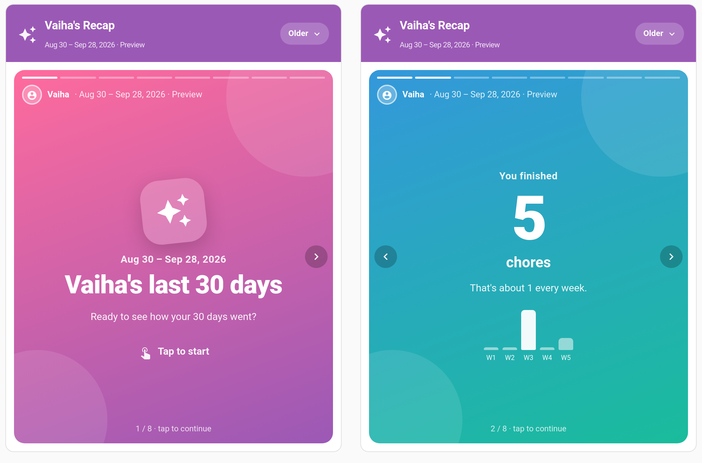
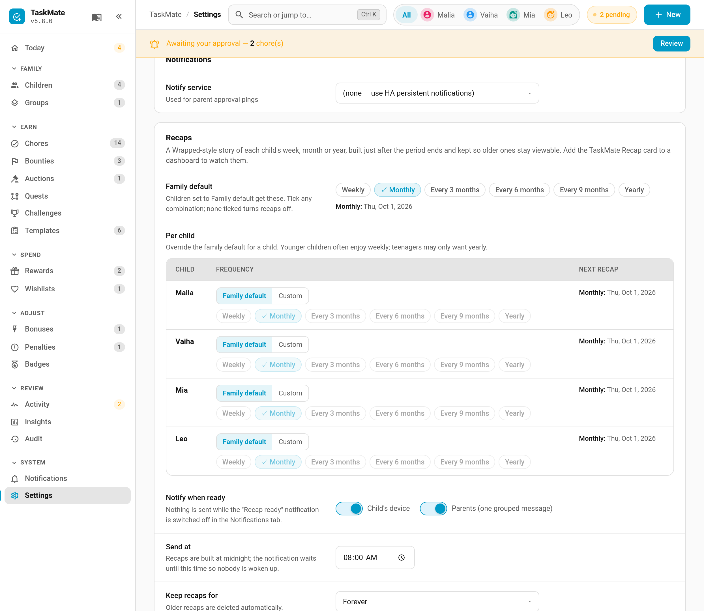

# Recaps

A **recap** is a "Wrapped"-style story of a child's week, month or year: how many chores they did, the points they earned, their favourite chore, their longest streak, their best day, the badges and rewards they picked up, and how it compares with last time. Children tap through it like a story on their phone, and can save the last slide as a picture to share.



> **New in v6.0.0.** Recaps are **off by default**. Nothing is built or sent until you choose how often you want them.

---

## Turning Recaps On

**TaskMate panel → Settings → Recaps**



| Setting | Default | Description |
|---------|---------|-------------|
| **Family default** | none ticked | Tick any mix of **Weekly**, **Monthly**, **Every 3 months**, **Every 6 months**, **Every 9 months** and **Yearly**. None ticked means recaps are off. The next date for each appears underneath |
| **Per child** | Family default | Switch a child to **Custom** to give them their own mix. Younger children often enjoy weekly; teenagers may only want yearly |
| **Notify when ready** | on / on | Whether the *Recap ready* notification goes to the child's device, to parents (as one grouped message), or both |
| **Send at** | `08:00` | Recaps are built just after midnight; the notification waits until this time so nobody is woken up |
| **Keep recaps for** | Forever | 1 year, 2 years or forever. Older recaps are deleted automatically |
| **Compare with previous period** | on | Adds a "vs last time" slide |
| **Preview** | — | Pick a child and build a throw-away recap of their last 30 days, to see what they'll get. It shows on their Recap card for a day, is never announced, and never counts as a "last time" to compare with |

The first time you turn recaps on, the *Recap ready* notification is switched on and routed to every child and parent. After that, your own routing in **Notifications** wins: switch it off and it stays off.

### When recaps are built

- **Periods follow the calendar.** Monthly is a calendar month; every 3 and 6 months follow quarters and halves of the year; yearly is the calendar year. Weekly starts on the first day of the week for the country set in Home Assistant (Monday, Sunday or Saturday). Every 9 months counts from 1 January 2026.
- **No back-filling.** Switching a frequency on never builds old recaps. The first one covers the period you switched it on in.
- **Missed boundaries are caught up.** If Home Assistant was off at midnight, the recap is built when it starts again.
- **Several at once.** When a month, a quarter and a year all end on the same day, all three arrive together and the longest one plays first.

---

## Watching a Recap

Add the **Recap** card to each child's dashboard. The newest unwatched recap opens first.

- **Tap** the right two-thirds of the story to go forward, the left third to go back. Arrow buttons and keyboard arrows work too.
- **Older ▾** lists every recap that has been kept, filterable by frequency. Ones not yet watched on this device carry a **NEW** badge, and the next upcoming recap is shown locked.
- The final slide has **Save as image**, which makes a picture with the child's name on it (using the share sheet where the device supports it), and **Again** to replay.

Slides with nothing to show are skipped, so a quiet week doesn't end up with an empty "badges" slide.

| Slide | Shows |
|-------|-------|
| Intro | The child's name and the period |
| Chores done | The total, with a bar per day, week or month |
| Points earned | From chores and bonuses |
| Top chore | The one they did most |
| Longest streak | Their best run of days in the period |
| Best day | The day with the most chores, and a weekday chart |
| Badges and rewards | What they earned and redeemed |
| Compared with last time | Up or down on the previous period of the same length |
| Finale | Save as image and Again |

---

## The Card

```yaml
type: custom:taskmate-recap-card
entity: sensor.taskmate_overview
child_id: 8e16ad66b23f404e
```

| Option | Type | Default | Description |
|--------|------|---------|-------------|
| `entity` | string | `sensor.taskmate_overview` | The TaskMate overview sensor |
| `child_id` | string | **required** | Whose recaps the card shows. Find IDs in the panel with **Show IDs** switched on |
| `title` | string | `<name>'s Recap` | Card header title |
| `default_frequency` | string | newest | Which recap opens when there's nothing new: `weekly`, `monthly`, `every_3_months`, `every_6_months`, `every_9_months` or `yearly`. Leave it out for the newest |
| `autoplay` | boolean | `false` | Move to the next slide every few seconds. Off: children tap at their own pace |
| `card_design` | string | global default | `classic`, `playroom`, `console`, `cleanpro`, `accessible` or `graphite` |
| `header_color` | string | `#9b59b6` | Header banner colour |

A child only ever sees their own recaps, unless the dashboard's account is allowed to act for other children too. See [Parent Access](Parent-Access.md).

---

## Notification and Event

- **Recap ready** — one push per child ("Your August recap is ready, Malia! Tap to watch it.") and one grouped message for parents, at the send time. The push carries no stats and no picture. Child [quiet hours](Quiet-Hours.md) are respected.
- **`taskmate_recap_ready`** fires once per child whenever new recaps are ready, even if the notification is switched off. It carries `child_id`, `child_name`, `count` and the list of `recaps`.

---

## Related

- [Insights](Insights.md) — the parent-facing reports: fairness, friction and the week ahead
- [Weekly Digest](Weekly-Digest.md) — a weekly summary notification for parents
- [Achievement Badges](Achievement-Badges.md) — what shows up on the badges slide
- [Notifications](Notifications.md) — routing the *Recap ready* notification
