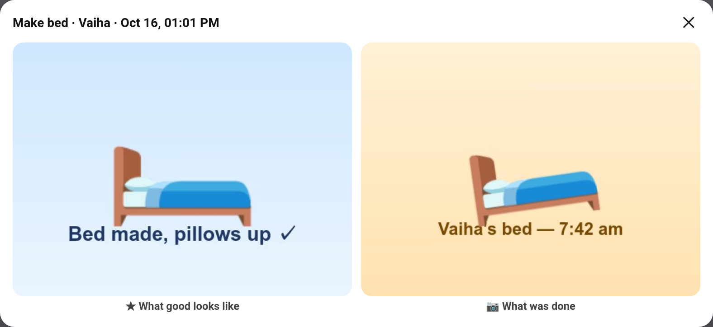
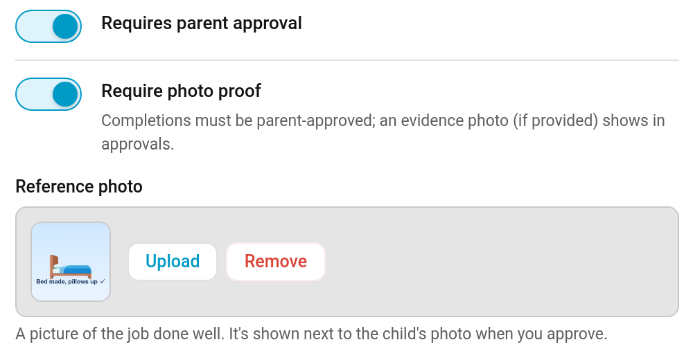
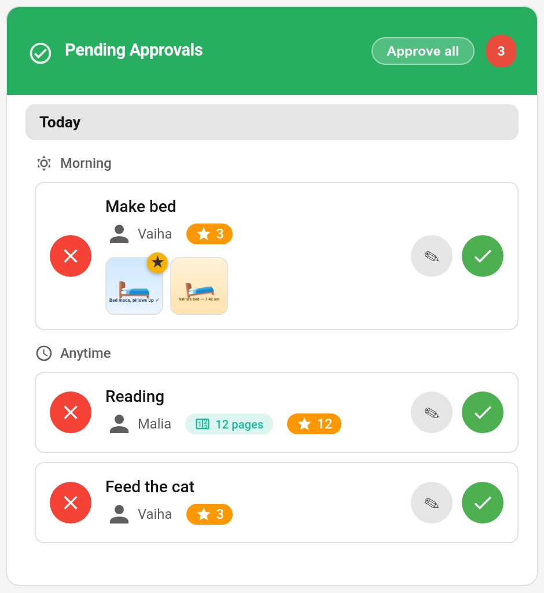
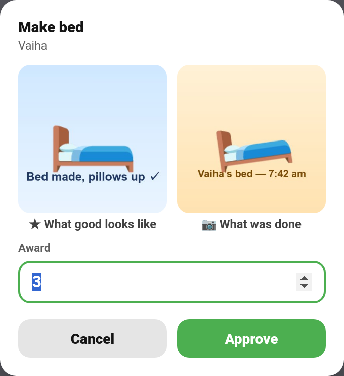

# Reference Photos

Is the bed made, or just "made"? Give a chore a **reference photo**: a picture of the job done properly. When the child sends their evidence photo, you see the two side by side as you approve, so judging it takes a glance. It also helps children: "done" means looking like the picture.

> **New in v7.0.0**

---

## Adding a Reference Photo

**TaskMate panel → Chores → edit a chore → Reference photo → Upload**

Upload a picture of the job done well (a tidy bedroom, a properly loaded dishwasher). **Remove** takes it off again. It's stored with TaskMate's other chore pictures and cleaned up when it's replaced, removed or the chore is deleted.

It works best on chores with [photo proof](Photo-Proof.md) switched on, but it's shown on any chore that needs approval: with no evidence photo, you compare it with the real thing.

The reference photo is set in the panel only; the `add_chore` and `update_chore` services don't take it.

---

## When You Approve

### Approvals card

A completion of a chore with a reference photo shows two thumbnails: the reference, marked with a gold ★, and the child's photo.

Tap either thumbnail to open them **side by side**, labelled **★ What good looks like** and **📷 What was done**, as in the picture at the top of this page.

The **review sheet** (the ✎ button, where you can change the points before approving) shows the pair too, above the award box:

If the child sent no photo, tapping the reference opens it on its own with the note "No photo was sent — compare it with the real thing."

This works in every card design.

### Parent dashboard card

The [parent dashboard card](Dashboard-Cards.md) shows the reference photo, marked with a ★, next to the evidence photo on each pending completion. Tap it to view it full size.

---

## Privacy

Reference photos are chore pictures, not photos of your children, and are served the same way as chore pictures. They are left out of the [diagnostics download](Repairs-and-Diagnostics.md#diagnostics).

---

## Related

- [Photo Proof](Photo-Proof.md) — evidence photos from children
- [Approvals Card](Approvals-Card.md) — reviewing completions
- [Quality Ratings](Quality-Ratings.md) — rating how well a job was done
- [Chores](Chores.md) — every chore field
