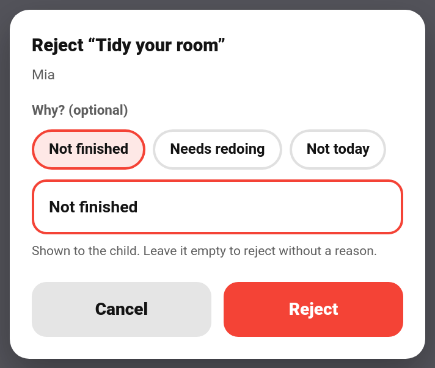
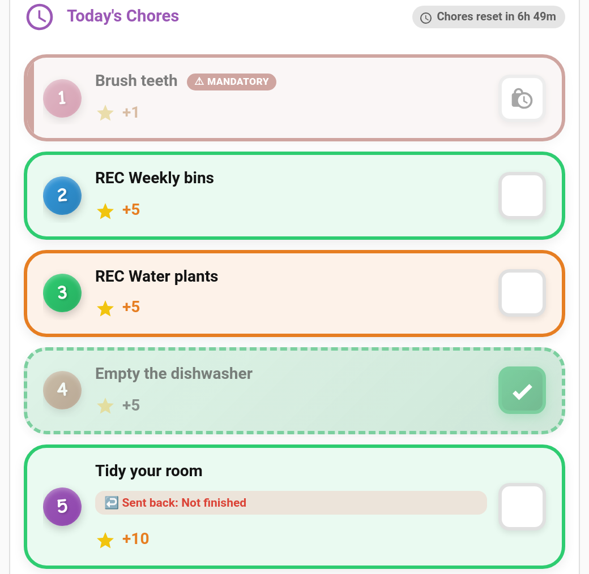

# Reject Reasons

A rejected chore with no explanation just leaves a child confused. When you reject a chore or a reward claim, you can now say **why**, and the child sees the reason on their card: "Sent back: Not finished".



> **New in v6.0.0**

---

## Giving a Reason

Tapping **Reject** now opens a small sheet instead of rejecting straight away:

- **Quick-pick chips:** *Not finished*, *Needs redoing*, *Not today*. Tap one to fill in the reason.
- **Free text:** type your own reason, up to 200 characters.
- **Cancel** or **Reject** to confirm.

The reason is **optional**. Leave the box empty and the reject works exactly as it always has.

### Where you can reject with a reason

| Where | Covers |
|-------|--------|
| **[Approvals card](Approvals-Card.md)** | Chores and reward claims, in every card design |
| **TaskMate panel** | The approval queue on the Today page, the Activity tab and bounty rows |
| **Phone approval notification** | **Reject** now opens a text box on the notification itself. Type a reason, or send it empty for a plain reject. |

The quick-pick chips are in your family's language, so the reason the child sees is too. The quick reject on the parent dashboard card still rejects without a reason.

---

## What the Child Sees



| Where | Shows |
|-------|-------|
| **Child card** | "Sent back: …" on the rejected chore, in every card design. |
| **Rewards card** | "Not approved: …" on the reward, when the card is set to a child. |
| **Activity card** | A *chore rejected* or *reward rejected* entry with the reason, under the Chores or Rewards filter. |

The note on the child card disappears once the child does the chore again, once it's done, or after **24 hours**, whichever comes first.

### Item rejected notification

Turn on the **Chore or reward sent back** notification type under **TaskMate panel → Notifications** to tell the child straight away:

> ↩️ Mia, "Tidy your room" was sent back: Not finished

It's off by default. With no reason given, the message simply ends at "was sent back".

---

## Services

`taskmate.reject_chore` and `taskmate.reject_reward` take an optional `reason`:

```yaml
action: taskmate.reject_chore
data:
  completion_id: f5548687
  reason: The bed still isn't made
```

| Field | Required | Description |
|-------|----------|-------------|
| `reason` | No | Up to 200 characters, kept to one line. Leave it out for a plain reject. |

The `taskmate_chore_rejected` and `taskmate_reward_rejected` events now carry `reason`. A child undoing their own chore (see [Child Undo Window](Child-Undo-Window.md)) fires `taskmate_chore_undone` instead, which never has a reason.

---

## How Long Reasons Are Kept

Rejecting removes the completion or claim, so the reason is stored in a small log of its own. Entries are kept for **7 days** (50 at most) and are removed along with the child if you delete them. A reject without a reason adds nothing to it.

---

## Tips

- **Be specific.** "The bed isn't made" gets a better second attempt than "Not finished".
- **Use *Not today*** for chores that were fine but done on the wrong day.
- **Done, but not very well?** With [Quality Ratings](Quality-Ratings.md) switched on, you can approve it with ★ instead of rejecting it.

---

## Related

- [Appeals](Appeals.md) — the child can ask for a second look at a rejection

- [Approvals Card](Approvals-Card.md) — reviewing chores from a dashboard
- [Rewards](Rewards.md) — reward claims and approval
- [Quality Ratings](Quality-Ratings.md) — rating approved chores
- [Notifications](Notifications.md) — notification types
