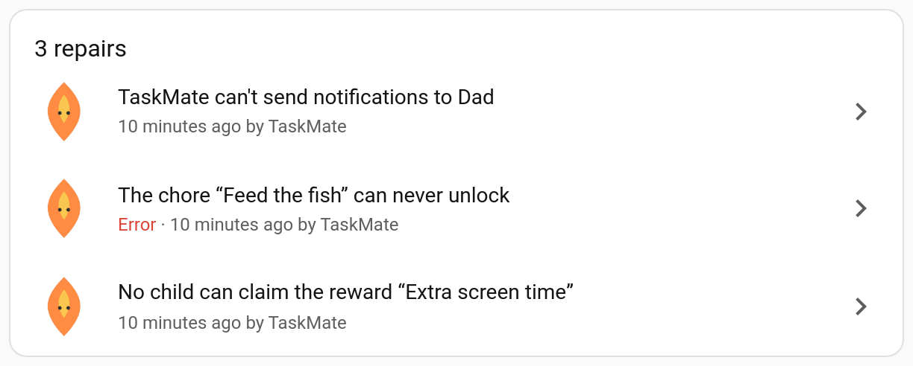
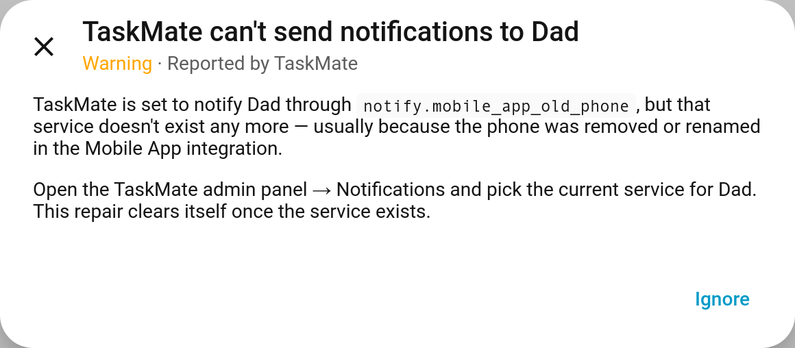
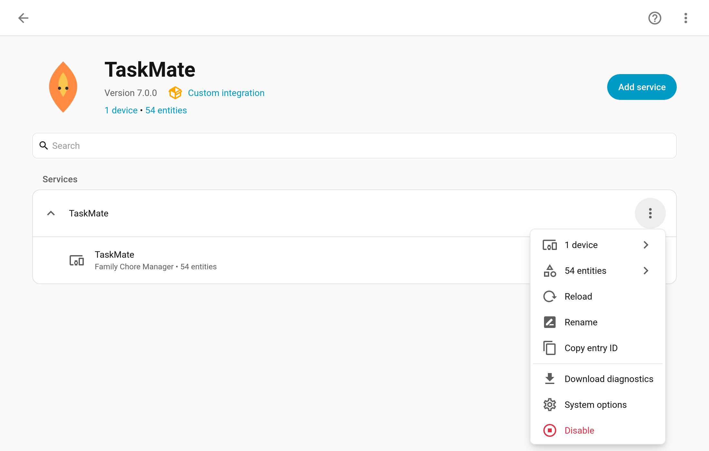
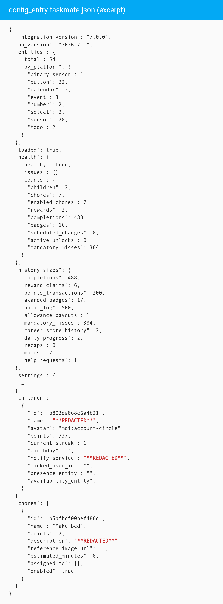

# Repairs and Diagnostics

TaskMate now uses two standard Home Assistant tools to help when something isn't working. **Repairs** tell you when part of your setup can't work any more (a phone removed from the Mobile App, a renamed entity, a chore left assigned to nobody) in the place Home Assistant users already check. The **diagnostics download** gives you a file to attach to a bug report that shows how TaskMate is configured without saying who your family are.

> **New in v7.0.0**

---

## Repairs

TaskMate's issues appear under **Settings → System → Repairs**, alongside any from Home Assistant itself, and the Settings menu shows a badge while there are any. Each one says what's wrong and where to fix it in the TaskMate panel.

There's nothing to click to "fix" in the repair itself: make the change it describes and the issue **clears itself** on TaskMate's next update. **Ignore** hides one you don't want to deal with.

### What's checked

| Repair | Severity | Raised when |
|--------|----------|-------------|
| **TaskMate can't send notifications to {who}** | Warning | A notify service TaskMate is set to use no longer exists: the old global notify setting, any parent recipient that's switched on, or a child's own notify service. Usually a phone removed or renamed in the Mobile App integration. Fix under **Notifications** |
| **{Child}'s profile uses a missing entity** | Warning | A child's availability, unavailability, presence or picture entity no longer exists, so the feature relying on it won't work. Fix under **Children** |
| **"{Chore}" uses a missing entity** | Warning | An enabled chore's visibility or weather entity no longer exists, so that check is skipped. Fix under **Chores** |
| **The chore "{Chore}" is assigned to nobody** | Warning | Every child an enabled chore was assigned to has been removed, so nobody will ever see it. Assign it or delete it under **Chores** |
| **The chore "{Chore}" can never unlock** | Error | An enabled chore [depends on](Chore-Dependencies.md) a chore that has been deleted, so it stays locked for ever. Remove the missing dependency under **Chores** |
| **No child can claim the reward "{Reward}"** | Warning | Every child a reward was meant for has been removed. Choose who it's for, or delete it, under **Rewards** |
| **The reward "{Reward}" unlocks nothing** | Warning | A reward is set to switch on an entity that isn't on TaskMate's [unlock allowlist](Timed-Unlock-Rewards.md) any more, so nothing happens when it's approved. Add it back under **Settings**, or edit the reward |

Each problem is raised once, however often it's checked: one repair per notify service, per chore or per reward, never a pile of duplicates. Disabled chores aren't checked.

### When checks run

Checks start once Home Assistant has finished starting and TaskMate has been loaded for two minutes. Notify services and entities from other integrations can take a while to appear after a restart, and a repair that flashed up at every boot would be worse than none. After that, every TaskMate update re-checks. Unloading TaskMate removes all its repairs.

The panel's **Insights → Health** page still gives the full picture of your setup on demand; repairs are for the things that need attention now.

---

## Diagnostics

**Settings → Devices & services → TaskMate → ⋮ → Download diagnostics**

This downloads a JSON file to attach to a bug report on GitHub. It describes how TaskMate is set up, which is what's needed to reproduce most problems, and leaves out anything that says who your family are.

### What's in it

| Section | Contents |
|---------|----------|
| Versions | TaskMate and Home Assistant versions |
| Entry | The config entry's version and options (its title is redacted) |
| Entities | How many TaskMate entities there are, by platform |
| Status | Whether TaskMate is loaded and its last update succeeded |
| Health | The same health report as **Insights → Health** |
| History sizes | How many completions, reward claims, points transactions, awarded badges, audit log entries, allowance payouts, mandatory misses, career score history entries, daily progress entries, recaps, moods and help requests are stored. **Only the counts**, never the records |
| Settings | Every TaskMate setting, with personal values redacted |
| Children | Each child's configuration and counters, with the ID kept so it lines up with chores' `assigned_to` |
| Chores and rewards | Their configuration **with names kept** ("the Bins chore never shows" is what a bug report is usually about) |
| Notifications | The notification configuration, with targets redacted |

### What's left out

These are replaced with `**REDACTED**` wherever they appear:

- children's names, and every other name except chore and reward names
- linked Home Assistant users and parent user IDs
- notify services (who gets pushes, and on which phone)
- picture, presence, availability and unavailability entities
- birthdays
- photos: evidence photo URLs, chore and reward pictures, [reference photos](Reference-Photos.md)
- descriptions, notes and reasons
- calendar subscription tokens, kiosk PINs and NFC tag IDs

History itself (completions, transactions, moods, help requests and so on) is never included, only how many there are.

Have a look through the file before you share it; it's plain JSON.

---

## Related

- [Troubleshooting](Troubleshooting.md) — common problems and fixes
- [Insights](Insights.md) — the Health page
- [Notifications](Notifications.md) — notify services and recipients
- [Chore Dependencies](Chore-Dependencies.md)
