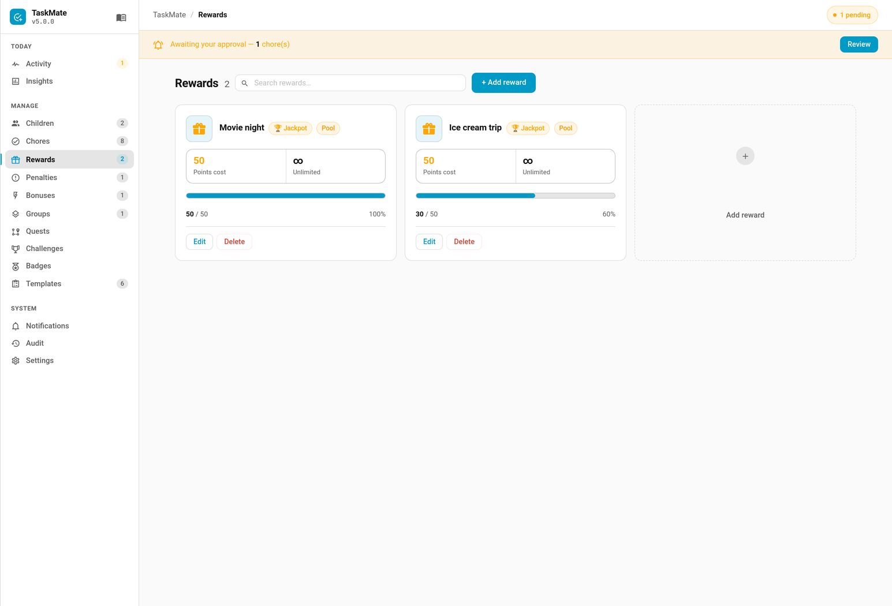
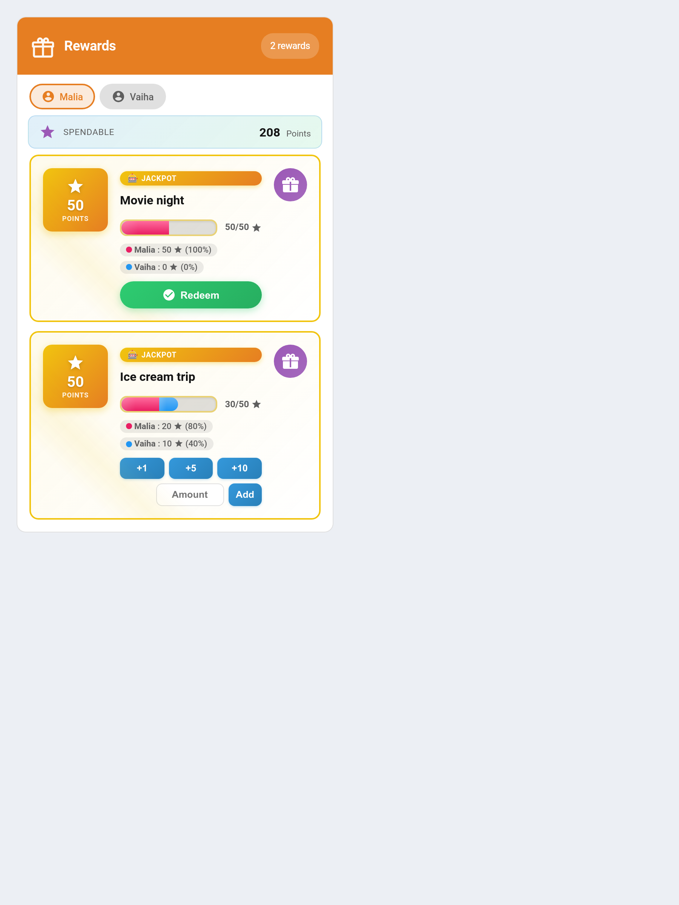

# Rewards Card




The TaskMate Rewards Card displays available rewards as a vertical list with cost badges, progress bars, and claim/redeem buttons. Children use it to claim regular rewards or (from v3.0) deposit points into savings-jar rewards.

## Adding the card

In any Lovelace dashboard: **Edit → + Add Card → Custom: TaskMate Rewards Card**. The card editor uses native Home Assistant form components.

Or via YAML:

```yaml
type: custom:taskmate-rewards-card
entity: sensor.taskmate_overview
```

## Configuration

| Option | Type | Default | Description |
| --- | --- | --- | --- |
| `entity` | string | **required** | The TaskMate overview sensor, usually `sensor.taskmate_overview` |
| `title` | string | `"Rewards"` | Card title displayed in the header |
| `child_id` | string | _none_ | If set, pin the card to this child (only their rewards, their interactions). If omitted, the card shows a **child picker** at the top so you can choose who is claiming/depositing — it defaults to the first child, so claim and deposit buttons work out of the box |
| `show_child_badges` | boolean | `true` | Show which children can claim each reward as small badges |
| `enable_pool_mode` | boolean | `false` | (v3.0+) Force all rewards on this card into Pool Mode, overriding per-reward flags |
| `header_color` | string | `#e67e22` | Card header background colour |

## Display

Each reward row shows:

- **Cost badge** (left): points icon + cost number
- **Reward name and optional description**
- **Progress bar** — for wallet rewards: child's points / cost. For pool rewards: allocated / cost.
- **Child badges** (if `show_child_badges: true` and not a jackpot): small chips showing which children this reward is assigned to
- **Quantity badge** (if limited stock): shows remaining count. Displays **Sold Out** when 0.
- **Expiry indicator** (if expiration date set): shows days remaining or **Expired**.
- **Action area** (right): Claim button (wallet) or deposit buttons `[+1] [+5] [+10]` (pool). When a pool fills, an animated green **Redeem** button replaces the deposits.

### Spendable balance banner (Pool Mode)

When any reward on the card is in pool mode and the card has a `child_id`, a banner above the rewards list shows the selected child's **Spendable** (what they can deposit right now) alongside their **gross balance**:

```
⭐ SPENDABLE              42 / 60 Points
```

## Examples

### Basic single-child card

```yaml
type: custom:taskmate-rewards-card
entity: sensor.taskmate_overview
child_id: 8a3b2c1d4e5f6789
```

### Force everything on this card into Pool Mode

```yaml
type: custom:taskmate-rewards-card
entity: sensor.taskmate_overview
child_id: 8a3b2c1d4e5f6789
enable_pool_mode: true
title: "Alice's Savings Goals"
```

### Shared card showing rewards for all children (view-only)

```yaml
type: custom:taskmate-rewards-card
entity: sensor.taskmate_overview
title: "Family Rewards"
```

Without a `child_id`, the card shows a **child picker** and defaults to the first child, so claim and deposit buttons work immediately — tap a child's tab to switch who is claiming/depositing. Set `child_id` to pin the card to a single child (e.g. one card per child on a shared tablet).

## Pool Mode details

Pool Mode is controlled at two levels:

- **Per reward** (**TaskMate** panel → **Rewards** → toggle "Pool Reward"). Rewards with the flag show deposit buttons; rewards without continue to show Claim.
- **Per card** (`enable_pool_mode: true`). Forces every reward on this specific card into Pool Mode regardless of the per-reward flag.

See [Pool Mode (Savings Jars)](Pool-Mode-(Savings-Jars).md) for the full guide.

## Jackpot rewards

Rewards with **Is Jackpot** enabled pool points across all assigned children. Jackpots are **always pool-mode** (there's no separate Pool toggle — the editor hides it): the card shows pooled **deposit** buttons and a segmented progress bar coloured per child, drawn from each child's allocation. The combined pool fills as children contribute, and any assigned child can **Redeem** once it reaches the cost — so a goal no single child could afford alone is reached together.

## Per-period spending cap (v4.0.0)

You can limit how many points each child is allowed to spend on rewards within a rolling period. The cap is a **global** setting (it applies to every child individually), configured in **Settings → History & streaks**, not per reward.

| Setting | Default | Description |
| --- | --- | --- |
| **Spending cap** | `off` | Master toggle |
| **Cap (pts)** | `0` | Maximum points spendable per period (`0` = no limit) |
| **Period** | `weekly` | `weekly` (resets Monday) or `monthly` (resets on the 1st) |

**How it works:**

- Enforced at **approval** time. When a parent approves a reward claim, TaskMate adds up the cost of all of that child's already-approved claims in the current period.
- If approving the new claim would push the total over the cap, the approval is **blocked** with a "Spending cap reached" error and no points are deducted. The claim stays pending — it can be approved in a later period or rejected.
- Pending and rejected claims do not count toward the cap; only approved spend does.
- The period boundary is the Monday of the current week (weekly) or the 1st of the current month (monthly).

See [Managing Rewards](Managing-Rewards.md) for the admin workflow.

## Auto-restock (v4.0.0)

Limited-stock rewards can refill their quantity automatically on a schedule, so you don't have to top them up by hand. Restock is set **per reward** in the reward's add/edit dialog.

| Field | Default | Description |
| --- | --- | --- |
| **Auto-restock** | `off` | Enable scheduled restocking for this reward |
| **Restock to** | `0` | The quantity to reset stock back to each period |
| **Restock every** | `Week (Mon)` | `Day`, `Week (Mon)`, or `Month (1st)` |

**How it works:**

- On the period boundary (daily = every day, weekly = Mondays, monthly = the 1st) the reward's **Quantity** is reset to the **Restock to** amount.
- Restock overwrites the current quantity — it sets stock back to the amount rather than adding to it. A reward that sold out mid-period becomes available again.
- A reward must have a restock amount above 0 and the toggle enabled, otherwise nothing happens.
- A guard prevents restocking the same reward twice in one day.

Restock only makes sense for rewards with a limited **Quantity**. See [Managing Rewards](Managing-Rewards.md) for setup.

## Related

- [Reward Fulfilment](Reward-Fulfilment.md) — keep an approved reward on an owed list until it is handed over
- [Managing Rewards](Managing-Rewards.md) — create and edit rewards
- [Pool Mode (Savings Jars)](Pool-Mode-(Savings-Jars).md) — the savings-jar feature
- [Wishlist](Wishlist.md) — children save towards things they want, and the family can chip in
- [Timed Unlock Rewards](Timed-Unlock-Rewards.md) — spend points to unlock a device for a while
- [Time-Locked Rewards](Time-Locked-Rewards.md) — limit when a reward can be claimed
- [Reject Reasons](Reject-Reasons.md) — the "Not approved: …" note a child sees when a claim is rejected
- [Services](Services.md) — underlying services the card calls
