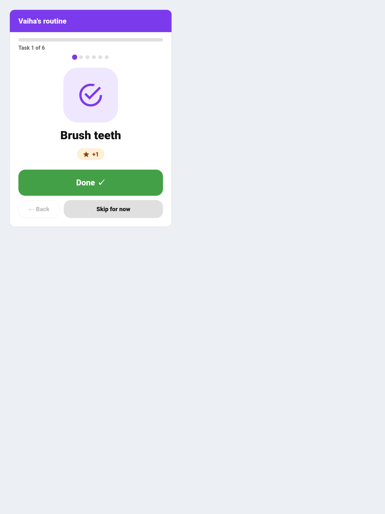

# Routine Mode

A guided, one-task-at-a-time flow for morning and bedtime routines.



The standard child card is a checklist. That is good for scanning but poor for walking a five-year-old through getting ready — a list of eight things is a list of eight chances to get distracted. Routine mode shows a **single task at a time** with a big **Done** button, a progress bar, and a celebration at the end.

---

## Adding the Card

```yaml
type: custom:taskmate-routine-card
entity: sensor.taskmate_overview
child_id: <child_id>
time_category: morning     # morning | afternoon | evening | night | anytime | all
title: Vaiha's morning     # optional
card_design: global        # optional — see Card Design Styles
```

| Control | Effect |
|---------|--------|
| **Done** | Completes the chore and moves to the next one. |
| **Skip for now** | Moves on without completing — the task stays outstanding. |
| **Back** | Returns to the previous task, so a mis-tap is recoverable. |

---

## Key Points

- **Availability comes from the integration itself.** The card reads the same chore-availability matrix everything else uses, so the [weather gate](Weather-Aware-Chores.md), [reactive deadlines](Reactive-Chores.md), [dependencies](Chore-Dependencies.md), rotation and [vacation mode](Vacation-Mode.md) are all honoured automatically — and stay honoured as those features evolve.
- Tasks appear in the child's **configured chore order**, the same order they have on the child card.
- **`time_category` is exact.** A `morning` routine shows only morning chores — `anytime` chores are *not* mixed in, because a routine is a specific sequence rather than "everything currently doable". Use `all` if you want everything. This deliberately differs from the child card's convention.
- Chores needing approval show **"waiting for a grown-up"**, and their points are totalled separately on the finish screen from points already banked.
- **The finish screen totals what was earned in that run**, not the whole day.
- An empty period shows a **"nothing to do"** state rather than an empty list.
- Skipping a task and then completing it later correctly stops counting it as left for later.

---

## Choosing a Time Category

Give a child two cards — one for each end of the day — and each shows only its own sequence:

```yaml
# Morning dashboard
type: custom:taskmate-routine-card
entity: sensor.taskmate_overview
child_id: <child_id>
time_category: morning
title: Morning

# Bedtime dashboard
type: custom:taskmate-routine-card
entity: sensor.taskmate_overview
child_id: <child_id>
time_category: night
title: Bedtime
```

For this to work, set each chore's **time of day** in the chore editor. Chores left as `anytime` will only ever appear in an `all` routine.

---

## Design Styles

The routine card supports all six [card design styles](Card-Design-Styles.md), set per card with `card_design` or from the global default. The **Accessible** style is worth considering here in particular: a guided one-task flow is often exactly what a child who needs high contrast and dyslexia-friendly type is using.

---

## Related

- [Dashboard Cards](Dashboard-Cards.md) — every Lovelace card TaskMate ships
- [Pre-Reader Mode](Pre-Reader-Mode.md) — a picture-only card for children who can't read yet
- [Card Design Styles](Card-Design-Styles.md) — Classic, Playroom, Console, Clean Pro and Accessible
- [Chores](Chores.md) — setting a chore's time of day and order
