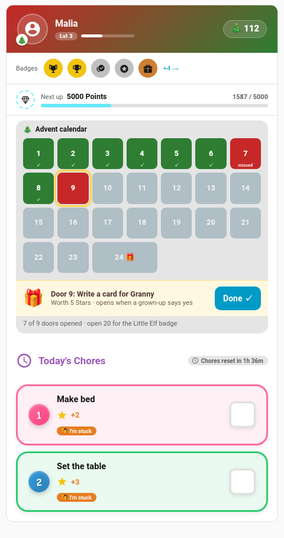

# Season Event Packs

A seasonal [theme](Card-Looks.md#seasonal-themes) changes how the cards look. An **event pack** brings the content: a few chores, a quest, a reward, a badge and, at Christmas, a 24-door advent calendar. Switch a pack on once and it looks after itself: it installs when its season starts, hides itself when the season ends, and comes back the next year.

Everything a pack installs is an ordinary TaskMate chore, reward, quest, challenge or badge. Once it's installed you can rename it, change its points, reassign it or delete it in its own tab, like anything you made yourself.

---

## Switching a Pack On

**TaskMate panel → Settings → Seasons & events**

Each season has its own row with two switches:

| Switch | What it does |
|--------|--------------|
| **Theme** | The card look: gradient header, season emoji, season celebration. Same as the old seasonal theme switches; your old choices are kept. |
| **Pack** | The content described on this page. Off by default. |

Turn on either, both or neither. Press **Save** at the bottom of Settings as usual.

Each row also shows:

- **What's inside**: chips for the quest, chores, reward, badge, challenge, advent calendar or egg hunt.
- **Assign to**: pick which children get the pack. Pick nobody and every child gets it. Grown-up profiles never get pack items.
- **A state chip**: **Installed** with the date, **Will install** with the date it starts, **Set the first school day** (Back to school only) or **Off**.
- **Preview**: a list of every item with its points, before anything is installed.
- **Remove pack**: shown once a pack has installed something (see [Removing a pack](#removing-a-pack)).

A pack you switch on in the middle of its season installs as soon as you save.

---

## The Seasons

| Season | When | Theme |
|--------|------|-------|
| 🎃 Halloween | 24–31 October | Orange to purple, bats |
| 🎄 Christmas | 1–26 December | Red to green, snow |
| 🐣 Easter | The 7 days ending on Easter Sunday | Purple to green |
| ☀️ Summer | 21 June – 31 August | Orange to sea blue, suns |
| 🎒 Back to school | 14 days from the first school day you set | Blue to yellow |

Easter moves every year. TaskMate works out Easter Sunday itself (the Western, Gregorian date), so there is nothing to set.

Back to school has no fixed date. Set **First school day** on its row; the season runs for 14 days from that day. Until a date is set the pack and the theme do nothing. Set it again for each new school year.

If two seasons overlap (Back to school can start before Summer ends), the cards dress for Back to school. Both packs can be on at once.

---

## What's in Each Pack

All points and costs are fixed numbers. Change them after the pack installs if they don't suit your family.

### 🎃 Halloween

| Item | Details |
|------|---------|
| Quest **Pumpkin Patrol** | 5 steps: Carve the pumpkin, Sweep the leaves, Sort the sweets, Hang the decorations, Trick-or-treat tidy-up. 25 bonus points |
| Chores | Carve the pumpkin (10), Sweep the leaves (5), Sort the sweets (5) |
| Reward **Pick the movie** | Costs 40 |
| Badge **Ghostbuster** | Earned after 5 Halloween jobs in the season |

### 🎄 Christmas

| Item | Details |
|------|---------|
| **Advent calendar** | 24 doors, one small job a day from 1 to 24 December, 5 points each. A grown-up approves each door |
| Quest **Elf Helper** | 6 steps: Write Christmas cards, Wrap a gift, Tidy under the tree, Set the table, Make a paper chain, Bake Christmas biscuits. 30 bonus points |
| Chores | Write Christmas cards (10), Wrap a gift (5), Tidy under the tree (3), Set the table (3) |
| Reward **Choose the Christmas Eve film** | Costs 60 |
| Badge **Little Elf** | Earned after opening 20 advent doors |

### 🐣 Easter

| Item | Details |
|------|---------|
| **Egg hunt** | A hidden egg to find each day of Easter week. Hide one, and the child ticks off "Find hidden egg 1", "2" and so on, one a day, 5 points each. A grown-up approves each one |
| Badge **Egg Hunter** | Earned after finding 5 eggs |

### ☀️ Summer

| Item | Details |
|------|---------|
| Challenge **Summer reading challenge** | A weekly [challenge](Challenges.md): read for 20 minutes a day and get 5 jobs done in the week, 25 bonus points. Comes with a daily "Read for 20 minutes" chore (3) |
| Chores | Water the garden (3, Mon/Wed/Fri), Tidy the paddling pool (5, weekly), Pack the beach bag (3, weekly) |
| Badge **Sun Seeker** | Earned after 20 summer jobs |

### 🎒 Back to school

| Item | Details |
|------|---------|
| Chores | Pack your bag the night before (3) and Lay out your uniform (2), Sunday to Thursday evenings; Bring your lunchbox back (2), weekday afternoons |
| Quest **Ready for School** | 4 steps: the three chores above, then Label your school things. 20 bonus points |

### Badges

A pack's badge counts the pack's own jobs, approved, inside the season's window. It's awarded the moment the last one is approved, with its bonus points, and the child keeps it. Between seasons a badge nobody earned is hidden from the badges card, and it comes back with the season.

---

## Names in Your Language

Pack items are named in Home Assistant's language when they install, from the same translations the cards use. A Norwegian family gets "Skjær ut gresskaret", a German one "Kürbis schnitzen". Change the language later and the names already installed stay as they are; rename them by hand if you like.

---

## The Season Ending, and Next Year

When the window ends (checked at midnight and whenever Home Assistant starts):

- the pack's chores are **disabled**,
- its quest and challenge are **paused**,
- its reward is hidden from the cards and can't be claimed,
- its badge stays with every child who earned it.

Nothing is deleted, so completions, points and history all stay.

Next year, when the window opens again, the **same items come back**: no duplicates. Advent doors and Easter eggs are re-dated to the new year, the quest starts fresh for everyone, and the pack is given to whoever is picked under **Assign to** at that point (so a new child joins in).

Switching a pack off in the middle of its season hides its items straight away. Switching it back on in the same season brings the same items back.

A pack installs **once per season**. Restarting Home Assistant, a vacation, sick days or scheduled changes never make a second set.

### Your edits stick

Parents can change installed items like any other: points, names, days, who they're for. A pack never overwrites those changes when it hides and comes back, with one exception: changing **Assign to** on the pack row re-assigns all of the pack's items to the new pick.

If you **delete** a pack item, the pack won't make it again, this season or next. To get it back, restore it from [Recently Deleted](Recently-Deleted.md) within 7 days, or remove the whole pack and switch it on again.

---

## Removing a Pack

**Remove pack** on the pack's row deletes everything the pack installed and switches the pack off:

- chores, the reward and the quest go to [Recently Deleted](Recently-Deleted.md) for 7 days, where you can restore them,
- the challenge is removed for good (challenges have no Recently Deleted),
- the badge is removed only if nobody has earned it. **A child never loses a badge they earned**: an earned pack badge stays on their cards, kept for just the children who have it, and nobody else is offered it. You'll still see it in the Badges tab.

Switch the pack on again later and it installs a fresh set.

---

## The Advent Calendar on the Cards

While the Christmas pack is in its window, the [child card](Dashboard-Cards.md#child-card) shows an advent strip above today's chores, under every [design style](Card-Design-Styles.md):

| Door | Means |
|------|-------|
| Green with ✓ | Opened (approved) |
| Amber with ⏳ | Done, waiting for a grown-up |
| Red, "missed" | A day that has passed without the job |
| Yellow outline | Today's door |
| Grey | Still to come |

Door 24 is double width. Today's door is the action: the child taps **Done** on the strip (it isn't repeated in the chore list). The line underneath counts the doors opened so far and how many more open the **Little Elf** badge.

The [kiosk card](Kiosk-Mode.md) shows the same doors as a small tile on the child's screen, and today's door is ticked off in the kiosk's chore list.

Children who weren't given the pack see no strip.

---

## Importing Pack Files

Season packs ship with TaskMate. The existing [template pack](Template-Packs.md) import only carries chores, so it can't hold a season pack's quest, reward, badge or challenge, and there is no import for season packs yet.

---

## For Automations

The overview sensor carries the advent calendar only while the Christmas pack is in its window (see [Sensor Reference](Sensor-Reference.md#sensortaskmate_overview)):

- `advent`: today's door: `chore` (the door chore's id), `door` (its number), and the badge `goal` and `badge` name;
- each child in `children` gets `advent`: 24 letters, one per door: `o` opened, `p` waiting for approval, `m` missed, `t` today, `l` still to come, `-` not this child's door.

The settings live with the rest of TaskMate's settings: `seasonal_<season>` (theme), `season_pack_<season>` (pack), `season_school_start` and `season_pack_children`.
