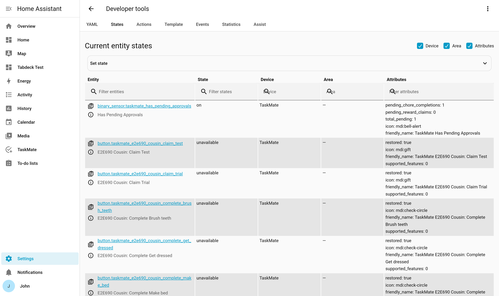

# Sensor Reference

TaskMate creates the following entities in Home Assistant.

> **Architecture note:** The overview sensor's attributes have been split across companion sensors (`sensor.taskmate_chores`, `sensor.taskmate_rewards`, etc.) to stay under the 16KB recorder limit. Cards use the `__taskmate_attrs` helper to transparently merge data from all sensors.

---

## sensor.taskmate_overview

The main overview sensor. Carries scalar stats and the compact per-child summary.

| Property | Value |
|----------|-------|
| State | Number of children |
| Icon | `mdi:clipboard-check-multiple` |

### Top-Level Attributes

| Attribute | Type | Description |
|-----------|------|-------------|
| `total_children` | int | Number of children |
| `total_chores` | int | Number of defined chores |
| `total_rewards` | int | Number of defined rewards |
| `total_points_available` | int | Sum of all children's current points |
| `total_chores_completed` | int | Sum of all-time chore completions across all children |
| `total_completions_all_time` | int | Lifetime chore completion records |
| `total_pending_completions` | int | Chore completions awaiting approval |
| `points_name` | string | Currency name (e.g. "Stars") |
| `points_icon` | string | Currency MDI icon (e.g. "mdi:star") |
| `card_design` | string | Global default [card design style](Card-Design-Styles.md) — `classic` / `playroom` / `console` / `cleanpro` / `accessible` (default `classic`). Cards apply this when they have no per-card override. See [Card Design Styles](Card-Design-Styles.md) |
| `today_day_of_week` | string | Current day in HA timezone (e.g. "monday") |
| `weekend_multiplier` | float | Current weekend multiplier setting |
| `streak_reset_mode` | string | "reset" or "pause" |
| `streak_milestones_enabled` | bool | Whether streak milestone bonuses are on |
| `streak_milestones` | string | Current milestone configuration string |
| `perfect_week_enabled` | bool | Whether perfect week bonus is on |
| `perfect_week_bonus` | int | Perfect week bonus points value |
| `streak_freeze_max` | int | (v6.0.0) Most [streak freeze](Streak-Freezes.md) tokens a child can hold; `0` = streak freezes off |
| `streak_freeze_earn_every` | int | (v6.0.0) Streak days per free token; `0` = never earned automatically |
| `time_boundaries` | dict | Legacy fixed time-window map: `morning_start`/`morning_end`/`afternoon_start`/… in `HH:MM` (kept for cards that read the four fixed periods) |
| `time_periods` | list | Custom [time-of-day periods](Settings.md#custom-time-of-day-periods-v400) — each entry has `id`, `label`, `start`, `end`, `icon`. Drives chore time-category windows |
| `vacation_active` | bool | `true` if a [vacation period](Vacation-Mode.md) covers today |
| `vacation_name` | string | Name of the active vacation period (empty when none) |
| `vacation_end` | string | ISO end date of the active vacation period (empty when none) |
| `vacation_periods` | list | All configured vacation periods — each has `id`, `name`, `start`, `end`. See [Vacation Mode](Vacation-Mode.md) |
| `family_goal` | object | (v4.4.0) Shared co-op [family goal](Family-Goals.md) state — `enabled` (bool), `name` (string), `target` (int), `reward` (string), `progress` (int — combined current points), `achieved` (bool). See [Family Goals](Family-Goals.md) |
| `season_month` | string | (v4.4.0) Current leaderboard season month, `YYYY-MM` |
| `season_champions` | list | (v4.4.0) Past monthly leaderboard champions (newest first, up to 12). See [Leaderboard Seasons](Leaderboard-Seasons.md) |

> **Note:** Level/XP, quest, challenge, and avatar-unlock data are carried **per child** inside the `children` array (see below), not as top-level attributes. See [Levels and XP](Levels-and-XP.md), [Quests](Quests.md), [Challenges](Challenges.md), [Avatars](Avatars.md).

### `children` Array

Each entry in the `children` array:

| Field | Type | Description |
|-------|------|-------------|
| `id` | string | Child's unique ID |
| `name` | string | Child's display name |
| `avatar` | string | MDI icon (the child's currently selected avatar) |
| `avatar_image` | string | (v6.4.0) The child's [photo](Children.md#child-photos), read from their **Photo from** entity. Empty when there is none; cards then show `avatar` |
| `level` | int | Current XP level (derived from `total_points_earned`). See [Levels and XP](Levels-and-XP.md) |
| `level_progress` | int | XP earned toward the next level within the current level band |
| `level_target` | int | XP required per level (the `level_xp_step` setting; default 100) |
| `points` | int | Current gross points balance (after pool deposits deducted) |
| `pending_points` | int | Points held by pending chore approvals |
| `committed_points` | int | Points reserved by pending reward claims |
| `spendable_balance` | int | `points − committed_points` — what the child can spend or deposit now |
| `allocated_points` | int | Total points deposited across all reward pools |
| `total_points_earned` | int | All-time points earned |
| `total_chores_completed` | int | All-time completions |
| `current_streak` | int | Current consecutive day streak |
| `best_streak` | int | Best streak ever |
| `season_points` | int | (v4.4.0) Points earned this leaderboard season (current month). See [Leaderboard Seasons](Leaderboard-Seasons.md) |
| `week_points_earned` | int | (v6.4.0) Approved chore points since Monday, bonus sub-tasks excluded |
| `week_points_available` | int | (v6.4.0) The most this week's scheduled chores could pay: every scheduled chore at its daily limit across Monday–Sunday, with the weekend and birthday multipliers, without vacation days; a weekly-target chore adds its target × points once. Rotation chores aren't counted, so `week_points_earned` can run past it. Read by the [Sticker Chart](Sticker-Chart-Card.md)'s week goal |
| `chore_order` | list | Custom chore display order |
| `last_completion_date` | string | ISO date of last completion |
| `streak_paused` | bool | Whether streak is paused |
| `streak_milestones_achieved` | list | Milestone day counts already awarded this streak |
| `awarded_perfect_weeks` | list | Monday ISO dates of awarded perfect weeks |
| `career_score` | int | Long-term score (`total_points_earned − total_penalties_received`) |
| `total_penalties_received` | int | Lifetime count of penalties applied |
| `quests` | list | This child's [quest](Quests.md) progress — each entry has `quest_id`, `name`, `icon`, `total_steps`, `step`, `done`, `times_completed`, `bonus_points`, `next_chore_id` |
| `challenges` | list | This child's [challenge](Challenges.md) progress — each entry has `challenge_id`, `name`, `icon`, `scope`, `metric`, `target`, `progress`, `value`, `bonus_points`, `complete`, `awarded` |
| `avatar_options` | list | The [avatar catalogue](Avatars.md) resolved for this child — each entry has `id`, `label`, `icon`, `unlocked`, `requirement` (human-readable unlock condition) |
| `is_guest` | bool | (v5.0.0) Present only for [guest profiles](Guest-Child-Profiles.md) |
| `guest_expires_on` | string | (v5.0.0) ISO date the guest profile is archived; present only for guests |
| `is_adult` | bool | (v6.4.0) `true` for an [adult profile](Adult-Profiles.md); present only for adults |
| `roulette` | object | (v5.0.0) Today's [roulette](Chore-Roulette.md) pick and `spins_left`; present only while roulette is enabled |
| `birthday` | object | (v6.0.0) Present only on the child's [birthday](Birthday-Mode.md): `multiplier` (float), `age` (int, when the birth year is known) and `chores_off: true` when the birthday day off is on |
| `streak_freezes` | int | (v6.0.0) [Streak freeze](Streak-Freezes.md) tokens the child holds. Present only while streak freezes are switched on, so `0` means "none left" rather than "not in use" |
| `rejections` | list | (v6.0.0) Recently sent-back chores and reward claims with a [reason](Reject-Reasons.md), newest first — each has `kind` (`chore` / `reward`), `id` (the chore or reward ID), `reason` and `at` (ISO datetime). Kept for 24 hours, or until the child tries again. Present only when there is one |
| `inspections` | list | (v6.0.0) Today's [inspection](Surprise-Inspections.md) banners for the child card (up to 4) — each has `id`, `chore_id`, `name`, `status` (`open` / `passed` / `failed` / `redo`), plus `bonus` and `until` while open, `bonus` when passed, `points` for a redo, and an optional `note`. A secret inspection is not listed until it is decided. Present only when there is one |
| `help` | list | (v7.0.0) Chore IDs the child has an open [help request](Help-Requests.md) for ("I'm stuck"), newest first. A request stays open until a parent answers it, or for two hours. Present only when there is one |
| `mood_today` | string | (v7.0.0) Today's [mood check-in](Mood-Check-In.md): `great`, `good`, `ok`, `sad` or `upset`. Present only once the child has said |
| `sick_today` | bool | (v7.0.0) `true` on a [sick day](Sick-Days.md). Present only then |
| `pet` | object | (v7.0.0) The child's [virtual pet](Virtual-Pets.md), present only while pets are switched on. `{adopted: false}` before adoption; afterwards `adopted`, `name`, `species`, `stage` (`egg` / `baby` / `kid` / `teen` / `grown`), `chores` (since adoption), `xp` (growth), `mood` (`happy` / `proud` / `content` / `sleepy`), `accessories`, plus, when reached or switched on, `goal`, `legendary`, `home`, `pet_level`, `egg_ready` and `family` (earlier pets: `species`, `name`, `legendary`) |
| `weekly_goal` | object | (v7.0.0) The child's own [weekly goal](Weekly-Goals.md), present only while weekly goals are switched on: `target` (0 = not set), `bonus`, and once a target is set `earned` (points since Monday) and `reached` |
| `redemptions` | list | (v7.0.0) Open [make-it-right](Make-It-Right-Penalties.md) offers — each has `id`, `chore_id`, `chore_name`, `penalty_name`, `points` (what doing the chore gives back) and `expires` (ISO date, the last day it can be done). Present only when there is one |

**`quests` entry fields:**

| Field | Type | Description |
|-------|------|-------------|
| `quest_id` | string | Quest ID |
| `name` | string | Quest display name |
| `icon` | string | MDI icon |
| `total_steps` | int | Number of chore steps in the chain |
| `step` | int | Child's current step (0-indexed, capped at `total_steps`) |
| `done` | bool | `true` when `step >= total_steps` |
| `times_completed` | int | How many times this child has completed the chain |
| `bonus_points` | int | Points awarded on completing the final step |
| `next_chore_id` | string | Chore ID of the next step to complete (empty when done) |

**`challenges` entry fields:**

| Field | Type | Description |
|-------|------|-------------|
| `challenge_id` | string | Challenge ID |
| `name` | string | Challenge display name |
| `icon` | string | MDI icon |
| `scope` | string | `daily` or `weekly` (week starts Monday) |
| `metric` | string | `chores` (count of completions) or `points` (points earned) |
| `target` | int | Goal value for the metric this period |
| `progress` | int | Progress toward target, capped at `target` |
| `value` | int | Actual current value (may exceed `target`) |
| `bonus_points` | int | Points awarded once the target is hit |
| `complete` | bool | `true` when `value >= target` |
| `awarded` | bool | `true` when the bonus has already been credited this period |

**`avatar_options` entry fields:**

| Field | Type | Description |
|-------|------|-------------|
| `id` | string | Avatar catalogue ID |
| `label` | string | Display name |
| `icon` | string | MDI icon |
| `unlocked` | bool | Whether this child meets the unlock condition |
| `requirement` | string | Human-readable unlock condition — `""` (free), `"Level X"`, `"X earned"`, or `"X-day streak"` |

> **Note:** The following arrays (`chores`, `rewards`, `todays_completions`, `recent_completions`, `recent_transactions`, `pending_completions`, `pending_reward_claims`) are served by companion sensors (see below). Cards merge them transparently via the `__taskmate_attrs` helper.

### `chores` Array

Each entry in the `chores` array (from `sensor.taskmate_chores`):

| Field | Type | Description |
|-------|------|-------------|
| `id` | string | Chore's unique ID |
| `name` | string | Display name |
| `description` | string | Optional description (omitted when empty) |
| `points` | int | Base points (before multipliers) awarded on completion |
| `difficulty` | string | `easy` / `medium` / `hard` — only emitted when **not** `medium`. See [Difficulty Tiers](Difficulty-Tiers.md) |
| `effective_points` | int | Points actually awarded after the difficulty multiplier — only emitted when it differs from `points` |
| `mandatory` | bool | `true` for a [mandatory chore](Mandatory-Chores.md) — only emitted when set (so cards can show the mandatory badge/styling) |
| `mandatory_penalty_points` | int | Penalty deducted if the chore is missed — only emitted when `mandatory` is set **and** the penalty is non-zero. See [Mandatory Chores](Mandatory-Chores.md) |
| `require_photo` | bool | `true` when the chore requires a [photo proof](Photo-Proof.md) — only emitted when set |
| `time_category` | string | morning / afternoon / evening / night / anytime |
| `schedule_mode` | string | `specific_days` / `recurring` / `one_shot` |
| `daily_limit` | int | Max completions per day (omitted when 1) |
| `weekly_target` | int | Completions needed per week, see [Weekly Targets](Weekly-Targets.md) (omitted when 0) |
| `weekly_target_bonus` | int | (v6.2.0) Bonus paid when the weekly target is reached. Only emitted when `weekly_target` is set and the bonus is non-zero |
| `claim_allowance_minutes` | int | Grace minutes past the period end during which the chore stays claimable (omitted when 0) |
| `assigned_to` | list | List of child IDs (empty = all children) |
| `completion_sound` | string | Sound name (omitted when default `coin`) |
| `due_days` | list | Scheduled days for `specific_days` mode (omitted when empty) |
| `recurrence` | string | `every_2_days` / `weekly` / `every_2_weeks` / `monthly` / `every_3_months` / `every_6_months`, or `every_<N>_days` (N = 2–365, v6.2.0) for a custom [Every N days](Chore-Scheduling.md#every-n-days-custom) chore (omitted when `weekly`) |
| `recurrence_day` | string | Day-of-week anchor for recurring weekly/fortnightly (omitted when empty) |
| `recurrence_start` | string | ISO date anchor for `every_2_days` / `every_<N>_days` recurrence (omitted when empty) |
| `visibility_entity` / `visibility_operator` / `visibility_state` | string | Dynamic visibility guard — emitted together when `visibility_entity` is set. See [Dynamic Chore Visibility](Dynamic-Chore-Visibility.md) |
| `requires_approval` | bool | Whether parent approval is needed (omitted when `true` — default) |
| `assignment_mode` | string | `everyone` / `alternating` / `random` / `balanced` / `first_come` / `unassigned`. See [Chore Scheduling](Chore-Scheduling.md) |
| `assignment_current_child_id` | string | Child ID assigned today (for alternating/random/balanced modes; omitted when empty) |
| `enabled` | bool | Whether the chore is active (`false` for soft-disabled one-shot chores) |
| `disabled_for` | list | Child IDs for whom this chore is individually disabled |
| `created_date` | string | ISO date for one-shot chore expiry (e.g. `"2026-04-16"`) |
| `task_type` | string | `standard` or `timed` |
| `timed_rate_points` | int | Points per rate window (timed chores only) |
| `timed_rate_minutes` | int | Rate window in minutes (timed chores only) |
| `timed_max_daily_minutes` | int | Daily cap in minutes; 0 = unlimited (timed chores only) |
| `bonus_subtasks` | list | Embedded bonus subtasks — each has `id`, `name`, `points` (description is omitted from the sensor payload) |
| `team` | object | (v6.0.0) Only on a [teamwork chore](Teamwork-Chores.md): `size` (children needed), `joined` (child IDs who have joined today; omitted when none) and `split: true` when the points are divided. On a teamwork chore `effective_points` is each member's share |
| `occ_today` | bool | (v6.0.0) Present only when today's occurrence has been moved or removed from the [calendar](Two-Way-Calendar.md), or on a one-off chore dated for another day. `false` means the chore is not due today even if its schedule says so; `true` means an occurrence was moved onto today |
| `moved_occurrences` | dict | (v6.0.0) Occurrences moved in the calendar, `{original ISO date: new ISO date}` (an empty target means the day was skipped). Only moves from the last 7 days onward |
| `auction_wins` | dict | (v6.0.0) Days this week won at [auction](Chore-Auctions.md), `{ISO date: child_id}` |
| `auction_prices` | dict | (v6.0.0) What each won day pays, `{ISO date: points}` |
| `auction` | object | (v6.0.0) Today's auction result, `{child_id, points}`. Only the winner does the chore today, and `effective_points` is the winning price |
| `estimated_minutes` | int | (v7.0.0) Roughly how long the chore takes, in minutes. See [Estimated Minutes](Estimated-Minutes.md). Only emitted when set |
| `quantity_unit` | string | (v7.0.0) The unit of a [quantity chore](Quantity-Chores.md) ("pages"); `points` is then per unit. Only emitted when set (and never on open-ended or timed chores) |
| `quantity_max` | int | (v7.0.0) Most units one completion counts. Only emitted when the chore has a cap |
| `unit_points` | float | (v7.0.0) Per-unit worth after the difficulty multiplier, unrounded. Only emitted on a quantity chore when it differs from `effective_points` |

> **Compact payloads:** The chores sensor deliberately omits rarely-used fields to stay under the 16KB recorder limit. `publish_calendar_entities`, `last_completed_at`, `first_occurrence_mode`, `assignment_rotation_anchor`, and the per-child availability matrix are **not** in this list. Per-child availability lives on [`sensor.taskmate_chore_availability`](#sensortaskmate_chore_availability). The chore editor fields `expires_on`, `due_time` / `early_bonus` / `late_penalty`, and `require_availability` are stored on the chore but are not emitted on this sensor; manage them in the [Admin Panel](Admin-Panel.md).

### `rewards` Array

Each entry in the `rewards` array:

| Field | Type | Description |
|-------|------|-------------|
| `id` | string | Reward's unique ID |
| `name` | string | Display name |
| `description` | string | Optional description |
| `cost` | int | Fixed point cost set by the parent |
| `icon` | string | MDI icon |
| `assigned_to` | list | Child IDs (empty = all children) |
| `is_jackpot` | bool | Whether this is a pooled jackpot reward |
| `pool_enabled` | bool | Whether this reward uses savings-jar (pool) semantics |
| `calculated_costs` | dict | Per-child cost `{child_id: cost}` |
| `pool_allocations` | dict | Per-child pool deposits `{child_id: points}` |
| `jackpot_pool_total` | int\|null | Combined pool total for jackpot rewards; `null` otherwise |
| `quantity` | int\|null | Remaining stock (null = unlimited) |
| `expires_at` | string\|null | ISO date expiry deadline (null = never) |
| `is_sold_out` | bool | `true` when quantity has reached 0 |
| `is_expired` | bool | `true` when past the expiry date |
| `is_available` | bool | `true` when not sold out and not expired |
| `days_until_expiry` | int\|null | Days remaining until expiry (null if no expiry set) |
| `streak_freeze` | bool | (v6.0.0) `true` on a **Streak freeze** reward, which gives the child one [streak freeze](Streak-Freezes.md) token when approved. Only present when set |

> **Note:** Auto-restock fields (`restock_enabled`, `restock_amount`, `restock_period`, `restock_last`) are stored on the reward but are **not** emitted on the sensor — they drive the periodic stock reset only. The reward-level [spending cap](Points-Economy.md) is a global setting, not a per-reward field. See [Points Economy](Points-Economy.md) and [Rewards](Rewards.md).

### `todays_completions` Array

Completions from today (both approved and pending):

| Field | Type | Description |
|-------|------|-------------|
| `completion_id` | string | Unique completion ID |
| `chore_id` | string | Chore ID |
| `child_id` | string | Child ID |
| `child_name` | string | Child display name |
| `chore_name` | string | Chore display name |
| `points` | int | Points value |
| `approved` | bool | Whether approved |
| `completed_at` | string | ISO datetime |
| `child_undo_pending` | bool | (v6.0.0) `true` when the child may still withdraw this pending submission. Only present while the [child undo window](Child-Undo-Window.md) is on |
| `child_undo_until` | string | (v6.0.0) ISO datetime until which the child may undo this automatically approved chore. Only present while it can still be undone |
| `quantity` | int | (v7.0.0) How many units the child did on a [quantity chore](Quantity-Chores.md). Only present on those |

A chore that a [surprise inspection](Surprise-Inspections.md) sent back to redo is left out, because it is owed again today.

### `recent_completions` Array

Up to 35 most recent completions across all time (capped to stay under the 16KB recorder limit).

Same fields as `todays_completions`, plus `rating` (v6.0.0, 1–3) when the parent gave a [quality rating](Quality-Ratings.md) at approval. A finished [bounty](Bounty-Board.md) appears here with the bounty's title as `chore_name`.

### `pending_completions` Array

Unapproved chore completions waiting for parent action:

| Field | Type | Description |
|-------|------|-------------|
| `completion_id` | string | Unique completion ID |
| `chore_id` | string | Chore ID |
| `child_id` | string | Child ID |
| `child_name` | string | Child display name |
| `chore_name` | string | Chore display name |
| `points` | int | Points value |
| `time_category` | string | Time of day |
| `completed_at` | string | ISO datetime |

### `pending_reward_claims` Array

Unapproved reward claims waiting for parent action:

| Field | Type | Description |
|-------|------|-------------|
| `claim_id` | string | Unique claim ID |
| `reward_id` | string | Reward ID |
| `child_id` | string | Child ID |
| `child_name` | string | Child display name |
| `reward_name` | string | Reward display name |
| `cost` | int | Points cost at time of claim |
| `claimed_at` | string | ISO datetime |

### `recent_transactions` Array

Up to 20 most recent points transactions and reward claim events:

| Field | Type | Description |
|-------|------|-------------|
| `id` | string | Transaction ID |
| `child_id` | string | Child ID |
| `points` | int | Points value (positive = add, negative = remove) |
| `reason` | string | Reason description |
| `created_at` | string | ISO datetime |

(v6.0.0) The feed also carries up to 8 recent rejections that had a [reason](Reject-Reasons.md) — `type` is `chore_rejected` or `reward_rejected`, with `chore_id`/`chore_name` or `reward_id`/`reward_name` and `reason` — and up to 8 [inspection](Surprise-Inspections.md) entries: `type` is `inspection_started`, `inspection_passed` (only when it paid no bonus; a bonus shows as its own points entry), `inspection_failed` or `inspection_redo`, with `chore_id`, `chore_name` and an optional `note`.

### `active_timed_sessions` Array

Active or paused timed task sessions:

| Field | Type | Description |
|-------|------|-------------|
| `chore_id` | string | Chore ID |
| `child_id` | string | Child ID |
| `state` | string | `running` or `paused` |
| `total_seconds_today` | int | Cumulative elapsed seconds today |
| `current_segment_start` | string\|null | ISO datetime of current running segment start |

---

## sensor.taskmate_pending_approvals

Numeric count of total pending items.

| Property | Value |
|----------|-------|
| State | Integer — total pending items |
| State class | `measurement` |
| Icon | `mdi:clipboard-clock` |

### Attributes

| Attribute | Type | Description |
|-----------|------|-------------|
| `pending_chore_completions` | int | Count of chores awaiting approval |
| `pending_reward_claims` | int | Count of reward claims awaiting approval |
| `pending_mandatory_misses` | int | Count of unresolved [mandatory-miss](Mandatory-Chores.md) review items |
| `chore_completions` | list | Full details of pending chore completions |
| `reward_claims` | list | Full details of pending reward claims |
| `mandatory_misses` | list | Unresolved mandatory-miss review items (see below). See [Mandatory Chores](Mandatory-Chores.md) |
| `quality_rating` | object | (v6.0.0) Present only while [quality ratings](Quality-Ratings.md) are on: `multipliers`, a list of the three star multipliers (★, ★★, ★★★). Approval cards use it to draw the star picker |

**`chore_completions` entries:**

| Field | Description |
|-------|-------------|
| `completion_id` | Completion ID (use with `approve_chore` / `reject_chore`) |
| `type` | Always `"chore"` |
| `child_name` | Child display name |
| `child_id` | Child ID |
| `chore_name` | Chore display name |
| `chore_id` | Chore ID |
| `points` | Points value |
| `time_category` | Time of day |
| `completed_at` | ISO datetime |
| `bounty_id` | (v6.0.0) Present when the completion is a finished [bounty](Bounty-Board.md) |
| `quantity` / `quantity_unit` | (v7.0.0) How many units were done on a [quantity chore](Quantity-Chores.md), e.g. `12` and `pages`, so you can see what is being paid for |
| `reference_image_url` | (v7.0.0) A signed link to the chore's [reference photo](Reference-Photos.md) — what the job looks like done well — shown beside the child's evidence photo. Present only when the chore has one |

**`reward_claims` entries:**

| Field | Description |
|-------|-------------|
| `claim_id` | Claim ID (use with `approve_reward` / `reject_reward`) |
| `type` | Always `"reward"` |
| `child_name` | Child display name |
| `child_id` | Child ID |
| `reward_name` | Reward display name |
| `reward_id` | Reward ID |
| `cost` | Points cost |
| `claimed_at` | ISO datetime |

**`mandatory_misses` entries:**

A pending [mandatory chore](Mandatory-Chores.md) miss, one per chore/child/day. Resolve with `apply_mandatory_penalty`, `postpone_mandatory_chore`, or `dismiss_mandatory_chore` (see [Services](Services.md#mandatory-chore-review-services-v420)).

| Field | Description |
|-------|-------------|
| `id` | Miss ID (use with the mandatory-miss services as `miss_id`) |
| `chore_id` | Chore ID |
| `child_id` | Child ID |
| `chore_name` | Chore display name |
| `child_name` | Child display name |
| `due_date` | ISO date the chore was missed |
| `period_id` | The time-of-day period whose window closed (`anytime` for an all-day chore) |
| `penalty_points` | Penalty snapshotted at miss time (applied by `apply_mandatory_penalty`) |
| `postpone_count` | How many times this miss has been postponed |
| `created_at` | ISO datetime the miss was recorded |

---

## sensor.taskmate_chores

Chore definitions and today's completions.

| Property | Value |
|----------|-------|
| State | Number of defined chores |
| Icon | `mdi:format-list-checks` |

### Attributes

| Attribute | Type | Description |
|-----------|------|-------------|
| `chores` | list | Full chore definitions (see `chores` array above) |
| `todays_completions` | list | Completions logged today (see `todays_completions` array above) |
| `task_groups` | list | Task group definitions — each has `id`, `name`, `policy`, `chore_ids`. See [Task Groups](Task-Groups.md) |
| `active_timed_sessions` | list | Running/paused timed sessions (see `active_timed_sessions` array below) |
| `vacation_active` | bool | `true` if a [vacation period](Vacation-Mode.md) covers today |
| `vacation_name` | string | Name of the active vacation period (empty when none) |
| `vacation_end` | string | ISO end date of the active vacation period (empty when none) |

---

## sensor.taskmate_chore_availability

Per-chore per-child availability matrix. Split from the chores sensor to keep payloads compact.

| Property | Value |
|----------|-------|
| State | Count of available chore/child combinations |
| Icon | `mdi:calendar-check` |

### Attributes

| Attribute | Type | Description |
|-----------|------|-------------|
| `chore_availability` | dict | `{chore_id: {child_id: bool}}` — whether each chore is available for each child today |

---

## sensor.taskmate_rewards

Rewards catalogue, pending claims, and pool allocations.

| Property | Value |
|----------|-------|
| State | Number of defined rewards |
| Icon | `mdi:gift-outline` |

### Attributes

| Attribute | Type | Description |
|-----------|------|-------------|
| `rewards` | list | Full reward definitions (see `rewards` array above) |
| `pending_reward_claims` | list | Pending reward claims (see `pending_reward_claims` array above) |
| `pool_allocations` | list | Raw pool allocation records |
| `raffles` | list | (v7.0.0) Open [raffles](Raffles.md) and those drawn or called off in the last 24 hours. Each has `id`, `name`, `prize`, `icon`, `cost` (ticket price), `draw_at`, `status` (`open` / `drawn` / `cancelled`), `tickets` (`{child_id: count}`), `total`, plus `max` (tickets per child) and `assigned_to` when set, and `winner_id` / `drawn_at` once drawn. Present only when there is one. Not recorded in history |

---

## sensor.taskmate_activity

Recent completion and transaction history.

| Property | Value |
|----------|-------|
| State | Total number of all-time completions |
| Icon | `mdi:history` |

### Attributes

| Attribute | Type | Description |
|-----------|------|-------------|
| `recent_completions` | list | Up to 35 most recent completions (see `recent_completions` array above) |
| `recent_transactions` | list | Up to 20 most recent point adjustments and reward events (see `recent_transactions` array above) |
| `career_score_history` | dict | `{child_id: [...]}` — recorded career-score snapshots per child, for trend charts |
| `photo_gallery` | list | (v4.4.0) Recent completions carrying a [photo proof](Photo-Proof.md) (newest first, up to 40) — each has `completion_id`, `child_name`, `chore_name`, `approved`, `completed_at`, `photo_url` (raw unsigned `/api/taskmate/photo/<file>` path) |

---

## sensor.taskmate_incentives

Penalties and bonuses catalogue.

| Property | Value |
|----------|-------|
| State | Total number of penalties + bonuses |
| Icon | `mdi:scale-balance` |

### Attributes

| Attribute | Type | Description |
|-----------|------|-------------|
| `penalties` | list | Penalty definitions — each has `id`, `name`, `points`, `description`, `icon`, `assigned_to` |
| `bonuses` | list | Bonus definitions — each has `id`, `name`, `points`, `description`, `icon`, `assigned_to` |

> **Note:** `task_groups` is published on [`sensor.taskmate_chores`](#sensortaskmate_chores), not on the incentives sensor.

---

## sensor.taskmate_bounties

(v6.0.0) The [bounty board](Bounty-Board.md).

| Property | Value |
|----------|-------|
| State | Number of open (unclaimed) bounties |
| Icon | `mdi:flag-checkered` |

### Attributes

| Attribute | Type | Description |
|-----------|------|-------------|
| `bounties` | list | Live bounties plus those completed in the last 24 hours. Expired bounties and older history stay in the admin panel |

**`bounties` entries** (optional fields appear only when set):

| Field | Type | Description |
|-------|------|-------------|
| `id` | string | Bounty ID (use with the [bounty services](Services.md#bounty-services-v600)) |
| `title` | string | What the job is |
| `points` | int | Points paid on approval |
| `icon` | string | MDI icon |
| `status` | string | `open` / `claimed` / `pending` (done, waiting for approval) / `completed` |
| `claim_hours` | int | How long a claim lasts |
| `description` | string | Extra detail |
| `eligible` | list | Child IDs who may claim it (absent = every child) |
| `expires_at` | string | ISO datetime the bounty leaves the board if unclaimed |
| `require_photo` | bool | A photo is needed to finish it |
| `claimed_by` | string | Child ID holding the claim |
| `claimed_at` / `claim_until` | string | ISO datetimes the claim started and runs out |
| `completion_id` | string | The finished job's completion ID, for `approve_chore` / `reject_chore` |
| `undo` | bool | The child may still take back their submission (see [Child Undo Window](Child-Undo-Window.md)) |
| `points_awarded` / `completed_at` | int / string | On a completed bounty: what was paid, and when |

---

## sensor.taskmate_auctions

(v6.0.0) [Chore auctions](Chore-Auctions.md). Bids are secret, so this sensor never shows who bid or how much — only how many bids are in, and the result once an auction closes.

| Property | Value |
|----------|-------|
| State | Number of open auctions |
| Icon | `mdi:gavel` |

### Attributes

| Attribute | Type | Description |
|-----------|------|-------------|
| `auctions` | list | Open auctions plus those closed in the last 24 hours — each has `id`, `chore_id`, `occurrence` (ISO date of the chore being auctioned), `closes_at`, `status` (`open` / `closed`), `bids` (count), `eligible` (child IDs), and once closed `winner_id` (empty when nobody bid) and `price` |

---

## sensor.taskmate_chore_board

(v6.1.0) Today's chore board for every child: the same data as the admin panel's **Today** page, readable by any user. Feeds the [Chore Board card](Dashboard-Cards.md#chore-board-card).

| Property | Value |
|----------|-------|
| State | Number of chores still to do today, across all children |
| Icon | `mdi:view-grid-outline` |

The state is handy in automations, e.g. a bedtime announcement when it isn't `0`.

### Attributes

| Attribute | Type | Description |
|-----------|------|-------------|
| `chore_board` | object | Today's board (time periods, and each child's chores with their status: done, awaiting approval, to do or missed) plus the last 7 days' done/total per child. Rebuilt at midnight. Not recorded in history |

---

## Per-Child Sensors

Each child gets two sensors:

**`sensor.{child_name}_points`** — State: current gross points balance. State class: `total`.

| Attribute | Type | Description |
|-----------|------|-------------|
| `child_id` | string | Child ID |
| `child_name` | string | Display name |
| `avatar` | string | MDI icon |
| `avatar_image` | string | (v6.4.0) The child's [photo](Children.md#child-photos), or empty |
| `total_points_earned` | int | Lifetime points earned |
| `total_chores_completed` | int | Lifetime completions |
| `current_streak` | int | Current consecutive day streak |
| `best_streak` | int | Best streak ever |
| `career_score` | int | Long-term score (`total_points_earned − total_penalties_received`) |

**`sensor.{child_name}_stats`** — State: total chores completed. State class: `total`. From v6.4.0 its entity picture is the child's [photo](Children.md#child-photos) when they have one.

| Attribute | Type | Description |
|-----------|------|-------------|
| `child_id` | string | Child ID |
| `child_name` | string | Display name |
| `avatar` | string | MDI icon |
| `avatar_image` | string | (v6.4.0) The child's [photo](Children.md#child-photos), or empty |
| `points` | int | Current points balance |
| `total_points_earned` | int | Lifetime points earned |
| `total_chores_completed` | int | Lifetime completions |
| `current_streak` | int | Current streak |
| `best_streak` | int | Best streak |
| `career_score` | int | Long-term score |
| `total_penalties_received` | int | Lifetime penalties applied |
| `assigned_chores` | list | Chores assigned to this child today (each has `id`, `name`, `points`, `time_category`) |
| `chore_order` | list | Custom chore display order |

---

## Per-Child Wishlist Sensors

(v6.0.0) **`sensor.taskmate_{child_slug}_wishlist`** — one per child, for the [Wishlist](Wishlist.md) card. State: wishes on the go (waiting for approval, saving, or waiting to be handed over). Icon `mdi:heart-outline`.

| Attribute | Type | Description |
|-----------|------|-------------|
| `wishlist_child_id` | string | The child this sensor belongs to (the card finds its sensor by this) |
| `wish_max_open` | int | Most wishes a child can have on the go (5) |
| `wishes` | list | The child's wishes, except redeemed ones |

**`wishes` entries** (optional fields appear only when set): `id`, `name`, `target`, `status` (`pending` / `active` / `redeem_requested` / `declined`), `saved` (the child's own points in it), `pledged` (total pledged), `pledges` (one `{name, points}` chip per person, largest first), `link`, `image_url`, `decline_reason`.

---

## Per-Child Watch Sensors

(v6.0.0) **`sensor.taskmate_{child_slug}_watch`** — a child's day in a few characters, sized for Apple Watch and Wear OS complications. See [Watch Complications](Watch-Complications.md). Icon `mdi:watch`.

**State:** a short phrase in Home Assistant's language — `3 left`, `All done` or `No chores`.

| Attribute | Type | Description |
|-----------|------|-------------|
| `child_id` | string | Child ID |
| `status` | string | `to_do` / `all_done` / `no_chores` — language-independent, for templates |
| `left` | int | Chores still owed today (including ones that need a photo or a timer) |
| `done` | int | Chores done today, approved or waiting for approval |
| `total` | int | Chores due today |
| `progress` | float | `done / total`, 0–1 (1.0 when nothing was due) — for gauge and ring complications |
| `points` | int | Current points balance |
| `streak` | int | Current streak |
| `next_chore` | string | The chore [`complete_next_chore`](Services.md#taskmatecomplete_next_chore-v600) would complete (up to 40 characters). Absent when nothing is left, or only chores that need a photo, note, timer or team remain |

---

## Per-Child Badge Sensors

**`sensor.taskmate_{child_slug}_badges`** — State: count of earned badges.

| Attribute | Type | Description |
|-----------|------|-------------|
| `earned` | list | Array of earned badge objects, each with `badge_id`, `name`, `icon`, `tier`, `earned_at`, `manually_awarded` (bool), `silent` (bool) |
| `available` | list | Array of not-yet-earned applicable badges, each with `badge_id`, `name`, `icon`, `tier`, `progress_pct`, `criteria_summary` |
| `total_badges` | int | Number of badges applicable to this child (earned + locked) |
| `child_name` | string | (v6.4.0) Whose badges these are |
| `child_avatar` | string | (v6.4.0) The child's MDI icon |
| `avatar_image` | string | (v6.4.0) The child's [photo](Children.md#child-photos), or empty |

See [Achievement Badges](Achievement-Badges.md) for full details.

---

## binary_sensor.taskmate_has_pending_approvals

Simple on/off sensor for use in automations and notifications.

| Property | Value |
|----------|-------|
| `on` | There are pending chore completions **or** reward claims |
| `off` | Nothing pending |
| Icon (on) | `mdi:bell-alert` |
| Icon (off) | `mdi:bell-check` |
| Device class | None |

### Attributes

| Attribute | Type | Description |
|-----------|------|-------------|
| `pending_chore_completions` | int | Count of chores pending |
| `pending_reward_claims` | int | Count of reward claims pending |
| `total_pending` | int | Combined total |

---

## Button Entities

One button entity per child/chore combination and per child/reward combination. Since v6.0.0, deleting a chore, reward or child removes its buttons, and buttons left behind by earlier deletions are cleaned up on start-up:

| Entity | Action |
|--------|--------|
| `button.{child}_complete_{chore}` | Complete the chore for the child |
| `button.{child}_claim_{reward}` | Claim the reward for the child |

The reward claim button is only `available` (not greyed out) when the child has enough points.

---

## Calendar Entities (v4.2.0)

One calendar entity per child, created by the calendar platform and added automatically as children are created:

| Entity | Description |
|--------|-------------|
| `calendar.taskmate_<child>` | Friendly name `TaskMate <child>` (icon `mdi:calendar-account`). Projects the child's upcoming chore occurrences from the recurrence/assignment engine — timed events inside the chore's time-of-day window, or all-day events for `anytime` chores. [Away](Vacation-Mode.md) periods appear as coalesced multi-day "Away" all-day events (chores are hidden on away days). The entity state is the current or next upcoming event. |

(v6.0.0) Parents and admins can also **edit** these calendars in Home Assistant's calendar: creating an event makes a one-off chore on that day, moving one occurrence shifts just that day, and deleting one occurrence skips it. Moving a whole series, or moving into the past, is refused. Completing a chore from the calendar is not supported. See [Two-Way Calendar](Two-Way-Calendar.md) and [Calendar](Calendar.md).

---

## To-Do Entities (v4.4.0)

One to-do list entity per child, created by the `todo` platform and added automatically as children are created:

| Entity | Description |
|--------|-------------|
| `todo.taskmate_<child>` | Friendly name = the child's name. Lists the chores the child still needs to do today. Checking an item off **completes** that chore for the child — so the native HA to-do card and voice assistants can drive TaskMate without the custom cards. Supports the `UPDATE_TODO_ITEM` feature only (no add/delete). |

See [Configuration Entities](Configuration-Entities.md).

---

## Configuration Entities (v4.4.0)

Key settings are surfaced as `number` and `select` entities so they can be read and changed from automations, scripts, and the HA UI without a service call. Values persist through the same settings store the admin panel uses, so panel and entity stay in sync.

| Entity | Type | Range / Options | Default | Setting |
|--------|------|-----------------|---------|---------|
| `number.taskmate_weekend_multiplier` | number | 1.0–5.0 (step 0.5) | 1.0 | `weekend_multiplier` |
| `number.taskmate_perfect_week_bonus` | number | 0–1000 (step 1) | 0 | `perfect_week_bonus` |
| `select.taskmate_streak_reset_mode` | select | `reset` / `pause` | `reset` | `streak_reset_mode` |
| `select.taskmate_card_design` | select | `classic` / `playroom` / `console` / `cleanpro` / `accessible` | `classic` | `card_design` |

See [Configuration Entities](Configuration-Entities.md) and [Settings](Settings.md).

---

## Event Entities (v7.0.0)

TaskMate's [bus events](Automations.md#bus-events-reference) are also published as event entities, so they can be picked in the UI automation editor and shown on a dashboard. See [Event Entities](Event-Entities.md).

| Entity | Description |
|--------|-------------|
| `event.taskmate_<child>_activity` | One per child (friendly name `<child> activity`). Fires for that child's moments: `chore_completed`, `chore_approved`, `chore_rejected`, `chore_approval_undone`, `chore_auto_approved`, `reward_claimed`, `reward_approved`, `reward_rejected`, `badge_earned`, `level_up`, `streak_updated`, `streak_freeze_used`, `perfect_week`, `weekly_target_reached`, `weekly_goal_reached`, `quest_completed`, `challenge_completed`, `bonus_applied`, `penalty_applied`, `penalty_redeemed`, `surprise_bonus`, `mandatory_missed`, `team_chore_completed`, `points_gifted`, `help_requested`, `mood_logged`, `sick_day`, `raffle_won`, `pet_evolved` |
| `event.taskmate_family_activity` | One for the family (friendly name `Family activity`). Fires for `family_goal_reached`, `season_champion`, `bounty_posted`, `scheduled_change_applied`, `raffle_drawn` |

The state is the time of the latest event; the `event_type` attribute says which one, and the event's own data (child, chore, points and so on) is copied onto the entity as attributes. A gift shows on both children's entities, and a teamwork chore on every team member's.

---

## Admin-Panel-Only Data (not entity attributes)

Some v4.0.0 data is served to the [Admin Panel](Admin-Panel.md) over the websocket API rather than exposed as sensor attributes:

| Data | Where | Notes |
|------|-------|-------|
| Quest **definitions** | websocket state `quests` / `quest_progress` | Per-child quest progress is mirrored into the overview `children[].quests`. See [Quests](Quests.md) |
| Challenge **definitions** | websocket state `challenges` | Per-child progress is mirrored into `children[].challenges`. See [Challenges](Challenges.md) |
| Avatar **catalogue** | websocket state `avatar_catalog` | Per-child unlock state is mirrored into `children[].avatar_options`. See [Avatars](Avatars.md) |
| **Swap requests** | websocket state `swap_requests` | Pending [chore swap](Chore-Swaps.md) requests awaiting parent action |
| **Audit log** | websocket commands `taskmate/audit/list` + `/clear`; initial state `audit_log` (newest 100) | See [Admin Audit Log](Admin-Audit-Log.md) |
| **Auction bids** | websocket `taskmate/auctions/list` | (v6.0.0) A child only ever gets their own bid back. See [Chore Auctions](Chore-Auctions.md) |
| **Recaps** | websocket `taskmate/recaps/list` + `/get` | (v6.0.0) Stored [recaps](Recaps.md) per child, read by the recap card |
| **Kiosk PINs** | websocket `taskmate/kiosk/status` | (v6.0.0) Only whether a child has a PIN; PINs are stored hashed. See [Kiosk Mode](Kiosk-Mode.md) |
| **Raffles** | websocket `taskmate/raffles/list` | (v7.0.0) Every raffle, including old ones, for the panel's **Raffles** tab. Cards read open and recent raffles from `sensor.taskmate_rewards` |
| **Moods** | websocket `taskmate/reports/moods` | (v7.0.0) Each child's moods for the last 14 days (up to 90), for **Insights → Moods**. See [Mood Check-In](Mood-Check-In.md) |

---

## Sensor Update Frequency

The coordinator polls every **30 seconds**. All entities update together. Completions, approvals, and point changes trigger an immediate refresh.
