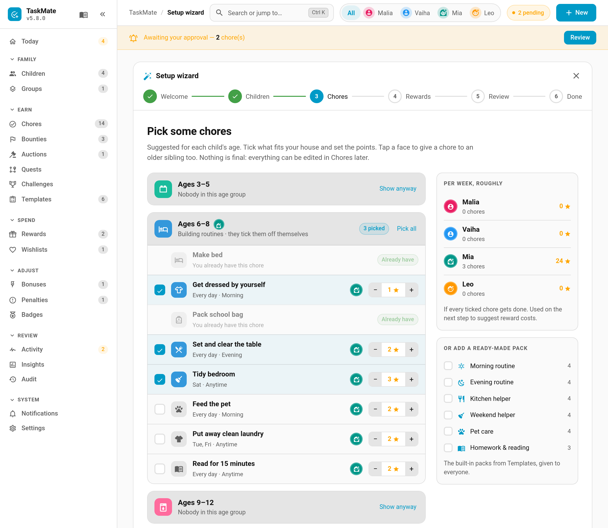
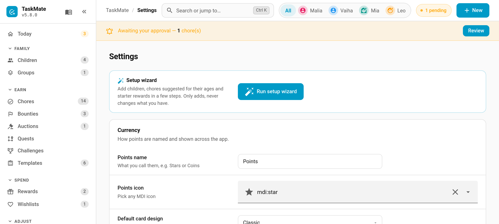
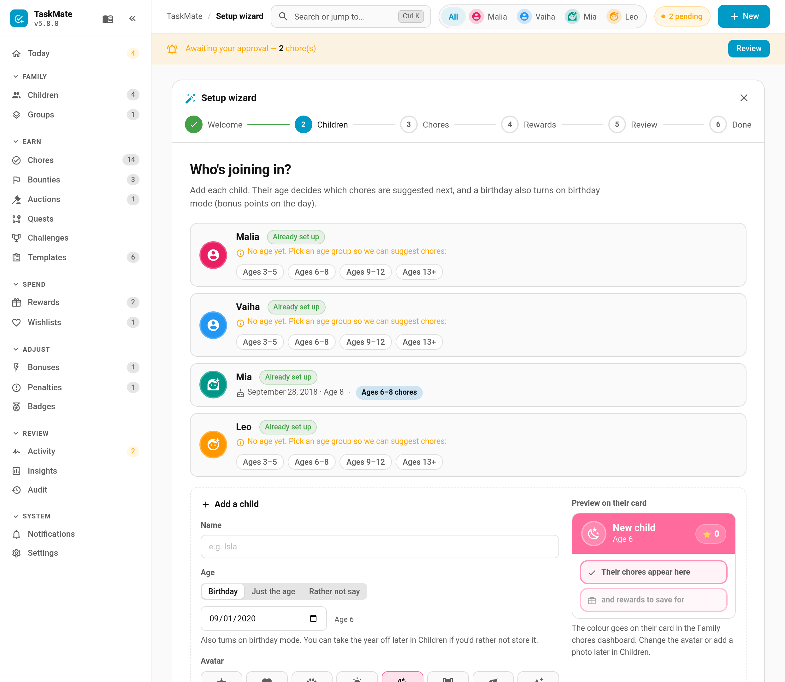
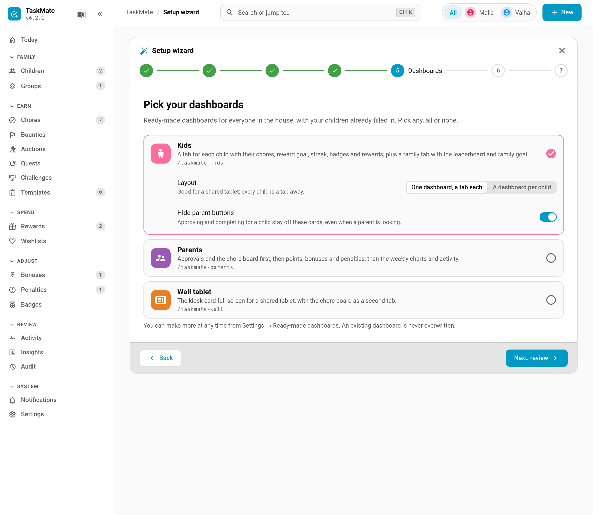
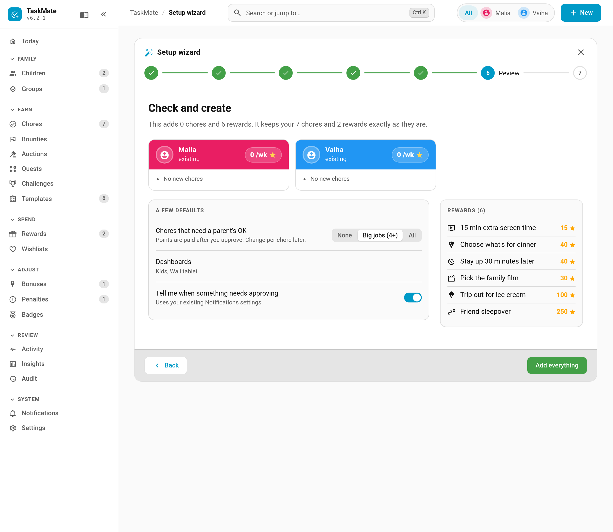

# Setup Wizard

The **setup wizard** gets a new family from an empty panel to a working chore chart in a few minutes. You add your children with an age or birthday, tick from chores suggested for their age, pick some starter rewards, and it creates the lot in one go, along with [ready-made dashboards](Ready-Made-Dashboards.md) for the kids, the parents or a wall tablet. You can run it again at any time to add more; it never deletes or changes anything you already have.

> **New in v6.0.0**

---

## Where to Find It

- **First run.** It opens by itself the first time you open the TaskMate panel with no children. If you skip it, the Today page offers **Start setup** and **Add a child myself**.
- **Settings.** **Settings → Setup wizard → Run setup wizard**, at the top of the page.
- **Command search.** Press **Ctrl K** and type "Run setup wizard".
- **Integration setup.** A link at the end of adding TaskMate in Home Assistant.

If you close it part-way, your draft is kept in the browser and picked up next time.

---

## The Steps

### 1. Welcome

Choose what your points are called: **Points**, **Stars**, **Coins**, **Gems** or your own name. It shows on every card and can be changed later in [Settings](Settings.md).

### 2. Children

Add each child with a name plus one of:

- a **birthday** (this also turns on [birthday mode](Birthday-Mode.md) for them),
- **just the age**, or
- **rather not say**, and pick an age group by hand.

Choose an avatar icon and a colour, and a preview shows their card header. The colour becomes their card's header on the Kids dashboard.

### 3. Chores

Suggestions are grouped by age: **3–5**, **6–8**, **9–12** and **13+**, 32 in all. Each group that has a child in it opens with its first five chores ticked.

- Change the points for any chore with − and +. A **Per week, roughly** panel shows what each child would earn.
- Tap a child's face on a chore to give it to an older sibling too. A chore is never given to a child younger than its age group.
- Prefer a themed set? The six built-in [template packs](Template-Packs.md) (Morning routine, Evening routine, Kitchen helper and so on) are offered alongside.
- A pack chore with the same name as a ticked suggestion, or as a chore you already have, is only added once.

### 4. Rewards

Starter rewards in three tiers: **Small treats**, **Worth saving for** and **Big goals**. Each shows roughly how often it could be earned with the chores you picked. Adjust the costs, or add your own. Costs are fixed.

### 5. Dashboards

> **New in v6.3.0.** Replaces the old "Create a Family chores dashboard" switch.

Pick any, all or none of the three [ready-made dashboards](Ready-Made-Dashboards.md): **Kids** (ticked by default), **Parents** and **Wall tablet**. Each ticked one shows its options: the Kids layout and **Hide parent buttons**, **Admins only** for Parents, and the chore board tab for the wall tablet. An address that's already in use is never overwritten.

You can make more at any time from **Settings → Ready-made dashboards**.

### 6. Review

A summary per child and the dashboards you picked, plus two choices:

| Choice | Default | What it does |
|--------|---------|--------------|
| **Chores that need a parent's OK** | Big jobs (4+) | None, big jobs worth 4 points or more, or all |
| **Tell me when something needs approving** | on | Switches on the approval notifications if they're off. Never switches anything off |

### 7. Done

**Add everything** on the review step creates it all in one go, and the Done step confirms what was added. Each dashboard is listed with an **Open** button, and any that already existed are noted as left alone. Everything is checked before anything is written, so a mistake leaves nothing half-created.

---

## Just the Dashboards

Already set up and only after the dashboards? Run the wizard, untick any chores and rewards it suggests, and tick the dashboards you want. The Review step says "Nothing new for the family this time: just the dashboards you picked", and nothing else in TaskMate is changed.

A draft saved by an older version carries over: its "Family chores" switch becomes the Kids dashboard.

---

## Running It on an Existing Family

When you already have children, the wizard asks before opening and works in **add-only** mode:

- Your existing children show as **Already set up**. You can only fill in a missing age group for them.
- Chores and rewards with a name you already have show as **Already have** and are skipped.
- Nothing is renamed, changed or deleted.

---

## New Chore Ideas as Children Grow

When a birthday moves a child into the next age group, the Today page shows a one-time nudge: "Vaiha is 9 now. See new chore ideas for their age?" Either button records the new age group, so it won't come back. Suggestions never move up a group by themselves.

A child's age group can also be set by hand under **Children → Edit → Age group**. It only decides which chores the wizard suggests; it changes nothing else.

---

## Related

- [Ready-Made Dashboards](Ready-Made-Dashboards.md) — the dashboard presets, also in Settings
- [Getting Started](Getting-Started.md) — setting TaskMate up by hand
- [Template Packs](Template-Packs.md) — the built-in and shareable chore packs
- [Children](Children.md) — editing children, birthdays and age groups
- [Birthday Mode](Birthday-Mode.md) — what a birthday turns on
- [Admin Panel](Admin-Panel.md) — the Today page and command search
