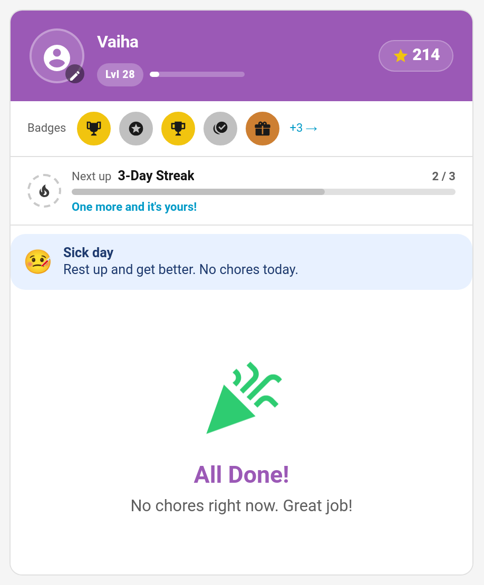
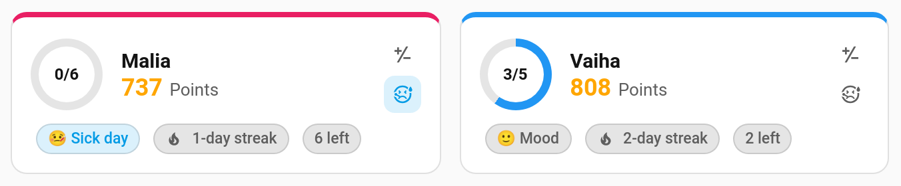

# Sick Days

When a child is ill, one tap gives them a sick day. Their chores disappear for the day, their streak is frozen so it survives, and no mandatory chore counts as missed. Their card shows a gentle "rest up" banner instead of a to-do list. It works like a one-child, one-day [vacation](Vacation-Mode.md), with nothing to set up beforehand.



> **New in v7.0.0**

---

## Giving a Sick Day

**TaskMate panel → Today**: each child's card has a sick-day button (the 🤒 face, next to the points button). Tap it to give that child a sick day today; tap it again to take it back.



While a child is on a sick day their card on the Today page shows a **Sick day** pill and the button stays highlighted.

To mark a different day (from a week ago to a month ahead), use the `set_sick_day` service, for example from an automation or a dashboard button:

```yaml
action: taskmate.set_sick_day
data:
  child_id: 8e16ad66b23f404e
  date: "2026-11-03"
```

---

## What a Sick Day Does

For that child, on that day:

| | |
|---|---|
| **Chores** | Hidden. Their card shows **Sick day — Rest up and get better. No chores today.** |
| **Streak** | Frozen. The day never counts as missed, and a sick day bridges a gap just as a vacation does, so a streak survives it |
| **Mandatory chores** | No missed-mandatory review items are raised |
| **Virtual pet** | Doesn't get sleepy; it stays content (see [Virtual Pets](Virtual-Pets.md#moods)) |
| **Logging past jobs** | A job can't be [logged for that day](Logging-Past-Jobs.md) afterwards: "Tuesday was Vaiha's sick day, so no jobs were due." |

Other children aren't affected.

Sick days are kept for 120 days, then dropped.

---

## Taking It Back

Tap the sick-day button on the Today page again, or call the service with `sick: false`. The child's chores come back straight away.

---

## Event

Setting or clearing a sick day fires `taskmate_sick_day` with `child_id`, `child_name`, `date` and `sick` (`true` or `false`). It shows as **Sick day** on the child's [event entity](Event-Entities.md), handy for, say, turning off the morning chore announcement.

---

## Service

| Service | Fields | Description |
|---------|--------|-------------|
| `taskmate.set_sick_day` | `child_id`, `date` (optional, default today; a week ago to a month ahead), `sick` (optional, default `true`; `false` takes it back) | Give a child a sick day, or take it back |

Each child's entry in `sensor.taskmate_overview`'s `children` attribute carries `sick_today: true` on a sick day.

---

## Related

- [Vacation Mode](Vacation-Mode.md) — time off for the whole family, or by date range
- [Streak Freezes](Streak-Freezes.md) — tokens that save a streak on a missed day
- [Mandatory Chores](Mandatory-Chores.md) — what a missed mandatory chore normally does
- [Mood Check-In](Mood-Check-In.md)
