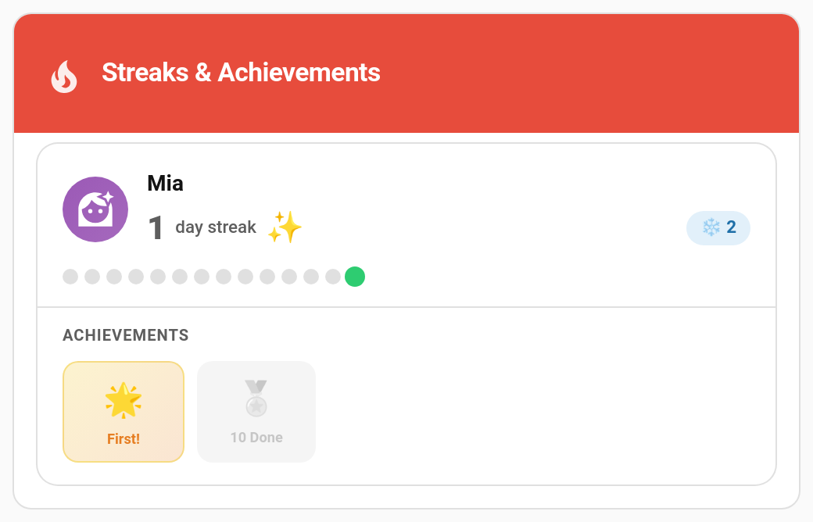

# Streak Freezes

A long streak is precious, and one forgotten day shouldn't wipe out weeks of effort. A **streak freeze** is a token a child holds in reserve: when they miss a day, a token is used up instead of the streak breaking.



> **New in v6.0.0**. Streak freezes are **switched on by default**. See [Turning It Off](#turning-it-off).

---

## How It Works

```
Child misses a day → midnight streak check → a token is used → the streak carries on
```

Each night TaskMate checks every child's streak. For each missed day it uses up one token, in date order, and the streak survives. The next completion carries the streak on across the gap as if nothing happened.

If the tokens run out partway through a longer gap, the streak breaks (or pauses, depending on your streak mode) exactly as it did before streak freezes existed.

---

## Getting Tokens

There are three ways a child can get a token.

### Earning them

A child earns **one token every 7 streak days** by default: at 7 days, 14 days, 21 days, and so on, up to the most they can hold.

If the completion that earned a token is undone, the token is taken back, so tapping undo and redo can't farm tokens.

### Buying them

Create a reward and switch on **Streak freeze** in the reward editor. Approving a claim gives the child one token. The reward shows a *Streak freeze* pill in the rewards list.

- The cost is always fixed.
- A claim is refused if the child already holds the most they're allowed. Claims still waiting for approval count toward that limit.
- A streak-freeze reward can't be a jackpot.

See [Managing Rewards](Managing-Rewards.md).

### Given by a parent

Grant or remove tokens with the `taskmate.adjust_streak_freezes` service:

| Field | Required | Description |
|-------|----------|-------------|
| `child_id` | Yes | The child |
| `amount` | Yes | From `-10` to `10`, not `0`. Positive grants tokens, negative removes them. |

```yaml
action: taskmate.adjust_streak_freezes
data:
  child_id: a8c8376a
  amount: 1
```

A grant never takes a child over the limit, and a removal stops at zero. Only parents and admins can use it.

---

## Settings

**TaskMate panel → Settings → History & streaks**

| Setting | Default | Description |
|---------|---------|-------------|
| **Streak freezes (most a child can hold)** | `2` | The most tokens a child can hold, up to `10`. `0` turns streak freezes off. |
| **Earn a streak freeze every** | `7` | Streak days per free token. `0` = never. Use this if you'd rather children buy tokens with a reward. |

### Turning It Off

To keep streaks working exactly as they did before v6.0.0, set **Streak freezes (most a child can hold)** to `0`.

---

## Days That Never Use a Token

Some days are already forgiven, so they never cost a token:

- **[Vacation](Vacation-Mode.md)** days
- Days a child is **away** (the global vacation calendar, or an unavailability sensor with *pause streak* switched on)
- A **[birthday day off](Birthday-Mode.md)**
- A streak that's already **paused**, or a child with no streak at all

---

## Where Tokens Show

| Where | What you see |
|-------|--------------|
| **Streak card** | A ❄️ count next to each child's streak, in every card design. It still shows `0` while the feature is on. |
| **Child card** | ❄️ N in the header, once the child holds at least one token. |
| **Activity** | An entry each time a token is earned, used, given, removed or taken back. These entries carry no points and can't be undone. |

---

## Notification and Event

- The **Streak freeze used** notification type tells you when a token saves a child's streak. It's off by default. Turn it on under **TaskMate panel → Notifications**.
- The `taskmate_streak_freeze_used` event fires each time a token is used, for your own automations.

---

## Related

- [Vacation Mode](Vacation-Mode.md) — pausing chores and streaks for a trip
- [Managing Rewards](Managing-Rewards.md) — creating a Streak freeze reward
- [Birthday Mode](Birthday-Mode.md) — a birthday day off never uses a token
- [Services](Services.md) — full service reference
