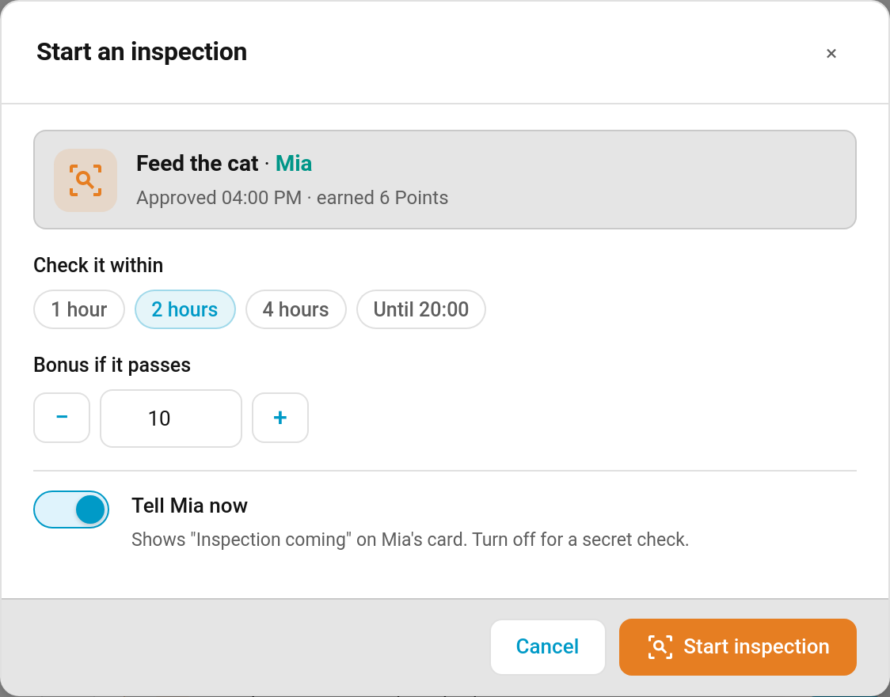
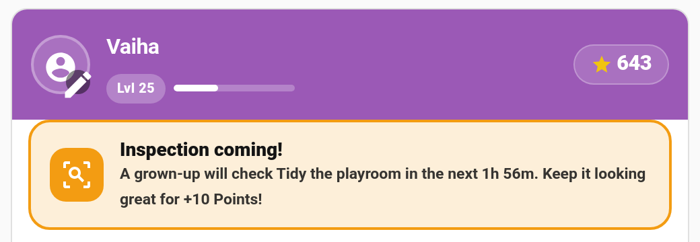
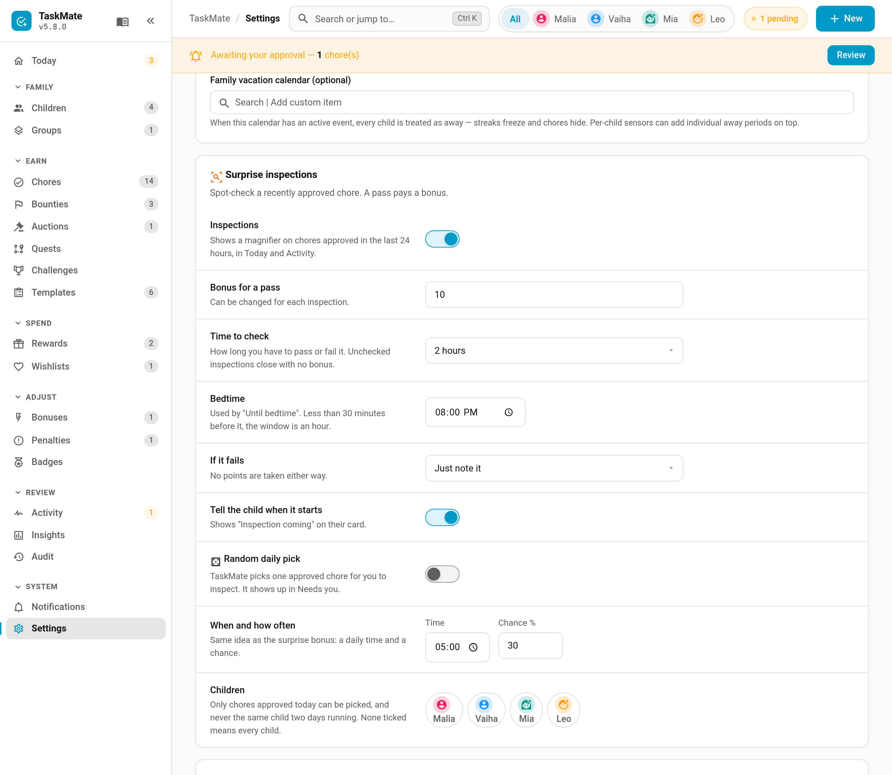

# Surprise Inspections

"I tidied my room!" — but did they? A **surprise inspection** lets you spot-check a chore you've already approved. If it still looks good when you check, the child earns a bonus. If it doesn't, you can just note it, or send it back to be redone. No points are ever taken away, so inspections reward keeping things tidy rather than punishing a slip.

> **New in v6.0.0**

---

## How It Works

1. **Flag a chore.** Any chore approved (or auto-approved) in the last 24 hours shows a 🔍 magnifier in **Recent activity** on the Today page and in Activity. Tap it.
2. **Set it up.** Choose how long you have to check it (1 hour, 2 hours, 4 hours or until bedtime), the bonus (10 points by default, editable), and whether to tell the child now. Turn **Tell … now** off for a secret check.
3. **Check it.** The open inspection sits at the top of **Needs you** on the Today page with a countdown, and **Pass**, **Fail** and cancel buttons.
4. **Decide.** Pass pays the bonus; fail notes it or sends the chore back.

Each approved chore can be inspected once.

---

## What the Child Sees

When the child has been told, their card shows an amber **Inspection coming!** banner with the countdown and the bonus, and the chore gets a dashed border and an **Inspection** tag.

| Outcome | On the child's card |
|---------|---------------------|
| **Passed** | A one-off celebration with your note, then a green banner and a **Passed +10** tag for the rest of the day |
| **Failed — just noted** | A grey "Not this time. No points lost." |
| **Failed — sent back** | The chore reappears as not done for today, with your note |
| **Secret check** | Nothing at all until you decide |

---

## Passing and Failing

- **Pass** pays the bonus as an ordinary points transaction ("Inspection passed: Tidy the playroom"). You can change the bonus as you pass it. Like any bonus it can be undone from the activity feed; undoing it takes the pass back and reopens the inspection if its time is still open.
- **Fail → Just note it** records the result. The child keeps the chore's original points.
- **Fail → Send it back to redo** puts the chore back on the child's list for today. They complete it again through the normal path (including approval, if the chore needs it), but the redo **pays nothing extra**. The original points stand.
- **Time runs out** — if you don't decide in time, the inspection closes quietly with no bonus. You get a reminder 30 minutes before.
- **Cancel** (✕) drops the inspection without a result.

Rejecting the inspected completion itself also cancels an open inspection on it.

---

## Settings

**TaskMate panel → Settings → Surprise inspections**

| Setting | Default | Description |
|---------|---------|-------------|
| **Inspections** | on | Shows the magnifier on chores approved in the last 24 hours, in Today and Activity |
| **Bonus for a pass** | `10` | The starting bonus. Can be changed for each inspection |
| **Time to check** | 2 hours | The starting window: 1 hour, 2 hours, 4 hours or until bedtime |
| **Bedtime** | `20:00` | Used by "Until bedtime". Less than 30 minutes before it, the window is an hour |
| **If it fails** | Just note it | Just note it, Send it back to redo, or Ask me each time |
| **Tell the child when it starts** | on | The starting position of the "Tell … now" switch |
| **Random daily pick** | off | TaskMate picks one approved chore for you to inspect. It shows up in Needs you |
| **When and how often** | `17:00`, 30% | The daily time the pick is made, and the chance it happens on any given day |
| **Children** | all | Which children can be picked. None ticked means every child |

The random pick only chooses chores approved that day, and never the same child two days running.

---

## Notifications

| Type | Sent to | Default |
|------|---------|---------|
| **Inspection started** | The child (only when told) | Off |
| **Inspection passed** | The child | Off |
| **Inspection reminder** | Parents, 30 minutes before the window closes | **On** |

---

## Services and Events

| Service | Description |
|---------|-------------|
| `taskmate.start_inspection` | Start one on a `completion_id`. Optional `bonus`, `window` (`1h`, `2h`, `4h` or `bed`) and `tell_child` |
| `taskmate.pass_inspection` | Pass it (`inspection_id`), with an optional `bonus` override and `note` |
| `taskmate.fail_inspection` | Fail it, with an optional `redo` (send it back) and `note` |
| `taskmate.cancel_inspection` | Cancel it |

All four are parent-only. Events: `taskmate_inspection_started`, `_passed`, `_failed`, `_expired`, `_cancelled` and `_reopened`. The activity feed and Activity card show started, didn't-pass and sent-back entries (a secret inspection only appears once it's decided).

---

## Related

- [Bonuses](Bonuses.md) — the other ways to hand out extra points
- [Managing Rewards](Managing-Rewards.md) — the approval queue
- [Admin Panel](Admin-Panel.md) — the Today page and Needs you
- [Celebrations](Celebrations.md) — the animation a pass plays on the child's card
