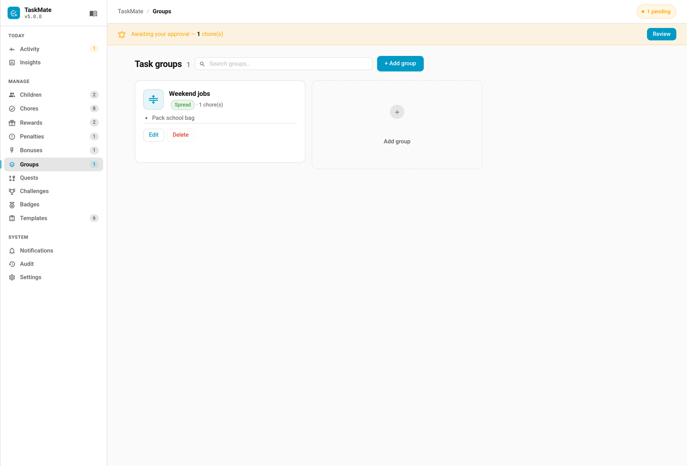

# Task Groups

Task Groups coordinate how rotation-mode chores are assigned together. They solve the problem of related chores being randomly split across different children when you want them handled as a set.



---

## Why Use Task Groups?

Without groups, three rotation-mode chores (Set Table, Serve Dinner, Clear Table) might be assigned to three different children on the same day. With a **sticky** group, all three go to the same child. With a **spread** group, each goes to a different child — guaranteed.

---

## Policies

### Sticky

All chores in the group are assigned to the **same child** today.

- The **first chore** in the group is the **leader** — its rotation pick determines who gets the whole group
- All other chores (followers) are forced onto the leader's assigned child, provided that child is in their assignment pool
- If the leader's child is not in a follower's pool, the follower falls back to its own rotation pick

**Use case:** Related chores that should be done by one person — setting and clearing the table, washing and drying dishes.

### Spread

Each chore in the group is assigned to a **different child** — no child gets two chores from the same group on the same day.

- Children are distributed in order, wrapping around if there are more chores than children
- Each chore starts from its own raw rotation pick, then walks forward to find an unused child

**Use case:** Distributing a set of equivalent chores fairly — three different rooms to tidy, each assigned to a different child.

---

## Creating a Task Group

### Via the Admin Panel

1. Open the **TaskMate** panel in the HA sidebar
2. Navigate to task group management
3. Click **Add Task Group**
4. Enter a name, select a policy (sticky or spread), and choose the chores to include
5. Save

### Via Services

```yaml
service: taskmate.add_task_group
data:
  name: "Dinner Duties"
  policy: sticky
  chore_ids:
    - abc12345
    - def67890
    - ghi11223
```

---

## Services

### `taskmate.add_task_group`

Create a new task group.

| Field | Required | Default | Description |
|-------|----------|---------|-------------|
| `name` | Yes | — | Group display name |
| `policy` | Yes | `sticky` | `sticky` or `spread` |
| `chore_ids` | No | `[]` | Ordered list of chore IDs |

### `taskmate.update_task_group`

Update an existing group. Only supplied fields are changed.

| Field | Required | Description |
|-------|----------|-------------|
| `group_id` | Yes | ID of the group to update |
| `name` | No | New name |
| `policy` | No | New policy |
| `chore_ids` | No | New ordered chore list |

```yaml
service: taskmate.update_task_group
data:
  group_id: grp_abc123
  policy: spread
```

### `taskmate.remove_task_group`

Delete a task group. The chores themselves are not deleted — they revert to independent rotation.

| Field | Required | Description |
|-------|----------|-------------|
| `group_id` | Yes | ID of the group to remove |

```yaml
service: taskmate.remove_task_group
data:
  group_id: grp_abc123
```

---

## How Groups Interact with Assignment Modes

- Groups **only apply** to chores using rotation assignment modes (`alternating`, `random`, `balanced`)
- Chores in `everyone` mode are unaffected by groups — every child sees them regardless
- Group policies are applied **after** the raw per-chore rotation picks are calculated at midnight
- The order of `chore_ids` matters for sticky groups — the first chore is the leader

---

## Skip Behaviour

- **Sticky followers** cannot be skipped individually — skip the leader and followers follow
- **Leader skip** propagates to all followers via the daily assignment recompute
- **Spread groups** allow individual chore skips normally

---

## Tips

- **Keep groups small** (2–4 chores) — large groups with sticky policy can overload one child
- **Order matters** for sticky — put the most important chore first as the leader
- **Mix with balanced mode** — balanced + spread distributes work most evenly across children
- **Use spread for fairness** — when all group chores are equivalent effort, spread ensures no child does two

---

## Related

- [Chores — Assignment Modes](Chores.md#assignment-modes) — how rotation modes work
- [Services](Services.md) — full service reference
