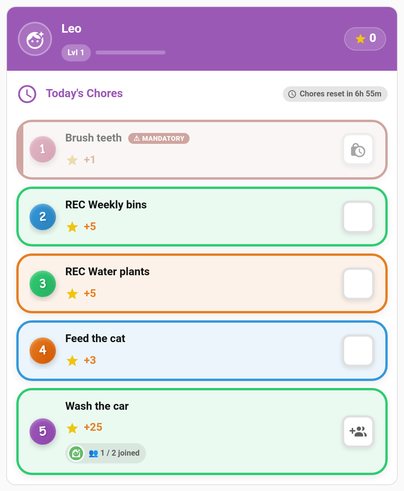

# Teamwork Chores

Some jobs are meant to be done together: washing the car, clearing the garden, carrying the shopping in. A **teamwork chore** only counts once a set number of children have joined it. Each child taps to join, and when the team is full, everyone gets the credit at once.



> **New in v6.0.0**

---

## How It Works

```
Mia taps Join (1 / 2 joined) → Leo taps Join → team full → both get a completion
```

- Each child's tap **joins** the team. A join on its own records nothing and pays nothing.
- The tap that **fills the team** records a completion for every member together.
- Those completions follow the chore's normal approval setting. If it needs approval, they all land in the approval queue together.
- If a parent completes it on a child's behalf and that fills the team, it's approved straight away, as with any chore completed by a parent.

---

## Setting It Up

**TaskMate panel → Chores → edit a chore → More options → Teamwork (optional)**

| Field | Default | Description |
|-------|---------|-------------|
| **Team size (0 = off)** | `0` | How many different children must join, from `2` to `10`. `0` makes it an ordinary chore. |
| **Team points** | Everyone gets the full points | *Everyone gets the full points*, or *Split the points evenly (rounded down)*. |
| **Team bonus (per child)** | `0` | Extra points for each member when the team completes it. |

Teamwork chores show a **Team of N** pill in the chore list.

### Points example

A 20-point chore with a team of 2 and a team bonus of 5:

| Team points | Each child gets |
|-------------|-----------------|
| Everyone gets the full points | 20 + 5 = **25** |
| Split evenly | 10 + 5 = **15** |

The child card quotes each child their own share, so the number they see is the number they'll get. Rewards are unaffected: reward costs are always fixed.

---

## On the Child Card

A teamwork chore shows how the team is filling up, for example **1 / 2 joined**, with the avatars of the children who have joined. Once a child has joined, it also says **You're in**.

| Button | What it does |
|--------|--------------|
| **Join** | Adds the child to today's team. |
| **Leave** | Takes them back out, as long as the team isn't full yet. |

A join that doesn't fill the team doesn't play the "done" celebration. That happens when the team completes it. This works in every card design and in pre-reader mode.

On the [kiosk card](Dashboard-Cards.md), a child who has joined sees "Waiting for your team".

---

## Every Day Starts Fresh

Joins belong to **today's** occurrence of the chore. A half-formed team resets at midnight, so nobody is left waiting from yesterday. Editing the chore never clears today's joins.

---

## What Can't Be a Teamwork Chore

A teamwork chore has to use the normal **everyone** assignment, where every assigned child sees the chore and can join. So it can't also be:

- **First-come** or any **[rotation](Task-Groups.md)** mode (alternating, random, balanced). Those give the chore to one child, so a team could never form.
- **[Open-ended](Open-Ended-Chores.md)**
- A **[timed task](Timed-Tasks.md)**

The chore editor, the WebSocket API and the `add_chore` service all refuse these combinations.

Photo proof still works: each child's join goes through the usual checks, including the photo.

---

## Services and Events

`taskmate.add_chore` accepts `team_size`, `team_points_mode` (`each` or `split`) and `team_bonus`.

A child can leave a team with `taskmate.leave_team_chore`:

| Field | Required | Description |
|-------|----------|-------------|
| `chore_id` | Yes | The teamwork chore |
| `child_id` | Yes | The child leaving |

| Event | When |
|-------|------|
| `taskmate_team_chore_joined` | A child joins a team that isn't full yet |
| `taskmate_team_chore_completed` | The team fills and completions are recorded |

The usual `taskmate_chore_completed` event also fires once for each member.

---

## Good Candidates

- **Washing the car**: two children, split the points, add a team bonus
- **Garden clear-up**: three children, everyone gets the full points
- **Unloading the shopping**: a quick team of two
- **Tidying the playroom** that everyone made a mess of

---

## Related

- [Chores](Chores.md) — creating and configuring chores
- [Chore Scheduling](Chore-Scheduling.md) — assignment and rotation modes
- [Family Goals](Family-Goals.md) — a shared points target for the whole family
