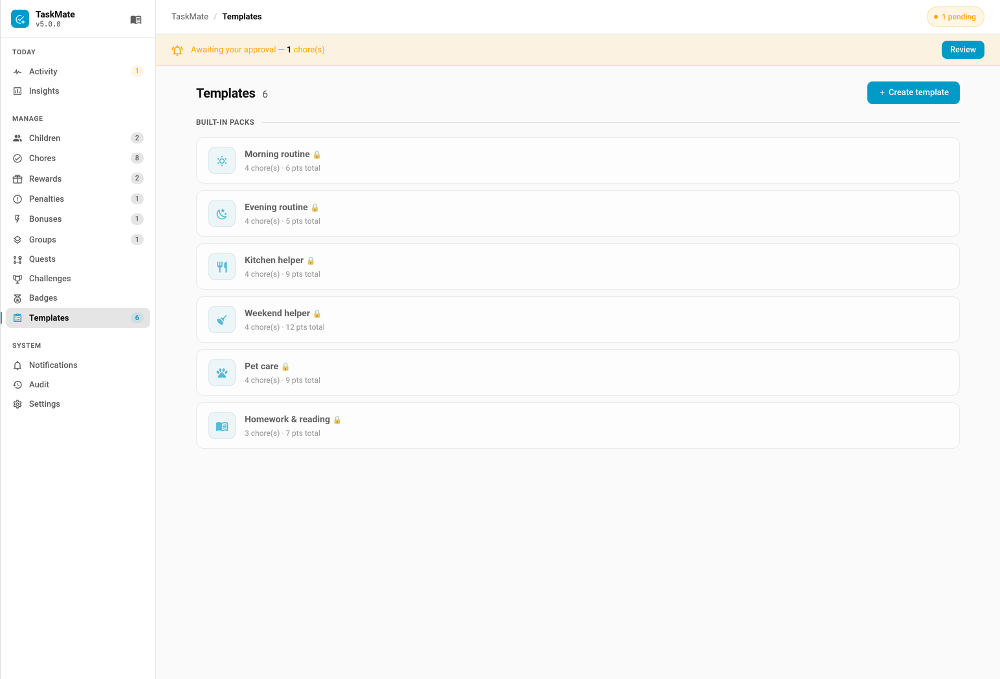

# Template Packs

Export your custom chore templates as a JSON pack, and import one somebody else made.

- **Export** — `taskmate/templates/export` returns a pack: all custom templates, or a chosen subset. Built-ins are excluded, because they ship with TaskMate and exporting them would only create duplicates on the other end.
- **Import** — `taskmate/templates/import` takes a pack object.

---

## Import Is Treated as Untrusted

A pack is arbitrary JSON from someone else, so it is handled defensively:

- **Unknown chore fields are dropped**, not carried through. A shared pack cannot set runtime state — rotation anchors, skip dates — or anything the panel wouldn't let you set by hand.
- **Format and version are checked.** A pack from a newer TaskMate says so plainly rather than being half-imported.
- **Sizes are capped** — 50 templates, 200 chores each. Long names are truncated rather than rejected.
- **A clashing name is suffixed, never overwritten** — `Morning routine (2)`. An import must not silently replace something your family built.
- **A pack that fails validation writes nothing.** There is no partial import to clean up afterwards.

---

## No URL Importing

Packs are imported from **pasted or uploaded JSON only**. Fetching arbitrary URLs from inside your home network would make TaskMate a server-side request forgery vector — a shared "pack link" could be used to probe your LAN. You can still paste a gist's raw contents.

---

## Sharing a Pack

1. Export your templates from the panel.
2. Send the JSON however you like — a gist, a forum post, a message.
3. The recipient pastes it into the import dialog.

Because names are suffixed rather than overwritten, importing a pack twice gives you a duplicate to delete, never a silent replacement of your own work.

---

## Related

- [Chores](Chores.md) — creating chores from a template
- [Admin Panel](Admin-Panel.md) — the Templates tab
- [Backup & Restore](Backup-and-Restore.md) — exporting your whole configuration, which is a different job
- [Services](Services.md) — the websocket commands
