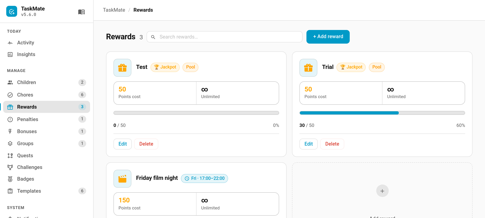
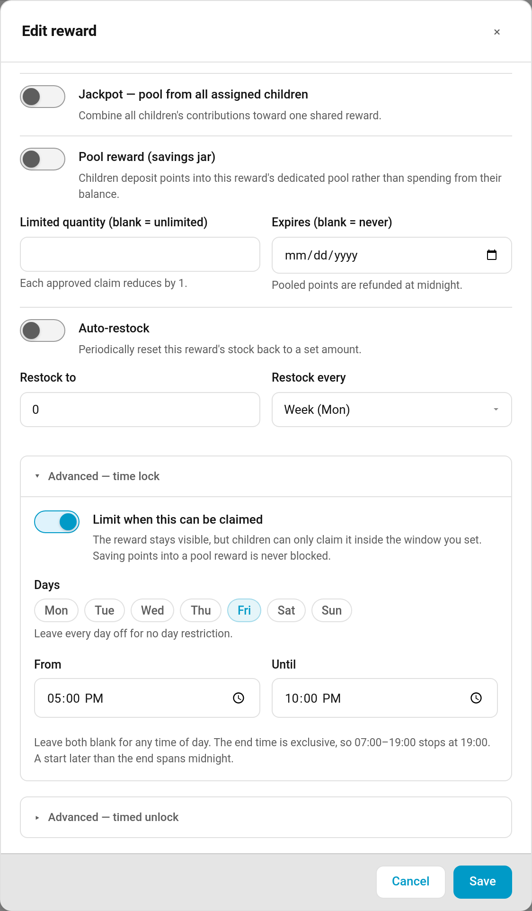

# Time Locked Rewards

Some rewards only make sense at certain times. Film night belongs to Friday evening; an hour of screen time shouldn't be claimable at 6am on a school day. A time lock restricts *when* a reward can be claimed, without hiding it the rest of the week.

Added in v5.6.0.

---

## How It Behaves

The reward stays visible on the card the whole time. Outside its window it is shown as locked and cannot be claimed; inside it, nothing is different from any other reward.

Two things are deliberately **not** blocked:

- **Saving into a pool.** A child can keep putting points into a savings jar for a time-locked reward whenever they like — only the final claim waits for the window.
- **Parent approval.** If a claim is already waiting when the window closes, a parent can still approve it. Approving is the parent's decision, not the child's, so it is not held to the child's window.

---

## Setting It Up

Open a reward in the admin panel and find **Advanced — time lock**, then turn on **Limit when this can be claimed**.

**Days** — tick the days the reward is claimable. Leave every day unticked for no day restriction.

**From / Until** — a time-of-day window. Leave both blank for any time of day.

The two parts are independent. Set only days, only a window, or both — whatever you configure has to pass.

---

## Key Points

- **The end time is exclusive.** `07:00–19:00` stops at 19:00 exactly.
- **Equal times mean no restriction.** `07:00–07:00` is treated as "any time", not as a full 24 hours, so a half-finished window never silently locks a reward forever.
- **A start later than the end spans midnight.** `20:00–01:00` runs through the evening and into the early hours.
- **An overnight window on a day-restricted reward only covers the part before midnight.** The day is read from the moment of the claim, so a Friday-only reward with a `20:00–01:00` window is claimable from 20:00 to 23:59 on Friday — the hour after midnight belongs to Saturday, which isn't ticked.
- **The lock is enforced in the backend**, not just drawn on the card, so a service call or automation cannot claim around it.
- **Turning the lock off restores normal behaviour** immediately; the day and time settings are kept in case you want it back.

---

## Worked Examples

| Goal | Days | From | Until |
|------|------|------|-------|
| Friday film night | Friday | `17:00` | `22:00` |
| Weekend lie-in treat | Saturday, Sunday | blank | blank |
| After school only, any weekday | Mon–Fri | `15:30` | `18:00` |
| Late-evening screen time spanning midnight | Saturday | `20:00` | `01:00` |

---

## See Also

- [Rewards](Rewards.md) — costs, stock, expiry and the claim flow
- [Pool Mode (Savings Jars)](Pool-Mode-(Savings-Jars).md) — saving towards a reward over time
- [Timed Unlock Rewards](Timed-Unlock-Rewards.md) — a reward that switches a device on for a while
