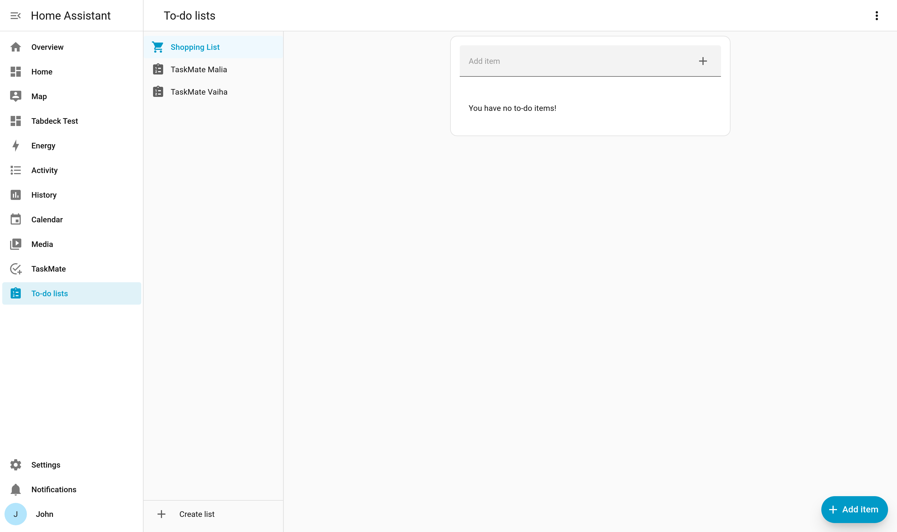

# To Do Lists

TaskMate publishes each child's outstanding chores as a native Home Assistant **To-do list**, so you can see and tick off today's chores using HA's built-in To-do List card — and through any voice assistant — without the custom TaskMate cards.



---

## What You Get

For every child, TaskMate creates one to-do list entity:

```
todo.taskmate_<child name>
```

For example, a child called Malia gets `todo.taskmate_malia`. New children get their own to-do list automatically as soon as they're added.

Each list shows the chores that child **still needs to do today** — the same set of due chores TaskMate uses everywhere else (it shares the integration's due-chore logic, so vacation mode, scheduling, availability and dynamic visibility are all honoured). Completed chores drop off the list.

---

## Ticking Items Off Completes the Chore

The list isn't just a read-only mirror. When you (or a child, or a voice assistant) **check an item off**, TaskMate marks that chore as completed for that child — exactly as if it had been completed from the child card. Points are awarded and the usual approval flow applies where configured.

This makes the native To-do List card a fully working way to drive TaskMate from anywhere in your Home Assistant dashboards.

> The to-do list supports updating items (checking them off). Items are added and removed by TaskMate itself based on what's due — you don't add chores from the to-do card; create them in the [Admin Panel](Admin-Panel.md) as usual. See [Chores](Chores.md).

---

## Adding the To-do List Card

Use Home Assistant's built-in **To-do List** card and point it at the child's list:

```yaml
type: todo-list
entity: todo.taskmate_malia
```

To show several children at once, stack one card per child (for example in a grid or vertical stack):

```yaml
type: vertical-stack
cards:
  - type: todo-list
    entity: todo.taskmate_malia
  - type: todo-list
    entity: todo.taskmate_alex
```

For TaskMate's own richer cards, see [Dashboard Cards](Dashboard-Cards.md).

---

## Voice Assistants

Because these are standard HA to-do lists, they work with voice assistants for free. You can ask Assist what's on a child's list and mark items done by voice, alongside TaskMate's dedicated voice intents. See [Voice Assistants](Voice-Assistants.md).

---

## See Also

- [Chores](Chores.md) — creating and scheduling the chores that appear here
- [Dashboard Cards](Dashboard-Cards.md) — TaskMate's own child cards
- [Voice Assistants](Voice-Assistants.md) — asking about and completing chores by voice
