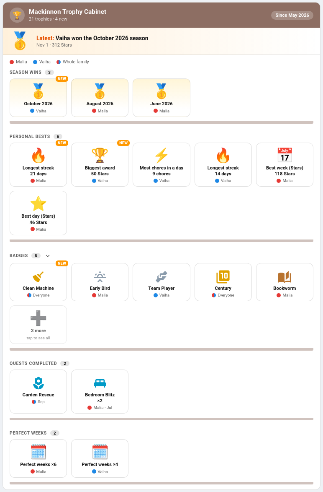

# Trophy Cabinet Card

Everything the family has won, on one card. Season wins, personal bests, badges, finished quests and perfect weeks each get a shelf, and every trophy carries the colour dot of the child who earned it. It's made for the hallway tablet: a glance tells you who has been busy, and the newest trophies are marked **New** so nobody's latest win goes unnoticed.



The card only shows what TaskMate already keeps. There is nothing to set up and nothing to award by hand: once a child wins a [season](Leaderboard-Seasons.md), beats a [personal best](Personal-Bests.md), earns a [badge](Achievement-Badges.md) or finishes a [quest](Quests.md), it goes on a shelf.

---

## Adding the Card

**Edit dashboard → + Add Card → TaskMate Trophy Cabinet**

```yaml
type: custom:taskmate-trophy-cabinet-card
entity: sensor.taskmate_overview
title: Mackinnon Trophy Cabinet   # optional — default: Trophy Cabinet
```

Point it at the **Overview** sensor, as with the other family cards. It finds each child's badges sensor through the Overview sensor, so it keeps working if Home Assistant has put an area in front of the entity ids or you have renamed them.

---

## The Shelves

| Shelf | What goes on it | Dated by |
|-------|-----------------|----------|
| **Season wins** | Each month a child won the [leaderboard season](Leaderboard-Seasons.md), with their points | The day the season was decided (the 1st of the next month) |
| **Personal bests** | Every [record](Personal-Bests.md) a child holds: longest streak, best day, best week, most chores in a day, biggest award | The day the record was set |
| **Badges** | Every [badge](Achievement-Badges.md) earned. A badge two children have earned is one trophy with both dots | The most recent time it was earned |
| **Quests completed** | Every [quest](Quests.md) a child has finished, with **×2**, **×3**… when a repeatable one has been done more than once | The most recent finish |
| **Perfect weeks** | One trophy per child: **Perfect weeks ×6** | The end of their latest perfect week |
| **Legendary pets** | A child's [pet](Virtual-Pets.md) once it has turned legendary, and legendary pets in its pet family. Off by default | — |

Each shelf lists its newest trophies first. The badge next to its name says how many trophies it holds.

**Whole family.** When every child on the card has the same badge or has finished the same quest, the trophy gets one two-tone dot and reads *Whole family* instead of a row of dots.

**New.** Anything earned in the last 7 days (change it with `new_days`) gets a **New** tag, and so does a personal best beaten today. The header counts the trophies and how many are new.

**The spotlight** across the top names the most recent trophy — *Latest: Vaiha won the October 2026 season* — with its date. Turn it off with `show_spotlight: false`.

**Long shelves.** A shelf shows 5 trophies (`badges_per_shelf`) and then a **N more** tile. Tap it, or tap the shelf's name, to open the whole shelf; tap again to fold it.

Season history goes back 12 months: that is how much the Overview sensor keeps.

---

## Narrow Cards

On a phone or in a narrow column (under 480 pixels wide) the card switches to a compact layout by itself: three tiles a shelf, short labels (*Oct*, *21 days*, *×6*) and no spotlight. Names are left out, so each dot carries the child's initial instead (two letters when two children share one), and the whole-family dot shows a family icon. A shelf with more than three trophies shows two and a **N more** tile.

---

## Children

Grown-up profiles are left out, as on the other family cards; set `show_adults: true` to include them. To show only some children, list them under `children`. A child with nothing on any shelf yet simply doesn't appear in the colour key, and an empty cabinet says so in a friendly way rather than showing bare shelves.

Each child's dot is the colour you picked for them under **Children** in the admin panel, or one from the card's palette.

---

## Options

| Option | Default | What it does |
|--------|---------|--------------|
| `entity` | — | The Overview sensor. Required |
| `title` | Trophy Cabinet | The card's name |
| `shelves` | `[seasons, bests, badges, quests, perfect_weeks]` | Which shelves to show, in this order. Add `pets` for legendary pets |
| `children` | every child | Child ids to show; leave out for everyone |
| `badges_per_shelf` | `5` | Trophies a shelf shows before the **N more** tile |
| `new_days` | `7` | How many days a trophy stays **New**. `0` turns the tag off (a record beaten today still gets it) |
| `show_spotlight` | `true` | The "Latest" strip across the top |
| `show_adults` | `false` | Include grown-up profiles |
| `header_color` | `#8d6e63` | The header's colour |
| `card_design` | global | Any [design style](Card-Design-Styles.md) |

Every option is in the visual editor.

```yaml
type: custom:taskmate-trophy-cabinet-card
entity: sensor.taskmate_overview
title: Mackinnon Trophy Cabinet
shelves: [seasons, bests, badges, quests, perfect_weeks, pets]
badges_per_shelf: 6
new_days: 14
header_color: "#8d6e63"
card_design: playroom
```

---

## Related

- [Dashboard Cards](Dashboard-Cards.md#trophy-cabinet-card)
- [Personal Bests](Personal-Bests.md) — one child's records in detail
- [Achievement Badges](Achievement-Badges.md) — the Badges card shows locked badges and progress too
