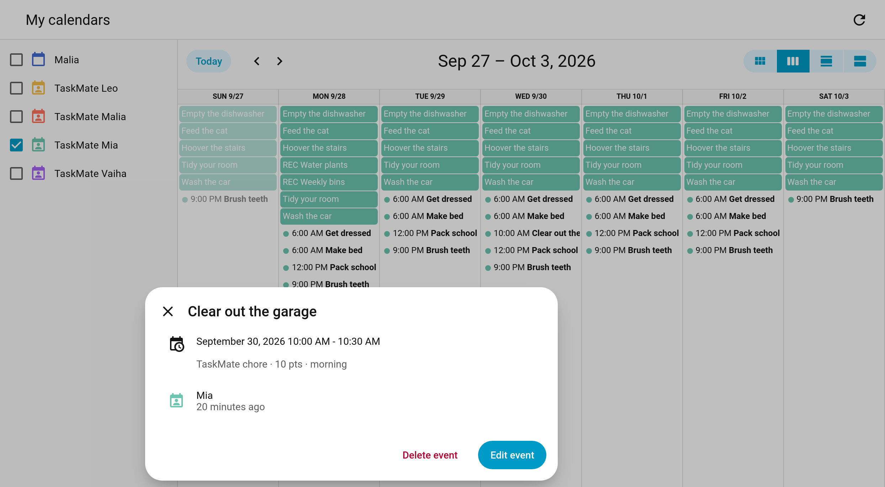

# Two Way Calendar

The per-child TaskMate calendars used to be read-only. Now you can **plan chores straight from Home Assistant's calendar**: add an event to create a one-off chore, drag a chore to another day, or delete a single day to skip it.



> **New in v6.0.0**

---

## Who Can Edit

Only **parents and admins** can change a TaskMate calendar. Anyone else gets a permission error. Automations and scripts that run without a user are allowed, the same as elsewhere in TaskMate.

Every change is checked by TaskMate first, then written to the [Admin Audit Log](Admin-Audit-Log.md).

---

## Adding a Chore

Create an event on a child's calendar (`calendar.taskmate_<child>`), either in Home Assistant's **Calendar** page or with the `calendar.create_event` action. TaskMate turns it into a **one-off chore** for that child on that date.

| Event | Resulting chore |
|-------|-----------------|
| **Title** | The chore's name |
| **Has a start time** | The chore gets that **due time**, and goes into the time-of-day period that contains it |
| **All day** | An *anytime* chore |
| **Points** | The standard **10**. Change them in the TaskMate panel afterwards if you like. |

These are refused, with a clear message:

- Repeating events
- Dates in the past
- An empty title

```yaml
action: calendar.create_event
target:
  entity_id: calendar.taskmate_mia
data:
  summary: Clear out the garage
  start_date_time: "2026-09-30 10:00:00"
  end_date_time: "2026-09-30 10:30:00"
```

---

## Moving a Chore

Drag a chore to another day in the calendar, or edit its date.

| Chore | What moves |
|-------|------------|
| **Repeating chore** | Only that one day. The rest of the schedule stays put. |
| **One-off chore** | The chore itself. Its title and time can change too. |

Chores with a due time show in the calendar as a 30-minute event at that time, so you can drag them to the same time on another day.

A moved occurrence is honoured everywhere: the child card, reminders, the Today board, streaks, perfect weeks, [mandatory](Mandatory-Chores.md) misses, the ICS feed and any calendars the chore is published to. Completing a moved chore counts for the day it was originally due, so it doesn't knock the next occurrence out of place.

### What you can't change from the calendar

These are refused, with a message telling you to edit the chore in the TaskMate panel instead:

- Moving a **whole series** (the "this and all future events" choice)
- **Renaming** a repeating chore
- Changing a repeating chore's **time of day**
- Moving a chore **into the past**

---

## Skipping a Day

Delete a single occurrence to **skip just that day**. The chore carries on as normal on every other day.

Deleting a one-off chore switches it off, the same way it's switched off once its day has passed.

---

## Shared Chores

A move or skip applies to the **chore**, not to one child. If the chore is shared by several children, moving it on Mia's calendar moves it for everyone who shares it, and it moves on all their calendars.

"Away" blocks (vacation and unavailable days) are still read-only.

---

## Related

- [Calendar](Calendar.md) — the per-child calendar entities and ICS feed
- [Chore Scheduling](Chore-Scheduling.md) — repeating and one-off chores
- [Chores](Chores.md) — editing a chore in the TaskMate panel
- [Admin Audit Log](Admin-Audit-Log.md) — where calendar changes are recorded
