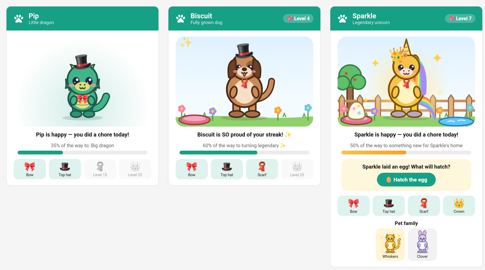
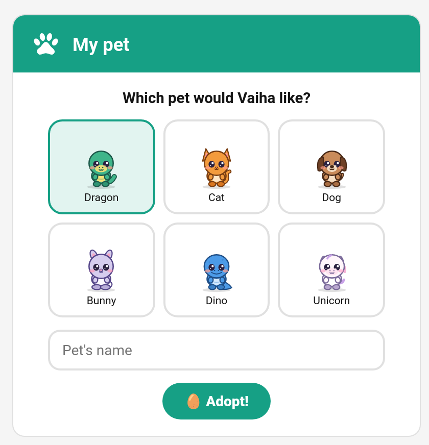
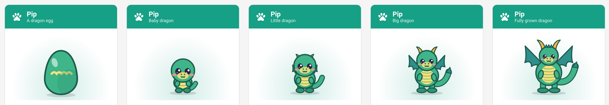
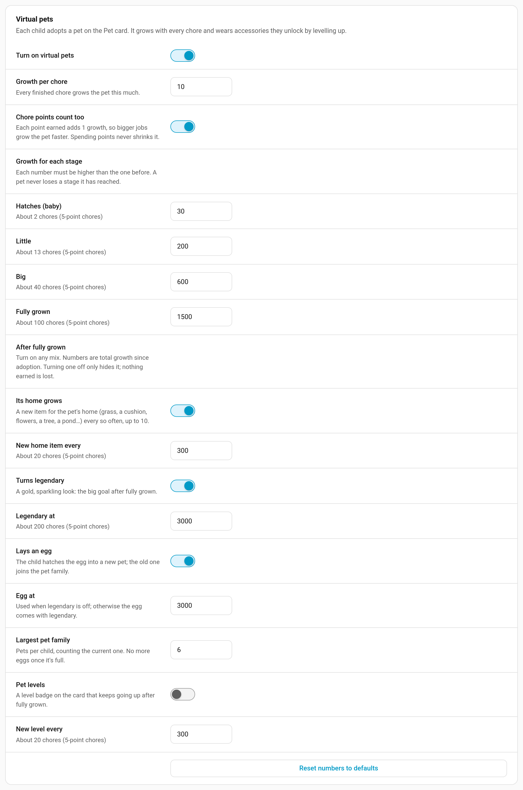

# Virtual Pets

Every child can look after a virtual pet that grows up as they do their chores. It starts as an egg, hatches into a baby and grows bigger with every job they finish. Once it is fully grown there is still more to work towards: a home to fill, a legendary golden coat, an egg that hatches into the next pet, and pet levels. It's a gentler motivator than a streak for younger children, because nothing is ever lost: a sleepy pet perks up again with the next chore.



> **New in v7.0.0**

---

## Turning Pets On

Pets are off until you switch them on:

**TaskMate panel → Settings → Virtual pets → Turn on virtual pets**

The same section holds every growth number described below. While pets are off, the Pet card says so and nothing about a pet is shown or counted.

---

## Adopting a Pet

The child adopts their pet on the [Pet card](#the-pet-card): they pick one of six creatures (dragon, cat, dog, bunny, dino or unicorn), give it a name and tap **Adopt!**



The pet starts as an egg and only counts chores finished **from adoption onwards**, so a child who has been using TaskMate for a year doesn't get a fully grown pet on day one.

Adopting again (the `adopt_pet` service with a new species or name) renames or re-chooses the pet but keeps its growth: it's still the same friend.

---

## How It Grows

Every finished chore adds **growth**. By default:

- each chore is worth **10 growth**, and
- every point the child **earns** adds **1 growth**, so a big job grows the pet faster than a quick one.

Spending points never shrinks the pet: growth counts points earned, not the balance.

The pet moves through five stages, each drawn as its own picture:



| Stage | Card shows | Default growth | Roughly (5-point chores) |
|-------|-----------|----------------|--------------------------|
| Egg | "A dragon egg" | 0 | at adoption |
| Baby | "Baby dragon" | 30 | 2 chores |
| Little | "Little dragon" | 200 | 13 chores |
| Big | "Big dragon" | 600 | 40 chores |
| Fully grown | "Fully grown dragon" | 1500 | 100 chores |

Babies are all head and eyes. As the pet grows it gets a body, legs and finally its grown-up features: wings and horns for the dragon, a mane for the unicorn, a collar for the dog, and so on.

A progress bar under the pet shows how far it is to the next thing ("35% of the way to: Big dragon").

### It never goes backwards

A stage, a legendary coat, a home item or a pet level, once reached, is kept. Undoing a chore or raising one of the numbers in Settings leaves the pet where it got to; it just takes longer to reach the next step.

---

## Moods

The pet's mood follows the child's last chore:

| Mood | When | What the card says |
|------|------|--------------------|
| **Happy** | A chore was done today | "Pip is happy — you did a chore today!" |
| **Proud** | A chore today and a streak of 7 days or more | "Pip is SO proud of your streak! ✨" |
| **Content** | The last chore was yesterday | "Pip is resting. A chore today will cheer them up." |
| **Sleepy** | Longer than that | "Pip is sleepy… do a chore to wake them up!" |

Days away don't make a pet sleepy: on a [vacation](Vacation-Mode.md) or a [sick day](Sick-Days.md) the pet stays content, because the child was meant to rest.

Tapping the pet gives it a cuddle: a little hop and some hearts. Nothing is saved.

---

## Accessories

Accessories are unlocked by the **child's** [level](Levels-and-XP.md), not the pet's growth:

| Accessory | Unlocks at |
|-----------|------------|
| 🎀 Bow | Level 3 |
| 🎩 Top hat | Level 8 |
| 🧣 Scarf | Level 15 |
| 👑 Crown | Level 25 |

The pet wears every accessory the child has unlocked. Locked ones show greyed out on the card with the level they need.

---

## After Fully Grown

Once the pet is fully grown, four things can keep it going. Each one can be switched on or off and tuned under **Settings → Virtual pets → After fully grown**. The numbers are **total growth since adoption**, so they always come after the "Fully grown" number. Turning one off only hides it; nothing earned is lost.

| Extra | Default | What happens |
|-------|---------|--------------|
| **Its home grows** | on, a new item every 300 growth | The pet's home fills up: grass, a cushion, flowers, a tree, a pond and more, up to 10 items |
| **Turns legendary** | on, at 3000 growth | The pet turns gold and sparkles. The big goal after fully grown |
| **Lays an egg** | on | The pet lays an egg the child can hatch into a new pet. With legendary on, the egg comes with legendary; with legendary off it comes at the **Egg at** number (3000 by default) |
| **Pet levels** | off, a new level every 300 growth | A level badge on the card that keeps going up |

### Eggs and the pet family

When the pet lays an egg, the card shows **Hatch the egg**. The child picks a creature and a name, and the new pet starts again from an egg. The previous pet joins the **Pet family** row at the bottom of the card, legendary ones still in gold.

**Largest pet family** (6 by default, 2–12) caps how many pets a child can have, counting the current one. Once the family is full, no more eggs are laid.

---

## Parent Settings



| Setting | Key | Default | Description |
|---------|-----|---------|-------------|
| Turn on virtual pets | `pets_enabled` | off | Master switch |
| Growth per chore | `pet_xp_per_chore` | `10` | Growth for every finished chore (0–1000) |
| Chore points count too | `pet_points_count` | on | Each point earned adds 1 growth |
| Hatches (baby) | `pet_stage_baby` | `30` | Growth to hatch |
| Little | `pet_stage_kid` | `200` | |
| Big | `pet_stage_teen` | `600` | |
| Fully grown | `pet_stage_grown` | `1500` | |
| Its home grows | `pet_home_enabled` | on | |
| New home item every | `pet_home_every` | `300` | |
| Turns legendary | `pet_legendary_enabled` | on | |
| Legendary at | `pet_legendary_at` | `3000` | |
| Lays an egg | `pet_eggs_enabled` | on | |
| Egg at | `pet_egg_at` | `3000` | Used only when legendary is off |
| Largest pet family | `pet_family_max` | `6` | 2–12, counting the current pet |
| Pet levels | `pet_levels_enabled` | off | |
| New level every | `pet_level_every` | `300` | |

Each stage number must be higher than the one before, and legendary and the egg must come after fully grown; the panel won't save numbers that break the order. Beside each number the panel shows roughly how many 5-point chores it takes. **Reset numbers to defaults** puts them all back.

If growth per chore is 0 and points don't count, pets can't grow, and the panel warns you.

---

## The Pet Card

**Edit dashboard → + Add Card → TaskMate Pet**

```yaml
type: custom:taskmate-pet-card
entity: sensor.taskmate_overview
child_id: 8e16ad66b23f404e
```

| Option | Type | Default | Description |
|--------|------|---------|-------------|
| `entity` | string | **required** | The TaskMate overview sensor |
| `child_id` | string | **required** | Whose pet this is. Find IDs in the panel with **Show IDs** switched on |
| `title` | string | the pet's name | Card title. Before adoption it reads "My pet" |
| `card_design` | string | global default | `classic`, `playroom`, `console`, `cleanpro`, `accessible` or `graphite` |
| `header_color` | string | `#16a085` | Header banner colour (YAML only) |

Before adoption the card is the adoption form. After that it shows the pet in its current stage and mood, the progress bar to the next goal, the accessories, the **Hatch the egg** box when an egg is ready, and the pet family.

The first time a device sees the pet reach something new (a stage, legendary, an egg, a home item or a level) the card plays a short "evolving" moment, once per device.

### On the kiosk tablet

*(v7.1.0)* The [kiosk card](Kiosk-Mode.md) shows each child's pet beside their chores, so a family that lives on the wall tablet sees it without another dashboard. It is the same pet card in a compact form: the pet, its mood and the growth bar, without the banner, accessories or pet family. Turn it off with `show_pet: false` on the kiosk card.

---

## Notification and Event

The **Pet grew up** notification (off by default; switch it on under **Notifications**) tells the child and/or parents when a pet:

- reaches its next stage: "🐣 Pip just grew up! Have a look at Vaiha's pet."
- turns legendary: "✨ Sparkle turned legendary! Vaiha's pet is shining gold."
- lays an egg: "🥚 Sparkle laid an egg! Vaiha can hatch a new pet."
- reaches a new pet level: "💖 Sparkle reached pet level 4!"

Every one of these fires the `taskmate_pet_evolved` event whether or not the notification is on. Its data includes `child_id`, `child_name`, `pet_name`, `species`, `kind` (`stage`, `legendary`, `egg` or `level`), plus `stage` or `pet_level` where relevant. It also shows up as **Pet grew up** on the child's [event entity](Event-Entities.md).

Growth is checked once a minute, so a pet grows up within a minute of the chore that did it.

---

## Services

| Service | Fields | Description |
|---------|--------|-------------|
| `taskmate.adopt_pet` | `child_id`, `species` (`dragon`, `cat`, `dog`, `bunny`, `dino`, `unicorn`), `name` (up to 24 characters), `hatch_egg` (optional) | Adopt a pet, or rename/re-choose the current one (growth is kept). With `hatch_egg: true`, hatch the egg the grown pet laid; the old pet joins the pet family |

While pets are on, each child's entry in `sensor.taskmate_overview`'s `children` attribute carries a `pet` object (stage, mood, growth, accessories, the next goal, and anything reached after fully grown).

---

## Related

- [Levels and XP](Levels-and-XP.md) — the child levels that unlock accessories
- [Dashboard Cards](Dashboard-Cards.md) — every TaskMate card
- [Notifications](Notifications.md) — switching on the Pet grew up notification
- [Weekly Goals](Weekly-Goals.md) — another motivator for the week
- [Event Entities](Event-Entities.md) — automating on a pet growing up
