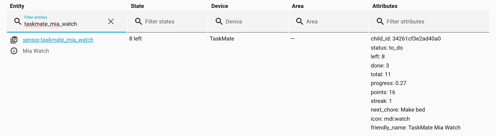

# Watch Complications

Put a child's chores on their wrist. TaskMate gives every child a small **watch sensor** ("3 left", "All done") and a **complete next chore** action, sized for Apple Watch complications and Wear OS complications and tiles. This page has copy-paste templates for both.



> **New in v6.0.0**

Watch faces aren't built by TaskMate itself. They're set up in the **Home Assistant companion apps**, using the sensor and action below.

---

## The Watch Sensor

Every child gets `sensor.taskmate_<child>_watch`, for example `sensor.taskmate_mia_watch`.

### State

A short phrase that fits on a complication, in your Home Assistant server's language:

| State | When |
|-------|------|
| `3 left` | Chores still to do today (the number changes) |
| `All done` | Everything for today is done |
| `No chores` | Nothing was due today |

### Attributes

| Attribute | Example | Description |
|-----------|---------|-------------|
| `child_id` | `34261cf3e2ad40a0` | The child's ID, for the action below |
| `status` | `to_do` | `to_do`, `all_done` or `no_chores`. The same in every language, so use this in templates rather than the state text. |
| `left` | `3` | Chores still to do today |
| `done` | `4` | Chores done today, including ones waiting for approval |
| `total` | `7` | Chores due today |
| `progress` | `0.57` | `done / total`, from `0` to `1`. Ready for a gauge or ring. `1.0` when nothing was due. |
| `points` | `126` | Current points |
| `streak` | `5` | Current streak in days |
| `next_chore` | `Make bed` | The chore **complete next chore** would tick off. Only present when there is one. Clipped to 40 characters. |

The counts use the same definition as the **Today** page in the TaskMate panel. `left` includes chores that need a photo or a timer; `next_chore` skips them (see below).

Replace `mia` with your child's name in every template on this page.

---

## The "Complete Next Chore" Action

`taskmate.complete_next_chore` ticks off the child's next outstanding chore. It's made for a watch button.

| Field | Required | Description |
|-------|----------|-------------|
| `child_id` | Yes | The child's ID (the `child_id` attribute of their watch sensor) |

- **"Next"** is the order the child sees on their card: their own custom order first, then the default order.
- **Skipped:** chores a single tap can't finish: [photo proof](Photo-Proof.md), [open-ended](Open-Ended-Chores.md), [timed](Timed-Tasks.md) and [teamwork](Teamwork-Chores.md) chores.
- **Normal rules apply:** approval, points and notifications behave exactly as if the child had tapped the chore on their card.
- **Nothing left?** It quietly does nothing, so a button pressed once too often doesn't raise an error.
- **Linked accounts:** it follows the same rule as ticking a chore. If the child is linked to a Home Assistant user, the watch has to be signed in as that user (or an admin).

### Wrap it in a script

Watches run **scripts**, so create one per child. **Settings → Automations & scenes → Scripts → Add script → Edit in YAML**:

```yaml
alias: Mia – next chore done
icon: mdi:check-circle-outline
mode: single
sequence:
  - action: taskmate.complete_next_chore
    data:
      child_id: "{{ state_attr('sensor.taskmate_mia_watch', 'child_id') }}"
```

Reading the ID from the sensor means you never have to look it up.

---

## Apple Watch

You need watchOS 9 or later, and you must be a Home Assistant **admin** to create complications.

### Adding a complication

1. On your iPhone, open the Home Assistant app's settings and go to the **Apple Watch** section → **Complications**.
2. Add a complication and pick a family and template (see below).
3. Paste the templates into the text, gauge or ring fields, and save.
4. On the watch, long-press the watch face → **Edit** → pick the Home Assistant complication.

For the Modular face (watchOS 9 and later), choose **Circular** or **Rectangular** from the **Graphic** section.

**Gauge and ring fields need a number from `0.0` to `1.0`.** That's exactly what the `progress` attribute gives you.

### Inline text

For a one-line complication (such as the text along the top of the face):

```jinja

{{ state_attr(w, 'left') }} left · {{ state_attr(w, 'next_chore') or '' }}✓ {{ states(w) }}
```

Shows `3 left · Make bed`, or `✓ All done`.

For the shortest possible text, just use the state:

```jinja
{{ states('sensor.taskmate_mia_watch') }}
```

### Circular gauge or ring

Pick a **Graphic → Circular** template with a gauge or ring.

**Gauge / ring value:**

```jinja
{{ state_attr('sensor.taskmate_mia_watch', 'progress') | float(0) }}
```

**Centre text:** how many are left:

```jinja
{{ state_attr('sensor.taskmate_mia_watch', 'left') | int(0) }}
```

…or done out of total:

```jinja
{{ state_attr(w, 'done') | int(0) }}/{{ state_attr(w, 'total') | int(0) }}
```

The ring fills as the day's chores get done, and is full once everything is ticked off.

### Rectangular

Pick a **Graphic → Rectangular** template. Fill as many lines as the template offers.

**Header:**

```jinja
Mia's chores
```

**Line 1:**

```jinja
{{ states('sensor.taskmate_mia_watch') }}
```

**Line 2:** the next chore, or the state when there isn't one:

```jinja
{{ ('Next: ' ~ nxt) if nxt else states(w) }}
```

**Line 3** (or a second text field): points and streak:

```jinja
⭐ {{ state_attr(w, 'points') | int(0) }} · 🔥 {{ state_attr(w, 'streak') | int(0) }}
```

**Gauge** (on templates that have one): use the `progress` template above.

### A "done" button on the watch

In the iPhone app's **Apple Watch** section, open **Configuration**, add the *Mia – next chore done* script, then **Save**. Reload the Home Assistant app on the watch. The script now shows as a button in the watch app.

### How often it updates

Apple Watch complications refresh roughly every 15 minutes (around :00, :15, :30 and :45), at a time chosen by watchOS. So a completed chore can take a few minutes to show on the face.

---

## Wear OS

You need the Home Assistant app on the watch, signed in through a paired Android phone.

### Entity State complication

The simplest option, and it needs no template.

1. On the **watch**, long-press the watch face → **Customise** → pick a complication slot.
2. Choose **Home Assistant → Entity state**.
3. Pick `sensor.taskmate_mia_watch`.

It shows the sensor's state: `3 left`, `All done` or `No chores`. You can optionally show the entity's name too.

This has to be set up on the watch itself, not in the watch app on the phone. The complication updates when the screen turns on and roughly every 15 minutes, and you can tap it to update it straight away.

### Template tile

A tile with more detail. The template is set from the **Android companion app** on the phone (the Wear OS settings), then the tile is added on the watch.

```jinja

<b>{{ states(w) }}</b><br>
Next: {{ state_attr(w, 'next_chore') }}<br>
<font color='#ffc107'>⭐ {{ state_attr(w, 'points') | int(0) }}</font> · 🔥 {{ state_attr(w, 'streak') | int(0) }}
```

Template tiles understand a few HTML tags: `<b>`, `<i>`, `<big>`, `<br>` and `<font color='…'>`. Set the tile's **refresh interval** to every few minutes so it keeps up.

### Shortcut

Add the *Mia – next chore done* script as a shortcut:

1. On the **watch**, open the Home Assistant app → **Settings** → the Shortcuts tile.
2. Add the script. A Shortcuts tile holds up to 7 shortcuts.
3. Add the Shortcuts tile to your tiles.

One tap on the tile ticks off the next chore. You can also add the script to the app's **Favourites**.

---

## Tips

- **Test your templates first** in Home Assistant's **Developer tools → Template** tab. Paste one in and check the output before putting it on the watch.
- **Use `status`, not the state text,** in `if` tests. The state is translated, and `status` is not.
- **A child sharing a parent's phone?** Point the complication at their own watch sensor, and use a separate script per child.

---

## Related

- [Sensor Reference](Sensor-Reference.md) — all TaskMate sensors
- [Services](Services.md) — full service reference
- [Voice Assistants](Voice-Assistants.md) — another hands-free way to tick off chores
- [Children](Children.md) — linking a child to a Home Assistant user
