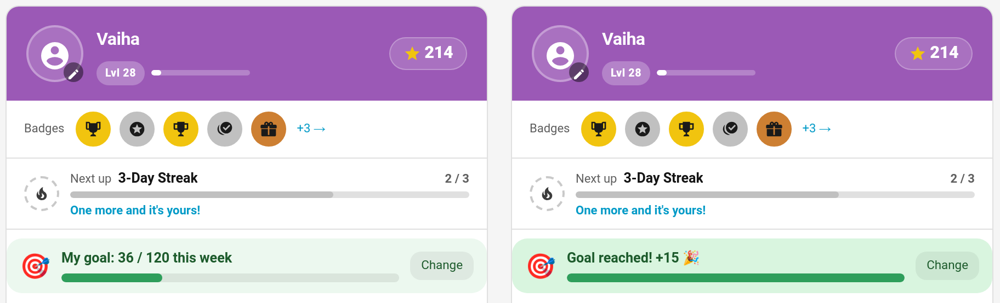
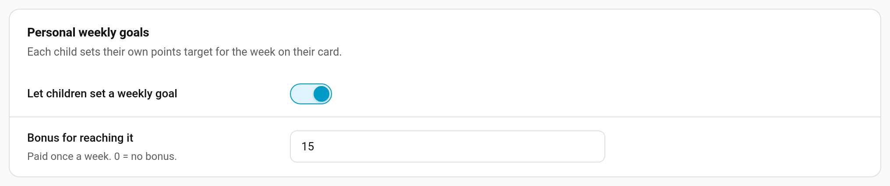
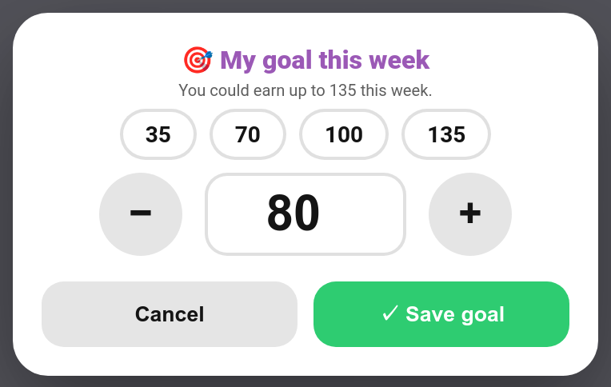

# Weekly Goals

Personal weekly goals let each child pick their own target for the week: "I want to earn 120 points this week." Their card shows how close they are, and reaching the goal pays a bonus once a week. Children who choose their own goal tend to care more about hitting it than one set for them.



> **New in v7.0.0**

---

## Turning It On

**TaskMate panel → Settings → Personal weekly goals**



| Setting | Key | Default | Description |
|---------|-----|---------|-------------|
| **Let children set a weekly goal** | `weekly_goal_enabled` | off | Shows the goal on every child card and allows goals to be set |
| **Bonus for reaching it** | `weekly_goal_bonus` | `10` | Points paid once a week when a child reaches their goal. 0 = no bonus, just the satisfaction of hitting it |

The bonus is the same for every child. It's a fixed amount, not a percentage of the goal, so setting a huge goal doesn't pay more.

---

## Setting a Goal

Once goals are on, a child without one sees **Set a goal for this week** on their card ("Pick how many points you want to earn. Reach it for +15!"). Tapping it, or **Change** once a goal is set, opens the goal sheet.



The sheet tells the child how many points they **could** earn this week from their chores, and offers quick picks at a quarter, half, three quarters and all of that. They can also type a number or use **−** / **+**, then tap **Save goal**.

A goal carries over from week to week until it is changed, so a child who likes their goal doesn't have to set it every Monday. Setting the goal to 0 clears it.

Two rules apply when the child sets their own goal, so the bonus stays a reward for aiming at something:

- the goal has to be at least the bonus it pays (with a 10-point bonus, 10 or more), so a goal of 1 can't farm the bonus every week
- once this week's bonus has been paid, the goal can't be changed until Monday

Parents can set or change a goal for a child with the `set_weekly_goal` service; neither rule applies to a parent.

---

## Progress and the Bonus

The goal widget sits above the chore list: **My goal: 36 / 120 this week**, with a progress bar. It counts the points from chores approved since Monday (bonus sub-tasks aside), the same figure the rest of the card uses for the week.

When the week's points reach the goal:

- the child gets the bonus ("Weekly goal reached 🎯 (120)" in their history), and the widget turns green: **Goal reached! +15 🎉**
- the *Weekly goal reached* notification goes out, if it's on

The goal is checked once a minute, and again straight away when a goal is saved, so setting a goal you have already passed this week counts at once.

### Once a week

The bonus is paid at most once per child per week (weeks start on Monday). Lowering the goal after reaching it, or clearing it and setting it again, doesn't pay a second bonus that week.

### If points are taken back

If a completion that counted towards the goal is undone, rejected or un-approved, and that drops the week's points below the goal, the bonus is taken back too ("Weekly goal reversed (120)"), along with its share of the leaderboard tally. The goal can then be reached, and paid, again later in the week.

A child's own undo checks that they still have the bonus in hand before letting them undo.

---

## Card Option

The widget appears on the [child card](Dashboard-Cards.md#child-card) in every design while weekly goals are on. To hide it on one card:

```yaml
type: custom:taskmate-child-card
entity: sensor.taskmate_overview
child_id: 8e16ad66b23f404e
show_weekly_goal: false
```

In the editor it's **Show my weekly goal**.

---

## Notification

**Weekly goal reached** (off by default; switch it on under **Notifications**): "🎯 Vaiha reached their weekly goal of 120 Points — +15 bonus!" It can go to the child, parents or both.

It fires the `taskmate_weekly_goal_reached` event whether or not the notification is on, with `child_id`, `child_name`, `target`, `earned`, `bonus` and `points_name`. On the child's [event entity](Event-Entities.md) it shows as **Weekly goal reached**.

---

## Service

| Service | Fields | Description |
|---------|--------|-------------|
| `taskmate.set_weekly_goal` | `child_id`, `target` (0–100,000) | Set a child's weekly points goal. 0 clears it |

While goals are on, each child's entry in `sensor.taskmate_overview`'s `children` attribute carries `weekly_goal`: `target`, `bonus`, and, once a target is set, `earned` and `reached`.

---

## Weekly Goals or Weekly Targets?

They're different features and can be used together:

| | Weekly goals | [Weekly targets](Weekly-Targets.md) |
|---|---|---|
| Set by | The child (or a parent) | A parent, per chore |
| Measures | Points earned this week | How many times one chore is done this week |
| Reward | One family-wide bonus per week | A bonus per chore target |

---

## Related

- [Weekly Targets](Weekly-Targets.md) — per-chore weekly counts
- [Bonus Points](Bonus-Points.md) — streak and perfect-week bonuses
- [Child Undo Window](Child-Undo-Window.md) — how undo interacts with bonuses
- [Virtual Pets](Virtual-Pets.md) — another long-running motivator
- [Notifications](Notifications.md)
