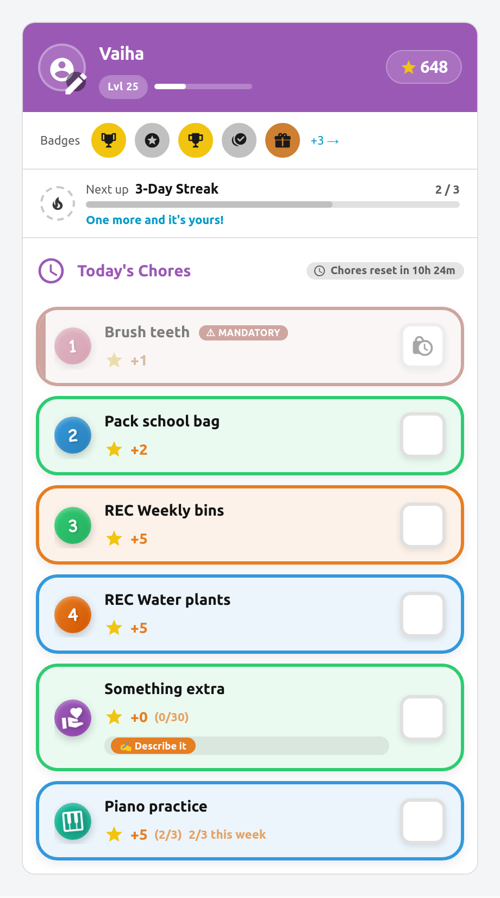
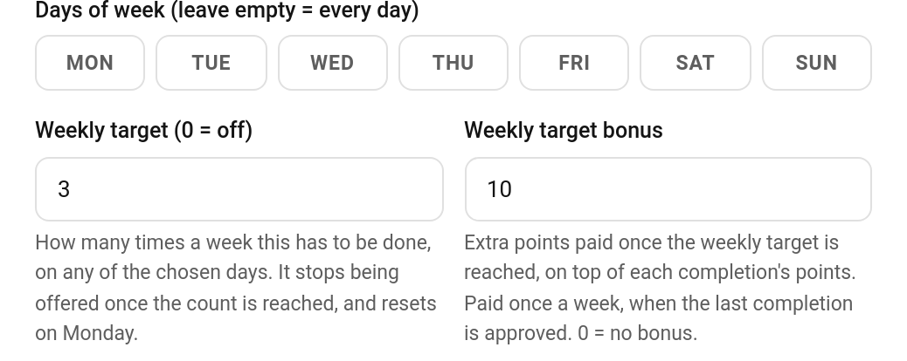

# Weekly Targets

Some chores aren't owed on a particular day — they're owed by the end of the week. Practise the piano three times. Read on four evenings. Get out for a run twice. A **weekly target** says *how many times this week*, and lets the child pick the days.

> **New in v5.8.0** (#904)

---

## How It Works

Set **Weekly target** on a chore to any number above zero. The chore is then offered on its usual days until the child has done it that many times this week, and stops being offered once the quota is full. The week is **Monday-anchored**, the same as [Challenges](Challenges.md).

Progress shows on the chore's row in the child card from the first tick — `2/3 this week` — and the row dims once the target is met.

The count is worked out from completions every time it's needed, never stored. Nothing has to reset on a Monday, and if you raise the target mid-week the chore simply becomes available again.

---

## Setting a Target

**TaskMate panel → Chores → edit a chore → Weekly target**

| Field | Default | Description |
|-------|---------|-------------|
| **Weekly target** | `0` | How many times a week this must be done. `0` = off, the chore behaves exactly as before. |
| **Weekly target bonus** | `0` | *(v6.2.0)* Extra points paid once the target is reached. `0` = no bonus. See [Weekly Target Bonus](#weekly-target-bonus) below. |

The target is one number, and the bonus is optional. Everything else about the chore stays as it is.

The weekly target fields sit under the day buttons, so they show when the chore's **Schedule mode** is *Specific days*.

---

## Weekly Target Bonus

> **New in v6.2.0**

A weekly target can carry a reward for hitting it. Set **Weekly target bonus** and the child gets those extra points once they reach the target, on top of the normal points for each completion.

*Example:* **Brush teeth**, weekly target 7, bonus 10. Each brush pays its usual points, and at 7/7 the child gets **+10** once.

### When it's paid

- **On approval.** A pending completion still counts towards the target, but the bonus is only paid once enough completions are **approved** to reach it. On a chore that doesn't need approval, that is the tap that fills the quota. On one that does, it is when you approve the last completion needed.
- **Once per week.** Each child can earn it once per chore per week (Monday to Sunday).
- **For the week the work was done.** Approving last Sunday's completion on a Monday settles *last* week's bonus. This week's bonus is still there to earn.
- [Bonus sub-tasks](Bonus-Subtasks.md) don't count towards the target.

The payment shows in the child's history as its own line, **Weekly target bonus: Brush teeth**. It can't be undone on its own from the panel or the activity card, because that would leave the week marked as paid. Undo or reject the completion instead (see below).

### When it's taken back

If an undone approval, a rejection or a [child undo](Child-Undo-Window.md) drops the week back below the target, the bonus is refunded automatically. It shows as **Weekly target bonus reversed: Brush teeth**. Once the child is back at the target, they can earn it again.

### What the child sees

When a tap on the [child card](Dashboard-Cards.md#child-card) fills the quota on a chore that doesn't need approval, the celebration popup adds a line: **🎉 Weekly target reached! +10**.

### For automations

Reaching the target fires a `taskmate_weekly_target_reached` event (see [Automations](Automations.md#chores)) and a medium (tier 2) [celebration](Celebrations.md) of kind `weekly_target_reached`. If you've turned on celebration notifications, that covers it too.

---

## It Rides On Top Of The Schedule

A weekly target is **not** a scheduling mode. It sits on top of whichever schedule the chore already has, which means you can combine the two:

| Setup | Result |
|-------|--------|
| Days: all, target 3 | Three times this week, any day at all |
| Days: Mon–Fri, target 3 | Three times this week, but only on weekdays |
| Days: Mon, Wed, Fri, target 2 | Two of those three days — the child picks which |

Leave the target at `0` and nothing changes: the chore is due on every day you chose, as always.

---

## Pending Approvals Count

A completion waiting for your approval counts toward the target straight away. A slow approval never hands out a spare go, and the numbers a child sees always match what they've actually done.

If you **reject** a completion, its slot is freed again — the record is deleted, so the count drops back.

---

## Interaction With Other Features

| Feature | Behaviour |
|---------|-----------|
| **Daily limit** | Today's allowance is capped by what's left in the week. A chore with a daily limit of 5 and one tick left in its quota offers one more, not five. |
| **[Mandatory chores](Mandatory-Chores.md)** | A mandatory chore with a filled quota doesn't raise a nightly miss. It isn't owed today — it's owed by Sunday. |
| **Perfect weeks** | With *perfect week requires all chores* enabled, a weekly chore isn't counted as "due today". It has the rest of the week to be done. |
| **[Rotation](Task-Groups.md) / first-come** | Unchanged. The target applies to whoever the chore lands on. |

---

## Good Candidates

- **Instrument practice** — "three times a week", not "every Tuesday"
- **Reading** — four evenings out of seven
- **Exercise** — twice a week, whenever it suits
- **Helping with dinner** — two nights, child's choice

Anything where the requirement is a weekly minimum rather than a particular day.

---

## See Also

- [Chores](Chores.md) — creating and configuring chores
- [Chore Scheduling](Chore-Scheduling.md) — specific days, recurring, rotation and first-come
- [Mandatory Chores](Mandatory-Chores.md) — must-do chores with late penalties
- [Challenges](Challenges.md) — the other Monday-anchored weekly system
- [Celebrations](Celebrations.md) — the `weekly_target_reached` celebration
