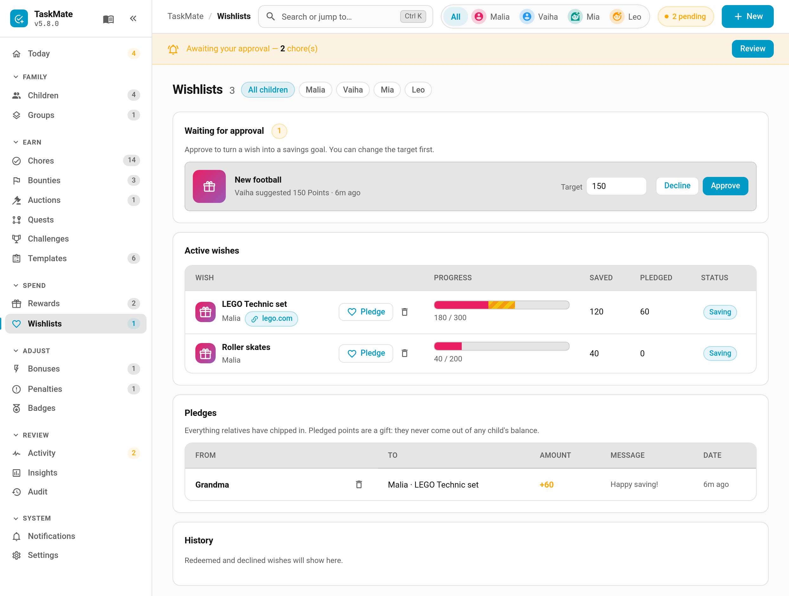

# Wishlist

Children keep a list of things they'd love to have and save their points towards them. You approve each wish and set its price, and the rest of the family can chip in: Grandma's 60-point pledge shows up as its own stripe on the progress bar. When a wish is fully funded, the child asks to redeem it and it arrives in your approval queue like any reward claim.


> **New in v6.0.0**

---

## How It Works

1. **The child adds a wish** on their Wishlist card: a name, a suggested target, and optionally a link and a picture. It waits for a grown-up.
2. **You approve it** on the **Wishlists** page, changing the target first if you like. Or you decline it, with an optional reason the child will see.
3. **The child saves towards it** by moving points in. The slider stops at what they can spend and at what the wish still needs.
4. **Family members pledge** points through you ("Grandma +60").
5. **Once it's fully funded**, the child taps **Ask to redeem**, and it becomes a normal reward claim for you to approve.

---

## Whose Points Are Whose

| Points | Where they come from | Can they come back out? |
|--------|----------------------|-------------------------|
| **Saved** ("Me") | The child's own balance | Yes. The child can **Take back** their own savings at any time |
| **Pledged** ("Family") | A gift you record on someone's behalf | No. Pledges never come out of a wish and never touch any child's balance |

Saved points leave the child's spendable balance straight away, like a savings jar, but they are still theirs. The card shows both numbers: "You can spend 596 · 160 saved in wishes".

- **Declining or deleting** a wish gives the child back everything they saved and cancels every pledge.
- **Redeeming** a wish takes nothing more from the wallet, because the saved points already left it.
- Moving points in and taking them back out doesn't count towards the monthly leaderboard, so it can't be used to farm season points.
- With [points expiry](Points-Economy.md) on, saved points keep the dates they were earned: taking them back out doesn't restart their clock. With decay on, saved points shrink by the same share as the balance.
- Every movement (save, take back, pledge, pledge removed, refund, redeem) is written to the activity log.

---

## Managing Wishes

**TaskMate panel → Wishlists**



| Section | What's there |
|---------|--------------|
| **Waiting for approval** | New wishes, with an editable target, **Approve** and **Decline** |
| **Active wishes** | Progress, saved and pledged amounts, and status. **Pledge**, **Fulfil** (once redeem is requested) and delete on each row |
| **Pledges** | Everything relatives have chipped in, with a remove button until the wish is redeemed |
| **History** | Redeemed and declined wishes |

New wish requests also appear in **Needs you** on the Today page. Filter by child with the chips at the top of the page.

### Recording a pledge

Tap **Pledge** on a wish. Enter the giver's name (names used before appear as quick chips), an amount (quick chips, or **Finish it** for exactly what's still needed) and an optional message. A preview bar shows the result before you save.

---

## Limits

- Up to **5 active wishes** per child. Targets are fixed once approved; there's no dynamic pricing.
- **Links** must start with `http://` or `https://`, and open in a new tab.
- **Pictures** are uploaded from the child's device (camera or gallery) and checked for type and size.

---

## The Card

```yaml
type: custom:taskmate-wishlist-card
entity: sensor.taskmate_overview
child_id: b803da068e6a4b21
```

| Option | Type | Default | Description |
|--------|------|---------|-------------|
| `entity` | string | **required** | The TaskMate overview sensor |
| `child_id` | string | — | Whose wishlist the card shows. Find IDs in the panel with **Show IDs** switched on |
| `title` | string | `<name>'s Wishlist` | Card header title |
| `card_design` | string | global default | `classic`, `playroom`, `console`, `cleanpro`, `accessible` or `graphite` |
| `header_color` | string | `#e91e63` | Header banner colour |

On the card, the child can **Add a wish**, **Move points**, **Take back**, **Withdraw** a wish that's still waiting, and **Ask to redeem** a funded one. A declined wish shows your reason until they tap **Got it**.

---

## Notifications

Both are off until you switch them on under **Notifications**:

| Type | Sent to | When |
|------|---------|------|
| **Wish requested** | Parents | A child adds a wish |
| **Wish pledged** | The child | Someone pledges towards their wish |

---

## Services and Sensors

| Service | Who | Description |
|---------|-----|-------------|
| `taskmate.add_wish` | Child | Add a wish (`child_id`, `name`, `target`, optional `link`, `photo_url`) |
| `taskmate.withdraw_wish` | Child | Withdraw a wish that's still waiting |
| `taskmate.move_points_to_wish` | Child | Save points into a wish |
| `taskmate.take_points_from_wish` | Child | Take saved points back out |
| `taskmate.request_wish_redeem` | Child | Ask to redeem a funded wish |
| `taskmate.approve_wish` | Parent | Approve, with an optional new `target` |
| `taskmate.decline_wish` | Parent | Decline, with an optional `reason` |
| `taskmate.pledge_to_wish` | Parent | Record a pledge (`name`, `points`, optional `message`) |
| `taskmate.remove_wish_pledge` | Parent | Remove a pledge |
| `taskmate.remove_wish` | Parent | Delete a wish, refunding the child's savings |

Each child gets a `sensor.taskmate_<child>_wishlist` sensor listing their wishes.

Events: `taskmate_wish_added`, `taskmate_wish_approved`, `taskmate_wish_declined`, `taskmate_wish_saved` and `taskmate_wish_pledged`. Redemption uses the usual `taskmate_reward_claimed` / `_approved` / `_rejected` events, with a `wish_id` field.

---

## Related

- [Rewards](Rewards.md) — fixed-cost rewards from your own catalogue
- [Pool Mode (Savings Jars)](Pool-Mode-(Savings-Jars).md) — saving towards a shared family reward
- [Managing Rewards](Managing-Rewards.md) — the approval queue a redeemed wish lands in
- [Gifting Points](Gifting-Points.md) — children giving points to each other
