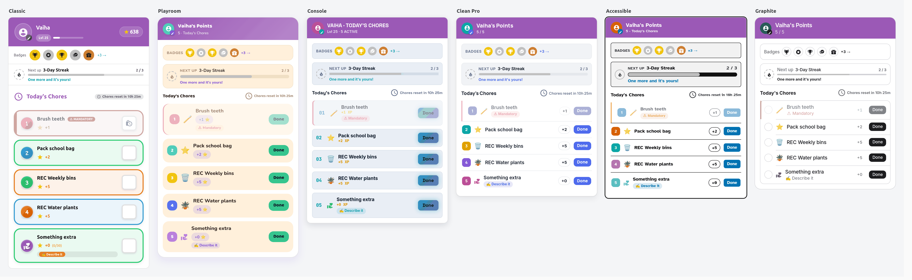

# TaskMate

Welcome to the TaskMate documentation. TaskMate is a Home Assistant integration that turns household chores into a gamified reward system for children.



---

## Getting Started

| Topic | Description |
|-------|-------------|
| [Installation](Installation.md) | How to install via HACS or manually |
| [Getting Started](Getting-Started.md) | First-time setup walkthrough |
| [Setup Wizard](Setup-Wizard.md) | A guided start: add children, pick age-suggested chores and starter rewards |
| [Ready-Made Dashboards](Ready-Made-Dashboards.md) | Dashboards for the kids, the parents and a wall tablet, built from your family in one click |
| [Admin Panel](Admin-Panel.md) | Management dashboard in the HA sidebar, with a Today home page |
| [Children](Children.md) | Managing children, levels, avatars and photos |
| [Adult Profiles](Adult-Profiles.md) | Profiles for parents who log their own chores, approved straight away and kept off the kids' cards |
| [Settings](Settings.md) | All configurable settings in one place |

## Chores

| Topic | Description |
|-------|-------------|
| [Chores](Chores.md) | Creating and configuring chores |
| [Chore Scheduling](Chore-Scheduling.md) | Specific days, recurring, one-shot, rotation, and first-come modes |
| [Mandatory Chores](Mandatory-Chores.md) | Must-do chores with parent-reviewed late penalties |
| [Difficulty Tiers](Difficulty-Tiers.md) | Easy / medium / hard tiers with a points multiplier |
| [Timed Tasks](Timed-Tasks.md) | Duration-based chores with start/pause/stop timers |
| [Weekly Targets](Weekly-Targets.md) | "Three times this week, any day" quotas on a chore, with an optional bonus for hitting them |
| [Task Groups](Task-Groups.md) | Coordinate rotation chores with sticky or spread policies |
| [Bonus Subtasks](Bonus-Subtasks.md) | Optional extra-credit tasks within a chore |
| [Photo Proof](Photo-Proof.md) | Require a photo as evidence before approval |
| [Open-Ended Chores](Open-Ended-Chores.md) | A placeholder the child describes themselves, priced by you at approval |
| [Chore Swaps](Chore-Swaps.md) | Siblings swap a chore with parent approval |
| [Chore Dependencies](Chore-Dependencies.md) | Lock a chore until its prerequisite chores are approved that day |
| [To-Do Lists](To-Do-Lists.md) | Each child's due chores as a native HA To-do list entity |
| [Vacation Mode](Vacation-Mode.md) | Pause chores and freeze streaks during time off |
| [Calendar](Calendar.md) | Per-child HA calendar entities, plus an ICS subscription feed |
| [Dynamic Chore Visibility](Dynamic-Chore-Visibility.md) | Show/hide chores based on HA entity state |
| [Weather-Aware Chores](Weather-Aware-Chores.md) | Hide outdoor chores when the weather is unsuitable |
| [Reactive Chores](Reactive-Chores.md) | Automation-raised chores with a deadline and a speed bonus |
| [Scheduled Config Changes](Scheduled-Config-Changes.md) | Queue an edit to take effect on a future date |
| [Chore Roulette](Chore-Roulette.md) | Spin for a random outstanding chore with a points multiplier |
| [Teamwork Chores](Teamwork-Chores.md) | A chore that only counts once two or more children have joined it |
| [NFC Tag Completion](NFC-Tag-Completion.md) | Tap an NFC tag or scan a QR code to complete a chore |
| [Two-Way Calendar](Two-Way-Calendar.md) | Add, move and skip chores straight from Home Assistant's calendar |
| [Chore Auctions](Chore-Auctions.md) | Children bid for an unpopular chore; the lowest bid wins |
| [Quality Ratings](Quality-Ratings.md) | Rate an approved chore 1–3 stars and scale the points to match |
| [Reject Reasons](Reject-Reasons.md) | Tell the child why a chore or reward was sent back |
| [Appeals](Appeals.md) | Children ask for a second look at a rejection or penalty; parents overturn or uphold it |
| [Surprise Inspections](Surprise-Inspections.md) | Spot-check a recently approved chore and pay a bonus if it passes |
| [Child Undo Window](Child-Undo-Window.md) | Let children take back their own chore tap within a set time |
| [Logging Past Jobs](Logging-Past-Jobs.md) | Record a job done on an earlier day that nobody ticked |
| [Estimated Minutes](Estimated-Minutes.md) | Say roughly how long a chore takes, and show "about 25 minutes of jobs left" |
| [Reference Photos](Reference-Photos.md) | A picture of the job done well, shown beside the child's photo when you approve |
| [Quantity Chores](Quantity-Chores.md) | "Read 20 pages": the child says how many they did and earns points per unit |
| [Auto-Approve](Auto-Approve.md) | Approve chores nobody reviewed within a set number of hours |
| [Help Requests](Help-Requests.md) | An "I'm stuck" button that asks a parent for help without skipping the chore |
| [Sick Days](Sick-Days.md) | One tap gives a child the day off: chores hidden, streak frozen |
| [Tomorrow Preview](Tomorrow-Preview.md) | A Today / Tomorrow switch on the child card to see what's coming |
| [Sibling Checks](Sibling-Checks.md) | An older child checks a younger one's chore, for a small bonus |
| [Praise Notes](Praise-Notes.md) | Approve with a short message the child sees on their card |
| [Child-Chosen Reminders](Child-Chosen-Reminders.md) | A child picks when to be reminded about a chore |

## Points, Rewards & Economy

| Topic | Description |
|-------|-------------|
| [Rewards](Rewards.md) | Fixed costs, jackpots, spending caps, auto-restock, and claim flow |
| [Managing Rewards](Managing-Rewards.md) | Parent/admin reward workflow |
| [Pool Mode (Savings Jars)](Pool-Mode-(Savings-Jars).md) | Dedicated savings pools for long-term reward goals |
| [Bonus Points](Bonus-Points.md) | Weekend multiplier, streaks, perfect week |
| [Bonuses](Bonuses.md) | Reusable point awards for positive behaviour |
| [Penalties](Penalties.md) | Named point deductions for unwanted behaviour |
| [Penalty Warnings](Penalty-Warnings.md) | A warning the first time, the points the next |
| [Make-It-Right Penalties](Make-It-Right-Penalties.md) | Let a child earn a penalty back by doing a chore that puts things right |
| [Points Economy](Points-Economy.md) | Savings interest, points decay, surprise bonus, negative-balance policy, and undo |
| [Gifting Points](Gifting-Points.md) | Parent-controlled child-to-child point transfers |
| [Allowance](Allowance.md) | Convert points into a real-money allowance with a payout ledger |
| [Family Goals](Family-Goals.md) | A shared co-op target the whole family works toward together |
| [Timed Unlock Rewards](Timed-Unlock-Rewards.md) | Spend points to unlock a device for a while, on a parent allowlist |
| [Time-Locked Rewards](Time-Locked-Rewards.md) | Limit a reward to certain days or hours, without hiding it the rest of the week |
| [External Lock-Screen Shops](External-Lock-Screen-Shops.md) | Let a kiosk or parental-control system present the shop, safely |
| [Bounty Board](Bounty-Board.md) | Post one-off jobs for a fixed number of points; first to claim gets it |
| [Wishlist](Wishlist.md) | Children save towards things they want, with pledges from family |
| [Raffles](Raffles.md) | Children buy tickets with points for a chance at a big prize |

## Gamification

| Topic | Description |
|-------|-------------|
| [Levels & XP](Levels-and-XP.md) | Lifetime-earned-points progression and level-ups |
| [Achievement Badges](Achievement-Badges.md) | Milestone badges with tiers, AND/OR criteria, and point bonuses |
| [Quests](Quests.md) | Multi-step chore chains with a completion bonus |
| [Challenges](Challenges.md) | Daily and weekly targets that reset automatically |
| [Avatars](Avatars.md) | Unlockable avatars gated by level, points, or streak |
| [Celebrations](Celebrations.md) | Tiered celebration moments for big achievements |
| [Leaderboard Seasons](Leaderboard-Seasons.md) | Monthly leaderboard reset with a recorded champion |
| [Streak Freezes](Streak-Freezes.md) | Tokens that save a streak on a missed day |
| [Birthday Mode](Birthday-Mode.md) | Bonus points, an optional day off and a badge on a child's birthday |
| [Recaps](Recaps.md) | A "Wrapped"-style story of each child's week, month or year |
| [Virtual Pets](Virtual-Pets.md) | A pet that hatches and grows as the child does chores |
| [Weekly Goals](Weekly-Goals.md) | Children set their own weekly points goal and earn a bonus for reaching it |
| [Boost Windows](Boost-Windows.md) | Timed multipliers on chosen chores, started on the spot, on a schedule or from an automation |
| [Personal Bests](Personal-Bests.md) | Each child's own records — longest streak, best day, best week, biggest award — celebrated when beaten |
| [Per-Chore Streaks](Per-Chore-Streaks.md) | "🔥 12 days" on a chore done every due day in a row |

## Notifications & Admin

| Topic | Description |
|-------|-------------|
| [Notifications](Notifications.md) | Built-in alerts, scheduled notifications, actionable callbacks, and bus events |
| [Quiet Hours](Quiet-Hours.md) | Per-child do-not-disturb windows that suppress notifications |
| [Presence-Aware Reminders](Presence-Aware-Reminders.md) | Hold reminders while a child is out, then send one on arrival |
| [Reminder Escalation](Reminder-Escalation.md) | Nudge → reminder → parent alert for an unfinished mandatory chore |
| [Weekly Digest](Weekly-Digest.md) | A weekly summary sent to parents, plus a monthly report |
| [Admin Audit Log](Admin-Audit-Log.md) | Who changed what, and when |
| [Multi-Parent Approval Routing](Multi-Parent-Approval-Routing.md) | Route approvals to whoever is home, or round-robin |
| [Insights](Insights.md) | Fairness, friction, week-ahead, health, quality, mood and calendar reports |
| [Mood Check-In](Mood-Check-In.md) | Children say how their day went; parents see the trend |
| [Parent Access](Parent-Access.md) | Give a second parent day-to-day control without HA admin rights |
| [Backup & Restore](Backup-and-Restore.md) | Export and import your TaskMate configuration |
| [Repairs & Diagnostics](Repairs-and-Diagnostics.md) | Problems raised in Settings → Repairs, and a diagnostics file for bug reports |

## Reference

| Topic | Description |
|-------|-------------|
| [Dashboard Cards](Dashboard-Cards.md) | All 32 Lovelace cards |
| [Routine Mode](Routine-Mode.md) | Guided one-task-at-a-time flow for morning and bedtime |
| [Kiosk Mode](Kiosk-Mode.md) | A full-screen card for a shared wall tablet, with optional PINs and bounties |
| [Sticker Chart Card](Sticker-Chart-Card.md) | Today's jobs as stickers to tap, with stars filling towards a reward |
| [Completion Heatmap](Completion-Heatmap.md) | A calendar grid per child, darker green for busier days, in Insights and as a card |
| [Watch Complications](Watch-Complications.md) | Chores left, points and streak on an Apple Watch or Wear OS watch |
| [Pre-Reader Mode](Pre-Reader-Mode.md) | Picture-only child card for children who can't read yet |
| [Card Design Styles](Card-Design-Styles.md) | Per-card visual themes: Classic, Playroom, Console, Clean Pro, Accessible |
| [Read Aloud](Read-Aloud.md) | Speak a child's outstanding chores to a media player |
| [Template Packs](Template-Packs.md) | Export and import shareable chore-template packs |
| [Printable Weekly Chart](Printable-Weekly-Chart.md) | A fridge-ready A4 chore chart |
| [Completion Sounds](Completion-Sounds.md) | Built-in effects, plus your own uploaded clips picked per chore |
| [Guest Child Profiles](Guest-Child-Profiles.md) | Temporary profiles for visitors that expire on their own |
| [Configuration Entities](Configuration-Entities.md) | Key settings exposed as HA number/select entities |
| [Voice Assistants](Voice-Assistants.md) | Ask Assist about chores and points with conversation intents |
| [Services](Services.md) | All callable services with examples |
| [Sensor Reference](Sensor-Reference.md) | All entities and their attributes |
| [Sensor Attributes](Sensor-Attributes.md) | The overview and per-child sensor attributes in detail |
| [Event Entities](Event-Entities.md) | Per-child and family activity event entities for the automation editor |
| [Approvals Card](Approvals-Card.md) | The parent sign-off card for chores and reward claims |
| [Visibility Configuration Guide](Visibility-Configuration-Guide.md) | Configuring dynamic chore visibility end to end |
| [Visibility Operators Reference](Visibility-Operators-Reference.md) | Every visibility operator, with examples |
| [Automations](Automations.md) | Bus events, blueprint pack, internal tasks, and example automations |
| [Localization](Localization.md) | Supported languages, right-to-left layout and translation |
| [Troubleshooting](Troubleshooting.md) | Common issues and fixes |
| [FAQ](FAQ.md) | Frequently asked questions |

---

## How TaskMate Works

```
Child completes chore → Parent approves (optional) → Points awarded
                                                           ↓
                                               Child claims reward
                                                           ↓
                                               Parent approves claim
                                                           ↓
                                                   Reward granted
```

All data is stored locally in Home Assistant. Nothing is sent to external services.

---

## Key Concepts

**Points** — The currency children earn by completing chores. You choose the name (Stars, Coins, Bucks) and icon during setup.

**Chores** — Tasks assigned to one or more children. Can require parent approval before points are awarded, and can carry a [difficulty tier](Difficulty-Tiers.md) that multiplies their value.

**Rewards** — Goals children save up for. You set a fixed point cost — children work toward it at their own pace.

**Streaks** — How many consecutive days a child has completed at least one chore. Bonus points are awarded at configurable milestones, and [streak freezes](Streak-Freezes.md) can save a streak on a missed day.

**Jackpot Rewards** — Special rewards where all assigned children's points pool together toward a shared goal.

**Timed Tasks** — Chores where points are earned based on duration. Children start, pause, and stop a timer; points are calculated from elapsed time.

**Task Groups** — Coordinate related rotation-mode chores so they're assigned to the same child (sticky) or spread across different children (spread).

**Levels & XP** — Every point a child has ever earned counts as XP; XP turns into levels automatically, so progress only ever goes up. See [Levels & XP](Levels-and-XP.md).

**Achievement Badges** — Milestone-based recognition with four tiers (Bronze, Silver, Gold, Platinum). Built-in badges plus custom badges with multi-criterion AND/OR rules.

**Quests & Challenges** — [Quests](Quests.md) chain several chores into a single goal with a bonus; [Challenges](Challenges.md) set recurring daily/weekly targets that reset each period.

**Bonus Subtasks** — Optional extra-credit tasks within a chore that unlock after the parent chore is completed.

**Allowance** — Convert a child's points into a real-money allowance at a fixed rate, recorded in a payout ledger. See [Allowance](Allowance.md).

**Family Goals** — A single shared target the whole family contributes to; when their combined points reach it, everyone earns the reward. See [Family Goals](Family-Goals.md).

**Chore Dependencies** — A chore can stay locked until its prerequisite chores are approved that day, letting you build ordered chains. See [Chore Dependencies](Chore-Dependencies.md).

**Teamwork Chores** — A chore with a team size only counts once that many children have joined it; then everyone who joined gets the completion. See [Teamwork Chores](Teamwork-Chores.md).

**Bounties & Auctions** — Two ways to handle jobs outside the normal list: a [bounty](Bounty-Board.md) is a one-off job at a fixed price that the first child to claim it does, and an [auction](Chore-Auctions.md) lets children bid down the price of an unpopular chore.

**Wishlist** — Children add things they want and save points towards them; relatives can pledge points too. See [Wishlist](Wishlist.md).

**Insights** — On-demand reports that read your setup back to you: who is actually doing the work, which chores never get done, what's coming next week, whether anything is misconfigured, and (with [quality ratings](Quality-Ratings.md) on) how well each chore is being done. See [Insights](Insights.md).

---

## Version
Current: **7.0.0**  
Requires: Home Assistant 2024.7+  
License: MIT
